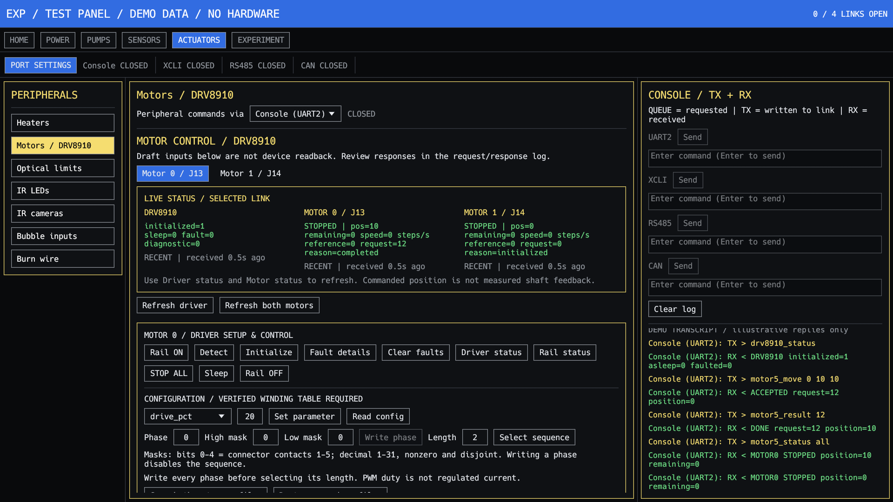
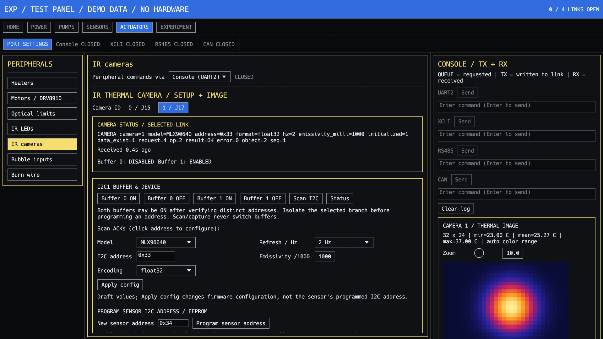
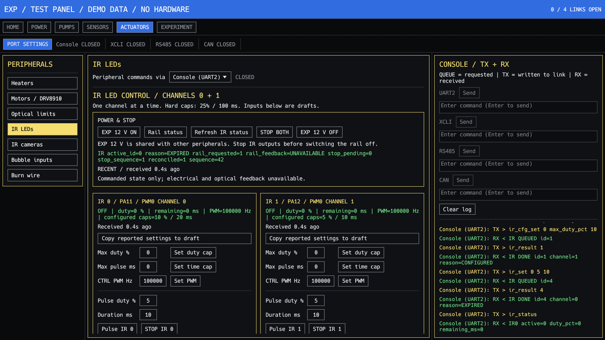
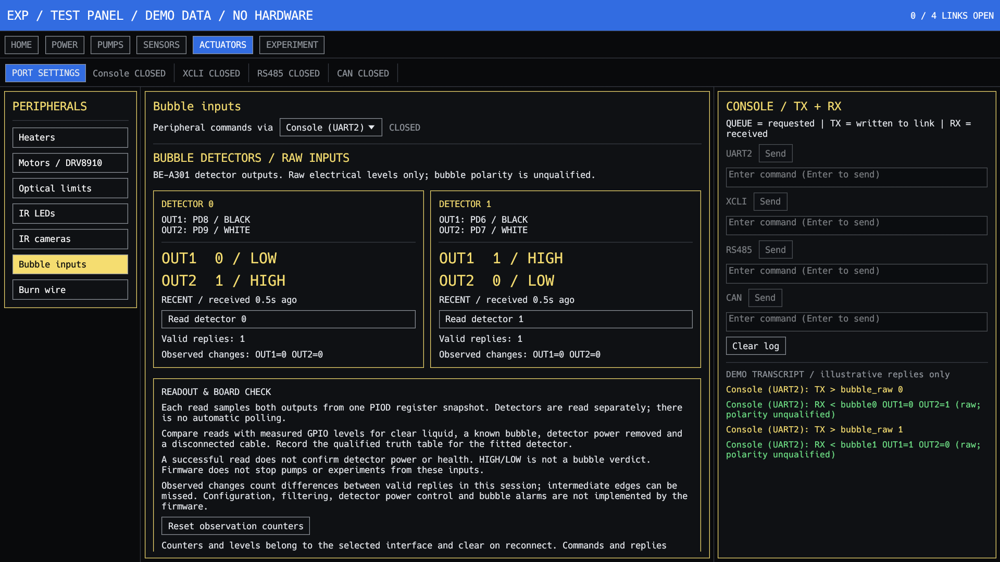

# EXP test GUI

IR camera 0/J15 and IR camera 1/J17 are separate left-menu entries, with
controls and the selected camera's thermal image in the middle pane. The wider
right pane is reserved for command traffic and logs. Each camera has controls and status for buffer
enable/disable, configuration, detection and image capture. Configuration drafts
are independent; download/release remains
shared with the firmware data queue.

Camera Detect displays completion and scans available I2C addresses. Capture /
show image automatically initializes when needed, polls capture, reads metadata
and downloads/displays on Console/UART2. Buffer status is refreshed from updated
firmware. Images remain retained until explicit release; older pending data is
never automatically discarded to reach a camera image.

Flow sensors 0 and 1 have Detect (initializes water mode), Read, and flow/temperature
displays with automatic request-result polling and failure/timeout reporting.

NTC displays four channels plus PCB temperature. BME688 and IMU provide detection,
cached reads and all firmware-supported measurements. RTC provides detection,
hardware UTC readout, validated datetime entry and Set with automatic readback.

PAC1934 includes Detect with a Detected/Unavailable result indicator and Refresh
with all four named channels' voltage (V), current (A), and power (W). Probe
completion is polled automatically; readings come from the firmware sensor cache.

Device/channel selectors in commands and replies are now **zero-based**. See [index convention](../../docs/testing/zero-based-indices.md). Physical connector, IC output and schematic labels retain their printed numbers. Update firmware, GUI and scripts together: index 1 now selects the second device.

Desktop test panel for the DAL EXP firmware. It shows request and response traffic beside peripheral controls and has a separate free-form command entry for the selected link.

Press **Q** to quit when no text field is focused. The shortcut is shown in the top header.

## Build and run on Windows

The application is `exp_test_gui.exe`. Run Cargo from `tools/exp_test_gui` so
`rust-toolchain.toml` selects `stable-x86_64-pc-windows-gnu`.

### Run the existing executable

Git Bash:

```bash
cd /d/PROJECT/LIINSPACE/DAL/SOFTWARE/EXP/SpaceLiinTech_DAL_EXP_SAMV71_FW/tools/exp_test_gui
./target/release/exp_test_gui.exe
```

PowerShell:

```powershell
Set-Location 'D:\PROJECT\LIINSPACE\DAL\SOFTWARE\EXP\SpaceLiinTech_DAL_EXP_SAMV71_FW\tools\exp_test_gui'
.\target\release\exp_test_gui.exe
```

No Python virtual environment or Robot Framework installation is required to run
the GUI. If the executable is missing, build it as described below.

### Build and launch from source

Install Rust with Rustup and MinGW-w64 GCC. On this workstation, GCC is provided
by MSYS2 at `C:\msys64\mingw64\bin`. Close the GUI before rebuilding so Windows
can replace the executable.

Git Bash, from the project directory above:

```bash
export PATH="/c/Users/Admin/.cargo/bin:/c/msys64/mingw64/bin:$PATH"
rustup toolchain install stable-x86_64-pc-windows-gnu --profile minimal
cargo run --release
```

PowerShell, from the same directory:

```powershell
$env:Path = "$env:USERPROFILE\.cargo\bin;C:\msys64\mingw64\bin;$env:Path"
rustup toolchain install stable-x86_64-pc-windows-gnu --profile minimal
cargo run --release
```

The toolchain installation is a first-time step. Adjust the GCC path if MSYS2 is
installed elsewhere. The first build needs network access to download Rust and
Cargo dependencies. After they are cached, `cargo run --release --offline` works.

Build without launching, or run host tests:

```bash
cargo build --release
cargo test --bin exp_test_gui
```

Cargo writes the normal application to `target/release/exp_test_gui.exe`.
The tests check host-side protocol, parser, transfer and panel behavior; they do
not verify physical hardware.

## Connect and use the GUI

1. Use firmware with the same zero-based command convention as this GUI.
2. Close other serial terminals using the required COM port.
3. Open **Port settings**, refresh the UART list, choose or enter the COM port,
   select the baud rate and press **Open**. UART2 Console defaults to 115200 8N1.
4. Select a peripheral page, then choose its **Peripheral commands via** link.
   Each interface has its own connection and command editor; multiple links can
   be open with separate adapters.
5. Read status before changing outputs. Enter a long command in the full-width
   console editor and press Enter or **Send**. Drag the console divider to widen
   it further. Commands and replies stay visible as QUEUE, TX and RX entries.
6. For queued work, poll the returned request ID until completion. Refresh status
   after changes; clicking a control does not populate measured state.
7. Stop active outputs and switch off their supply as appropriate before closing
   the connection.

For XCLI, select UART0; for RS485, select UART4. USB-CAN requires the supported
SLCAN serial-adapter backend. UART0 defaults to 230400 8N1 and UART4 to 115200 8N1; enter the actual
adapter serial baud for SLCAN. The GUI configures CAN to 1 Mbit/s.

The manual heater page provides **Heater 0-3**, separate duty and finite ON-time
inputs, ON/Apply, OFF, status, shared 12V_EXP power and **Refresh NTC**. It has no
profile control buttons. Firmware thermal/ownership protections still apply.
NTC 0-3 and board temperature are displayed with validity and receive age.

Device indexes start at zero: heater/pump4/valve/limit 0-3;
motor/IR/bubble/flow/camera/burn wire 0-1. Request IDs, addresses and physical
connector labels retain their meanings. See the index convention linked above.

### Troubleshooting startup and connections

| Symptom | Action |
| --- | --- |
| `cargo` is not found | Add Rustup's `.cargo/bin` to PATH, or reopen the terminal after installing Rustup. |
| GCC/linker is missing | Install MinGW-w64 and add its `bin` directory to PATH; run Cargo inside this project directory. |
| Access denied replacing `exp_test_gui.exe` | Close the running GUI, then rebuild under the same executable name. |
| COM port open fails | Close the other terminal/GUI using that port and check the selected adapter. |
| Link opens but replies are absent | Check firmware, UART endpoint, baud, wiring and the selected transport. |
| Status is UNKNOWN or STALE | Use the page's refresh/read buttons; readback is not automatically polled. |
| Controls target an unexpected channel | Use matching zero-based firmware and scripts; index 1 selects the second channel. |

The interface has SLTUI-inspired monospace text, a dark canvas, blue section tabs, and yellow-bordered panels. Select a section at the top and a peripheral on the left. Its controls appear in the center; commands and responses remain visible in the right-hand log. Console, XCLI, RS485, and USB-CAN each have an independent port, baud rate, Open/Close control, and command field. Open several links at once to observe and control them concurrently. Every response is labeled with its source interface.

Select **Port settings** to open the connection panel. For each interface, type its Windows COM port or select one from **Choose UART**, then select **Open**. Use **Refresh UART list** after plugging in an adapter. The compact bar on the main window shows which links are open. A physical COM port can be opened by only one interface at a time, so connect each hardware UART through its own adapter. UART0 defaults to 230400 8N1; UART2 and UART4 default to 115200 8N1. XCLI uses xTP framing and automatically polls `obc_result` for queued CLI commands. RS485 uses CSP v1/KISS and RPARAM table 1. CAN currently uses an **SLCAN-compatible USB-CAN adapter** with a COM port; enter the adapter's serial baud (typically 115200). The tool sends `C`, `S8` (1 Mbit/s), `O` on connect and uses 29-bit extended CFP frames. It requires a terminated CAN bus and an adapter firmware that supports SLCAN commands. Native PCAN/Kvaser/gs_usb adapters are not connected by this backend. The route selector above the center panel chooses which open link receives peripheral button commands; it does not affect the separate command fields.

The **Home > RPARAM tables** page accepts table IDs 0-10. The GUI logs all received binary records in hex and decodes table 1 shell output. It uses CSP source address 2 on RS485 and source 1 on CAN, destination 11, port 7. Only one remote-shell client should control table 1 at a time. The GUI supports UART2 XMODEM downloads; it does not implement remote binary READ for bulk transfer over xTP/CSP.

## Hardware test sequence

Use **Power > Switched rails** to read the rail status, then turn on the SLN/HD rail. For U11, select the fitted driver in the U11 type dropdown and press **Set type** (`pump_type_set lowdriver` or `pump_type_set highdriver`) while the rail is off, then use **Pumps > U11 single pump** for Detect, Initialize, State, Set frequency/voltage, On, Hardware status and Off. U15 controls are on the adjacent page. It has four control channels feeding eight piezo pairs. `pump4_enable` enables the driver globally; only channels with nonzero voltage produce output. Stop both pumps before switching off the shared rail.

UART2 commands can report completion directly. XCLI and RPARAM remote shell may report queued work before the owner finishes; inspect `pump_result <id>` or the relevant peripheral result command in the log. The schematic review leaves connector insulation and fitted U11 variant for board qualification; use approved loads and voltage limits.

See [pump commands](../../docs/testing/08_pump.md), [RPARAM/CAN](../../docs/testing/34_rparam_can_communication.md), and [RS485](../../docs/testing/35_csp_rs485.md).

## Motor controls

**Actuators > Motors / DRV8910** provides per-motor MANUAL/OPERATION selection, driver initialization and fault status, continuous CW/CCW jog, explicit stop, and homing against one assigned optical limit. Jog continues until stopped; it has no timeout or travel cutoff. MANUAL jog ignores limit mapping. Set the optical input's active level on **Optical limits** before homing. Save motor profiles after changing persistent settings. See the [motor panel guide](../../docs/testing/37_exp_test_gui.md#motor-control-panel).

**Actuators > Burn wire** shows both persisted profiles, start/arm and abort controls, outcome/status, and PAC1934 channel 1 voltage/current/power. Profile fields are persisted individually. PAC readings represent the shared 12V_MOTOR feed, not individual wire current. See the [burn-wire panel guide](../../docs/testing/37_exp_test_gui.md#burn-wire-panel).



The SLTUI motor page includes driver and motor status cards with per-interface readback, receive age and a five-second stale marker. Refresh driver/motors manually to populate them. The adjacent console distinguishes QUEUE requests, successful TX writes and RX replies. `cargo run --release --example motor_preview` renders the full app with labelled demo data and no hardware communication.

Driver setup and motion controls share the **Motor / Driver setup & control** panel. Select the motor, choose its mode, jog CW or CCW, and press **STOP MOTOR** to stop. Assign its home optical input and press **HOME** to move until that switch activates. The GUI does not expose finite step moves or winding phase editing. Status cards and command/response logs remain on the same page.

## IR camera controls and image viewer

**Actuators > IR cameras** includes camera 0/1 selection, explicit I2C buffer enable/disable, ACK scanning, model/address/encoding/rate/emissivity configuration, detect/init/capture and status polling. Configuration changes the firmware address setting, not the sensor EEPROM. Scan addresses can fill the configuration draft.

Use Console / UART2 for **Read inventory / select metadata > Download selected > Release saved object**. XMODEM checks block CRC16, metadata identity and whole-payload CRC32, saves unique binary and metadata files, and displays valid 32x24 float32/int16 camera frames as a heatmap. Release is explicit and rechecks the saved binary. Older logs can be saved and released before collecting a camera image. Setup commands also work on the other links; image download currently requires UART2. See the [complete GUI sequence](../../docs/testing/37_exp_test_gui.md#ir-camera-panel).



**Program sensor address** is separate from Apply config. Enable only the selected
camera's buffer, enter the new I2C address, program and poll status. The firmware
checks isolation/conflicts, verifies the EEPROM write and saves the new target.
MLX90640 then requires a camera supply power cycle; MLX90642 activates the address
after programming. Verify both cameras at distinct addresses individually before
leaving **both buffer ON** controls enabled. See the camera guide for the complete
sequence and recovery instructions.

## IR LED panel

**Actuators > IR LEDs** provides separate channel 0/1 configuration and bounded pulse controls, per-channel/all stop, explicit shared EXP 12 V power control, received status and IR request-result polling. Configuration ranges match the current firmware: 0-25% maximum duty, 0-100 ms maximum duration, and 100-100000 Hz PWM. Both caps default to zero; pulse controls require recent idle/rail/limit readback. Only one channel may expose at a time. Commands and replies use the existing console and selected interface. See the [GUI sequence](../../docs/testing/37_exp_test_gui.md#ir-led-control-panel).



## Bubble detector panel

**Actuators > Bubble inputs** displays OUT1/OUT2 GPIO levels for both BE-A301 detectors, with individual read buttons, wiring, receive age, stale indicators and per-interface observation counters. It uses `bubble_raw 0` / `bubble_raw 1` through the selected link and logs TX/RX. Levels are raw; there is no qualified bubble verdict or automatic pump stop. See the [panel guide](../../docs/testing/37_exp_test_gui.md#bubble-detector-panel).



The U11 page has a fitted-driver dropdown (lowdriver/highdriver), an explicit **Set type** button, and **Read type**. Change type with the SLN/HD rail OFF. Dropdown selection alone does not send a command or indicate the board's saved type.

## Consistent SLTUI layout

The shared theme covers all pages, port settings, fields and buttons with square outlines, dark surfaces, yellow card borders, blue selections and monospace text. Pump controls follow driver setup, output settings, then operation/readback; power controls align by rail. The console keeps commands and responses alongside these controls.

Run the updated application with `cargo run --release`, or open `target/release/exp_test_gui.exe`. Close the application before rebuilding on Windows. See [layout details and preview commands](../../docs/testing/37_exp_test_gui.md#shared-sltui-layout).


## Manual heater panel

The Heaters page provides separate H0-H3 duty (0-100%) and ON duration
(1-600000 ms, default 30000), ON / Apply duty (`heater_set`), OFF
(`heater_stop`) and status (`heater_get`). Requested values are drafts;
applied-duty cards update from explicit firmware status replies. Refresh status
after changes. Ownership, errors and request tickets remain visible in TX/RX;
use Read result (`heater_result <id>`) for pending or timed-out requests.

Power ON/OFF controls the shared `12V_EXP` supply with normal, owner-checked
commands. This rail also powers IR LEDs. Stop consumers before switching it off.
Manual heating requires configured, disabled profiles and safe fresh NTCs;
firmware duty ceilings, ownership checks and duration limits remain enforced.

Refresh NTC sends `ntc_read_all`, displaying NTC 0-3 and board temperature,
including firmware age/raw values and INVALID, STALE or NO_SAMPLE states.
Readings are separate from heater numbers: profile configuration defines sensor
mapping. Cards show time since receipt and become visually stale after five
seconds. Data belongs to the selected interface and clears on reconnect.
There is no automatic polling or physical current verification.

Disconnected layout preview: `cargo run --release -- --heater-preview`.

The manual heater panel has no profile configuration/start/stop buttons. Command editors span the full console-panel width; resize the console divider for more space.


### Serial write failures

`failed to write whole buffer` means the host could not complete a COM-port write;
it is not a firmware command rejection. Writes have a one-second driver timeout;
normal receive polling remains 30 ms. Short writes continue only the remaining
bytes. Zero-byte writes or other write failures close the link and report the
byte count; commands are not automatically replayed.

Check the board/USB adapter and COM number, close other serial terminals, then
reopen the link in Port settings at the correct baud. Test `help` or `pc_status`.
After a partial write, the command outcome may be unknown; check device status
before retrying an actuator command. A stalled adapter may need unplug/replug.


## Run the GUI against Renode (virtual COM bridge)

The GUI Console uses a COM port. A com0com pair alone does not connect it to
Renode. On the inspected workstation, COM3 and COM6 are the virtual pair;
GUI opens COM3 and the bridge opens COM6. Confirm the pair in com0com Setup
if the machine configuration changes. Use neither endpoint in another terminal.

From the repository root, load Renode:

```bash
renode test/renode/spaceliin_satellite.resc
```

In the **Renode monitor** (not the firmware CLI), create the raw UART2 terminal:

```text
emulation CreateServerSocketTerminal 19002 "guiUart" false
connector Connect sysbus.uart2 guiUart
start
```

Create the terminal only once per Renode session. If a Robot suite already owns
port 19002/UART2, stop that suite before using the GUI. Use the command exactly as shown for the raw UART socket used by the bridge.

In a second **Git Bash** terminal, from the repository root:

```bash
./.venv/bin/python.exe tools/exp_test_gui/renode_uart_bridge.py --serial COM6 --port 19002
```

The bridge requires pyserial (`python -m pip install pyserial` if missing).
Keep this terminal running. It prints forwarded byte counts and exits on a
connection error; it does not automatically replay commands.

Open the normal GUI, select **Console UART2 / COM3 / 115200**, then Open.
Send `help` or `pc_status` and check both TX and RX. Start emulation if paused.
The path is GUI COM3 -> com0com COM6 -> bridge -> TCP 19002 -> Renode UART2.
A TX success alone only confirms a host write. No bridge/peer reader can leave
the virtual port buffer stalled and cause a zero-byte write on a later command.

The normal GUI itself needs no Python environment; this optional Renode bridge
does. For real hardware, use its physical USB-UART COM port instead of com0com.

## PSRAM collection update (2026-10-21)

LWL/PC/image payloads and metadata now reside in PSRAM; RAM is staging and catalogue storage. Verified commit releases producer staging immediately. Multiple camera frames can remain pending, including several from one camera. The 192-object catalogue enforces type partitions and preserves unacknowledged data when full. LWL includes the ISS big-endian CRC16/XMODEM trailer; PC preserves PCLG v3 framing and payload CRC16. Transfer CRC32 covers all downloadable bytes.

`data_ready_collect` reports type and per-camera counts. `data_list [after_object_id]` enumerates eight descriptors per page. `data_ready_collect <id>` and `xmodem_collect_data <id>` select an object without draining older logs. `data_collect_done <id>` frees only that object. GUI capture downloads its exact ID; the shared collection panel supports inventory, paged selection, verified save and explicit release.

Implemented in source and host-tested; PSRAM/SPI timing, stack margins, full-storage recovery and deployed-OBC HIL qualification remain TODO. See [storage architecture](../../docs/architecture/exp-obc-communication.md) for exact layout, CRC coverage, volatility and tests.

## Camera initialization, image-only list and local BMP conversion

Each IR camera panel has **Detect**, **Initialize**, **Read status**, **Apply configuration** and **Capture image**. Detection and Initialized YES/NO/INITIALIZING are displayed separately. Applying configuration invalidates initialization; capture initializes first when needed and polls completion. A NOT_INITIALIZED admission refusal triggers initialization instead of leaving the panel stuck on Capturing. Short queued-command replies do not erase the last full status snapshot.

**Refresh object list** traverses all catalogue pages automatically and the dropdown shows only **Image object IDs for the selected camera**; LWL/PC descriptors are excluded. Choose an image ID and press **Get data / choose destination**. A Windows folder picker opens; select the folder to start UART2 XMODEM. Cancelling keeps target data intact. The binary and metadata sidecar are saved and CRC-checked; releasing the saved target object remains explicit. Capture's automatic download uses the same folder picker.

**Convert image binary to BMP...** works on local files without a target connection. Select a .bin, then choose a .bmp destination. A 32x24 float32 image is 3072 bytes; int16 is 1536 bytes at 0.02 C/count. A matching .txt metadata sidecar is validated, including CRC32. Without that sidecar, the format is inferred from exact file length, so target identity/CRC authenticity cannot be checked. Trim XMODEM padding first. Invalid lengths or non-finite pixels are refused.

The exported BMP is a 32x24, 24-bit false-color image using the GUI's automatic min/max scale. The converted image also appears in the selected camera panel with temperature hover/zoom. BMP colors do not replace the original numerical temperature data; the raw binary is preserved. Local conversion does not send an ACK or enable release of an imported file as a target object. Native file/folder dialogs currently require Windows.
