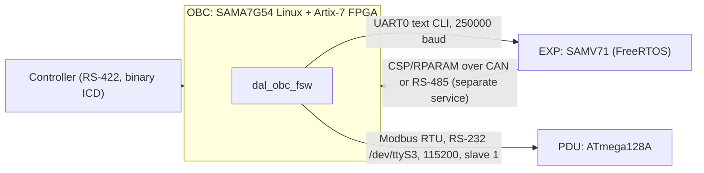

# DAL OBC flight software (`dal_obc_fsw`) — verification and automated test plan

Scope: the RS-422 binary ICD and the local text console of `service/dal_obc_fsw/`.
Sources compared: [`flight-software.md`](flight-software.md), [`flight-command-register.md`](flight-command-register.md),
[`icd-console-mapping.md`](icd-console-mapping.md), [`icd.md`](icd.md) against the code in
`service/dal_obc_fsw/` (`bee_dal_tmtc_service.c`, `flight_console_service.c`,
`bee_dal_proto.c`, `dal_obc_config.h`).

What was checked in code: framing/CRC/decoder, the dispatch table, every handler's
length and range checks, and the console text parser. What was **not** checked and
must be confirmed by the tests below: EXP firmware replies, PDU Modbus behaviour, the
power/sensor bit tables (`power_en.c`, `power_stat.c`, `sensor_stat.c`), `gui_state`
content, and the `usb_cam` tool.

---

## 1. Documentation vs. code findings

| # | Finding | Evidence | Action |
| --- | --- | --- | --- |
| D1 | **Inter-byte timeout — resolved: 2000 ms.** The docs said 2000 ms while the code dropped a stalled frame after about 600 ms (`BEE_DAL_INTER_BYTE_TIMEOUT_MS = 500`, 200 ms ticks). The owner chose 2000 ms, so the constant is now 2000. The decoder is ticked every 200 ms (`DAL_OBC_RS422_READ_TIMEOUT_MS`), so a stalled frame is dropped between 2.0 and about 2.4 s. | `bee_dal_proto.h` | Done. T-FRM-07 (gap 2.8 s dropped) and T-FRM-09 (gap 1.6 s survives) pin it. |
| D2 | **`flight-command-register.md` and `flight-software.md` omit 11 implemented commands.** `01/13`–`01/18`, `01/1A`, `01/1B` are in the dispatcher (and in `icd-console-mapping.md`) but not in the register table. The register's "Unsupported entries" paragraph also lists the "supported" set without them. | `bee_dal_tmtc_service.c:1365-1372`, `flight_console_service.c:373-647` | Add rows to the register. |
| D3 | `rba_cfg 01/19` is documented as "reserved"; the dispatcher returns unknown error `0x03`. Consistent, but no console command exists. | `icd-console-mapping.md:1654` | None; covered by negative test T-NEG-03. |
| D4 | PC client `tool/pc_client` has no `thm_*`, `fld_*`, `rba_*` commands. Automation cannot rely on it for those. | `repl.py` command list | Plan uses its own framing library (section 4). |
| D5 | Error-code split not documented: unknown ADDR under TYPE `01`/`02`/`05` and `04/01` → `0x03`; unknown ADDR under TYPE `00`/`03`/`04`, and unknown TYPE → `0x00`. | `bee_dal_tmtc_service.c:1348-1414` | Document; pinned by T-NEG-*. |
| D6 | `ping` ignores payload length (any payload is accepted). Not documented. | `handle_ping` | Pinned by T-PING-02. |
| D7 | `dat_sel`/`dat_get`/`dat_del`/`dat_mark` historically accepted **longer** payloads than specified (extra bytes ignored, stderr note); shorter → `0x00`. | `bee_dal_tmtc_service.c:994,1015,1077,1110,1144` | Pinned by T-DAT-*. |
| D8 | **Source and docs moved during the review.** `02/01 pc_cfg` (20:52), `02/02 pc_ctl` (21:11), `02/00 pc_stat` (21:18), `02/03 thp_cfg` (22:09) and `02/04 thp_ctl` (22:21) were added to `dispatch()` and `help` on 2026-10-28. `icd-console-mapping.md` and `icd.md` were updated at 22:10 and now document all five (the 22:22 docs update added `thp_ctl`). `flight-command-register.md` and `flight-software.md` were updated on 2026-10-29: the register now has rows for `01/13`–`01/18`, `01/1A`, `01/1B` and `02/00`–`02/04`, the unsupported paragraph lists `02/05`–`02/09`, and both state the 2000 ms timeout. `test_inv_01` catches the next change of this kind. | `bee_dal_tmtc_service.c` (`handle_pc_*`, `handle_thp_cfg`, `handle_thp_ctl`) | Done; the drift test catches the next addition. |
| D9 | The HK cache retains the last good sample through read failures until that sample is >30 s old. A stale/missing file therefore does not give `0x01` immediately. Matches the code comment; docs say only "older than 30 s is rejected". | `hk_service.c:poll_snapshot` | Document; pinned by T-TM-03/03b/08. |
| D10 | **Hazard:** `debug_handoff` runs `systemctl start serial-getty@ttyS1.service` on whatever host runs the daemon. The framework puts a stub `systemctl` first on PATH; never run the daemon with the real one in tests. | `main.c:trigger_debug_getty` | Built into `fsw_auto/fixtures.py`. |
| D11 | **Size and CRC in `dat_sel` can disagree.** Size comes from the `dat_lst` scan; CRC32 is computed at `dat_sel` over the whole file as it is then. If a file grows between the two, the advertised CRC covers more bytes than the advertised size and a client's whole-file check fails, with nothing in the reply to flag it. The docs' "retry if size or CRC changes" can't be detected from `dat_sel` alone. | `bee_dal_files.c:bee_dal_files_info/read_chunk` | Characterised by T-DAT-13. Fix: compute size and CRC together at select time, or document. |
| D12 | SCI1/SCI2 (`dat_sel` type 1 or 2) return data error `01` for every index and `dat_lst` always reports 0 for them (no board yet). A stale-snapshot `0x03` from `dat_sel`/`dat_get`/`dat_del` is unreachable in the current code: the handler and backend snapshot ids advance together, so T-DAT-09 (stale) is dropped. | `bee_dal_files.c:resolve`, `bee_dal_tmtc_service.c` | Document. |
| D13 | **`capture_ar2020.sh` always exits 0.** No `set -e` and the last line is an `echo`, so a failed `media-ctl` or `v4l2-ctl` is invisible to the caller. The flight software requires the full 39,321,600-byte RAW frame before PNG conversion, so a short frame is rejected. The expected size is 5120 × 3840 × 2 = 39,321,600 bytes. | `camera_tools/capture_ar2020.sh`, `gui_hw.c:mipi-capture` | Covered by T-MIP-12/13. The script still needs correct exit status from its tools. |
| D14 | The script hard-codes `/dev/media0`, `/dev/video0` and the entity names (`ar2020 1-0036`, `dw-csi.0`, `csi2dc`, scaler). USB cameras use `/dev/video2` (`CAPTURE.MD`); a UVC device that registers a media node could renumber them. The same sensor entity name is used for MIPI board 1 and board 2. | same | Preflight check in tier B (T-MIP-30). |
| D15 | Media bus format is `SRGGB10_1X10` (RGGB) while the video format is `BG10` (BGGR), and `raw_jpeg` is run with a Bayer order chosen by the operator. Whether the ISC driver remaps one to the other is not shown in the repo. | script, `raw_jpeg.c` | Verify on hardware (T-MIP-33): read back `v4l2-ctl --get-fmt-video` and check colour. |
| D16 | `switch_lane.py` and `switch_sensor.py` open SMBus **bus 2**, but the sysfs switch devices are `1-0070` and `1-0020` (bus 1). `switch_ar2020.sh` uses `sudo tee`, which may not be in the image. Neither is used by the flight software. | `camera_tools/*` | Document or fix; not tested in tier A. |
| D17 | Each MIPI capture retains a 39 MB RAW frame and a PNG in `$DAL_GUI_MIPI_DATA_DIR` (default `/home/bee/data/images/mipi`) with no retention limit. RS-422 cannot start MIPI capture; `dat_*` can list and transfer the saved files. | `gui_hw.c`, `bee_dal_files.c` | Tier B storage test (T-MIP-34); product decision on a wire capture command. |
| D18 | **Signed arguments reject hex.** Docs state every numeric console argument accepts decimal or `0x` hex. Unsigned fields use `strtoul` base 0, but signed ones (`signed_number`: `thp_cfg` temperatures, `rba_ctl move/goto` steps) use base 10 only, so `0x0BB8` is refused where `3000` works. | `flight_console_service.c:136` | Characterised by T-THP-13. Fix the parser or the docs. |
| D19 | **Leading zeros are octal.** `number()` uses base 0, so `010` is 8 and `09` is rejected. Easy to trip over with zero-padded values. | `flight_console_service.c:125` | Characterised by T-CON-11. Document or parse base 10 unless `0x`. |
| D20 | **Switching MIPI board leaves the first camera powered.** `mipi-route 2 S` after `mipi-route 1 S` switches board 1's I2C buffer off but leaves `pow_mipicam_1` on, so both cameras stay powered until `mipi-power N off` is called. | `gui_hw.c:mipi_route` | Characterised by T-MIP-18. Decide whether routing should power the other board down. |
| D21 | **Motor speed cap is stale.** EXP commit `ddc3ae2` raised `MOTOR5_MAX_SPS` from 200 to 1000 and the wire status clamps the speed byte to 255. `rba_ctl` still rejects a speed above 200 and `rba_stat` rejects a speed byte above 200, so a motor running faster than 200 sps makes `rba_stat` return data error `01`. | `bee_dal_tmtc_service.c:handle_rba_ctl/handle_rba_stat`, `flight_console_service.c` (`rba_ctl`) | Characterised by T-RBA-14 and T-ORC-05. Decide the OBC cap (255 is the byte limit) and whether the status check should only bound to 255. |
| D22 | **Stale pump ticket text.** The EXP now answers `Pump result replaced or unknown` (cli_pump.c); the OBC matches `Pump result expired or unknown`, so a replaced ticket gives data error `01` instead of status 11. | `bee_dal_tmtc_service.c` (`handle_fld_cfg`) | Characterised by T-FLD-07. One-line fix: match `or unknown`. |

Everything else spot-checked matched the docs: CRC over payload only (`0xFFFF` for
empty), little-endian fields, 32768-byte payload cap, `0xFE` debug ACK, 41-byte
`dat_sel` reply, 96-byte `sys_info`, 64-byte `tm_obc_get`, `pwr_adj_cfg` range 800–20000 mV.

---

## 2. Implemented command inventory

### 2.1 RS-422 binary commands (36 TYPE/ADDR entries)

"Len" is the TC payload length enforced by the handler; a wrong length returns `0x00`
(invalid TC) unless noted. "Err" lists the other error codes the handler can return
(`01` data, `02` memory, `03` unknown).

| TYPE/ADDR | Console command | TC len | Reply payload | Err / validation notes |
| --- | --- | --- | --- | --- |
| `00/00` | `ping` | any | 4 (uptime s) | none |
| `01/00` | `sys_info` | 0 | 96 | — |
| `01/01` | `sys_rtc [epoch\|now]` | 0 or 4 | 4 (epoch) | `03` if `clock_settime` fails (needs root) |
| `01/02` | `pdu_vout get\|set <mV>` (alias `pwr_adj_cfg`) | 0 or 2 | 8 | `01` if mV <800 or >20000; `03` if PDU Modbus fails |
| `01/03` | `pwr_en <OBC\|EXP\|PDU> get\|<rail> on\|off\|set <sel> <on> [force]` | 1 or 6 | 7 | `01` board ∉ {3,4,5} or select=0 or bad rail; `03` hardware failure |
| `01/04` | `pwr_stat <board> get [src\|all\|mask m]` | 3 | 6 + 12·N (board, count, epoch U32, then 12-byte records) | `01` bad board/bits; `03` failure |
| `01/07` | `sen_stat <board> get <group> [src] [cursor n]` | 4 | 10 + ≤8·12 | `01` bad args; `03` read failure |
| `01/10` | `uvc_cfg <1-4> get\|set …` | 1 or 32 | 32 | `01` camera ∉ 1–4, `payload[1]`≠1, reserved mask bits (`mask & 0xE000`), PWM duty >100 or nonzero without mask bit 12, tool failure |
| `01/11` | `uvc_ctl <1-4> capture <id>` | 8 | 8 | `01` op≠1 or reserved≠0; `03` queue failure |
| `01/12` | `uvc_stat <1-4> get <id>` | 5 | 8 | `01` unknown request |
| `01/13` | `thm_cfg get\|heater n set …\|ir n set …` | 0 or 32 | 32 | `01`: `p[0]≠1`, mask 0 or bits 6-7, heater duty/slew >100, on-time 0 or >60000 (10 ms units), IR duty >25, pulse 0 or >100, pwm_hz outside 100–100000; `03` EXP UART failure |
| `01/14` | `thm_ctl heater\|ir <ch> off\|set …\|feedback_start` | 8 | 4 (uptime) | `01` range checks (heater ch 0-3 / IR ch 0-1, duty, duration ≤600000 ms, feedback only for IR) |
| `01/15` | `thm_stat [get]` | 0 | 6 | `01` out-of-range duty byte; `03` |
| `01/16` | `fld_cfg get [page]\|valve\|flow\|route\|profile\|resume\|pump_type\|pump detect/result` | 0 or 32 | 32 | `01` field/range checks, EXP reply mismatch; `03` UART failure |
| `01/17` | `fld_ctl valve mask <m>\|pump u11\|u15 on\|off\|frequency\|voltage …` | 8 | 0 or 4 (pump request id) | `01` range (U11 8–1992 Hz / ≤150 V; U15 50–800 Hz / ≤250 V, ch 0–3); `03` |
| `01/18` | `fld_stat [get]` | 0 | 16 | `01` reserved bits set / non-hex reply; `03` |
| `01/1A` | `rba_ctl init\|move\|goto\|jog\|home\|stop\|disable\|result …` | 8 | 0, 4 (id) or 12 (result) | `01` bad opcode/motor/speed (>200)/zero move/jog value; `03` |
| `01/1B` | `rba_stat [get]` | 0 | 16 | `01` inconsistent bytes (`out[4]/[5]>5`, speeds >200, …); `03` |
| `02/00` | `pc_stat` (added 21:18, 2026-10-28) | 0 | 1 | `00` len≠0; `01` EXP reply lacks `PC_STAT <hex>` or the byte is impossible (state 7; bit 5 needs state 1–3; bit 6 needs state 3) |
| `02/01` | `pc_cfg get\|…` (added 2026-10-28, after the first draft of this plan) | 0 or 32 | 32 | Same handler as `fld_cfg` (`01/16`) except sub-ops 8 (pump type) and 9 (pump detect), which return `01`. Console forms also list `datalog on\|off` and `defaults` in `help`; their wire encoding has not been reviewed yet |
| `02/02` | `pc_ctl activate\|deactivate\|test\|replace\|circulation [both\|a\|b]\|ground <preset>\|standby\|stop\|reset_error` (added 21:11, 2026-10-28) | 8 | 0 | `00` len≠8; `01` bytes 2–7 nonzero, opcode ∉ 1–9, selector out of range for the opcode (0–2 for test/replace/circulation, 0–3 for ground, 0 otherwise), EXP answered `ERROR`/unexpected text; `03` UART failure |
| `02/04` | `thp_ctl heater <0-3> start\|stop\|status\|resume`, `thp_ctl ir <0-1> start\|stop\|status` (added 22:21, 2026-10-28) | 1 | 1 | `00` len≠1; `01` reserved bits 5–7 set, IR channel > 1, IR resume, MCU refusal (`ERROR THP_CTL refused`), missing `THP_CTL <hex>`, phase out of range for the kind, or running bit inconsistent with the phase; `03` UART failure. TM byte: bits 0–2 phase, 3–5 fault reason, 6 configured, 7 running. Docs: `icd-console-mapping.md#thp_ctl-0x04` |
| `02/03` | `thp_cfg heater\|ir get\|set …` (added 22:09, 2026-10-28) | 32 | 32 | `00` len≠32; `01` action/kind/index out of range (heater 0–3, IR 0–1), get with bytes 3–31 non-zero, heater set with bytes 28–31 non-zero, or the EXP answers `ERROR THP_CFG …`, omits `THP_CFG <64 hex>`, or echoes different action/kind/index; `03` UART failure. Layout: docs `icd-console-mapping.md#thp_cfg-0x03` |
| `02/0A` | `exp_ping` | 0 | 3 + text | `00` if len≠0 |
| `02/0B` | `exp_tlm <section>` | 1–19, no NUL | 3 + JSON | `00` otherwise |
| `02/0C` | `exp_run <cmd>` (also `sen_bme_cfg`, `sen_imu_cfg` EXP routes) | 1–95, no NUL | 3 + text | `00` otherwise; status byte 0–4 inside payload |
| `03/00` | `dat_lst <mark>` | exactly 1 | 12 | valid listing invalidates selection; invalid length returns `FF/00` |
| `03/01` | `dat_sel type idx chunk` | ≥5 | 41 | `00` len<5 or type>2; `01` chunk 0 or >32768, bad index; `03` stale snapshot |
| `03/02` | `dat_get chunk` | ≥4 | ≤chunk bytes | `00` len<4; `01` not selected or bad chunk; `03` stale |
| `03/03` | `dat_des` | any | 4 (uptime) | none |
| `03/04` | `dat_del type idx` | ≥3 | 12 | `00` len<3 or type>2; `01` active file; `03` stale |
| `03/05` | `dat_mark m` | ≥1 | 4 (uptime) | `00` len<1 or m=`0xFF`; `01` not selected |
| `04/00` | `tm_get` | any | 29 | `01` no valid HK snapshot (<30 s old) |
| `04/02` | `tm_obc_get` | 0 | 64 | `00` len≠0; `01` no valid snapshot |
| `FF/00` | `debug_handoff yes` | 16 (`DEBUG_HANDOFF_OK`) | 4, ACK byte `0xFE`; process then exits | any other payload falls through to `0x00` |
| `FF/01` | `shell <cmd>` | 1–2048 | 7 + ≤20480, ACK byte `0xFE` | `00` len 0 or >2048 |

### 2.2 Not implemented (must return an error, never hang)

| Entry | Expected TM |
| --- | --- |
| `01/05`, `01/06`, `01/08`–`01/0F`, `01/19`, `01/1F`–`01/FF` | `FF/03` |
| `02/05`–`02/09`, `02/0D`–`02/FF` | `FF/03` |
| `04/01` (`tm_cfg`), `05/xx` (SFU) | `FF/03` |
| `00/01`–`00/FF`, `03/06`–`03/FF`, `04/03`–`04/FF`, TYPE `06`–`FE`, `FF/02`–`FF/FF` | `FF/00` |

### 2.3 Console-only (local Unix socket `/run/dal/dal_obc_fsw/console.sock`)

`help`, `gui_state`, `gui_shell <1..120 s> <cmd>`, `raw <type> <addr> [bytes]`,
`json on|off` / `--json`, `exit`/`quit` (client only). Request limit 4096 bytes,
one request per connection, socket mode `0600`.

### 2.4 Peripheral map: what each board has and what the flight software exposes

Sources: `service/ref/OBC_DAL/*.md` and schematic review, `service/ref/https-github.com-baobuibk-SpaceLiin_BEE-DAL_EXP_V1.0_FW/docs/`,
`service/ref/SpaceLiinTech_DAL_PDU_AVR_FW_HW1.1/doc/docs/`, `service/ref/review_dal_{exp,pdu}_docs/`. Each board has its own
microcontroller; `dal_obc_fsw` reaches them over different links.



| Board | Peripheral | Hardware | Flight-software surface | Sim fake |
| --- | --- | --- | --- | --- |
| **OBC** | USB cameras ×4 | J5/J6/J14/J15 behind a 1:4 switch (U32), port power switches U10/U20 with fault flags | `uvc_cfg/ctl/stat` (`01/10`–`01/12`) via the `usb_cam` tool; `pwr_en OBC USB1…4_power` | `DAL_USB_CAM_TOOL` stub |
| | MIPI cameras ×2 | J16/J17 via MIPI buffer U36 and 1:2 switch U37, I2C buffers U38/U39, power switch U40 | No wire command. `pwr_en OBC MIPI1/2_power`; route/capture only through `gui_shell` and `--gui-hw` (see 4.7b, findings D13–D17) | stub `media-ctl`/`v4l2-ctl`, sysfs files, LED-class files |
| | Power rails | five eFuses; PAC1934 ×2 measure 8 rails | `pwr_en OBC` (8 outputs), `pwr_stat OBC` (16 sources), `tm_obc_get` | LED files, HK snapshot |
| | Sensors | BME688, board temp sensor, 4 NTC inputs | `tm_get`, `tm_obc_get`, `sen_stat OBC` | HK snapshot |
| | RTC | RV-3129 on `/dev/rtc2` | `sys_rtc` | — (host clock) |
| | Links | RS-422 (shared with debug console by a mux), RS-485, 2× RS-232, 2× CAN on one pair, PC104 I2C/SPI | RS-422 is the ICD; RS-232 reaches the PDU; CAN is another service | PTYs |
| | FPGA | drives parallel outputs J8/J12 | none | — |
| **EXP** | Thermal cameras ×2 | Melexis arrays on I2C1 behind PCA9508 buffers; images staged in PSRAM, delivered over CSP/RPARAM | `sen_stat EXP camera1/2` only. **Not** the OBC `uvc_*` cameras | `sen_stat` snapshot |
| | Sensors | BME688, LSM6DSOX IMU, 4 NTC + board temp, 2 flow sensors | `sen_stat`, `sen_bme_cfg`, `sen_imu_cfg`, `exp_tlm`, `exp_run` | `ExpModel`, scripted replies |
| | Heaters, IR | 4 heater outputs (TC0), 2 IR LED drivers (PWM0) | `thm_cfg/ctl/stat` | scripted EXP |
| | Fluidics | MAX22200 4-valve driver; pumps U11 (low or high driver) and U15 (4-channel) on I2C0 | `fld_cfg/ctl/stat`, `pc_cfg/ctl/stat` | scripted EXP |
| | Motion | DRV8910 driving 2 five-phase motors, 4 optical limit inputs | `rba_ctl/stat`, `sen_stat EXP limits` | scripted EXP |
| | Burn wires, power | 2 burn-wire outputs; branches 12V_EXP / SLN_HD / MOTOR, PAC1934 ×1 | `pwr_en EXP`, `pwr_stat EXP` | `ExpModel`, EXP snapshot |
| | Storage, links | PSRAM, FRAM, MRAM, RTC, watchdog; UART0 (OBC), UART2 (console), CAN/RS-485, PC104 | UART0 only | PTY |
| **PDU** | Outputs | +5_TRANS fixed 5 V; VOUT programmable 5–12 V (TPS55287) | `pwr_en PDU TRANS/VOUT`, `pdu_vout` (`01/02`) | `FakePdu` |
| | Measurements | PAC1934 ×1 (VOUT, +12 in, +5_TRANS, +5), board temp sensor | `pwr_stat PDU`, `gui_state.pdu` | `FakePdu` |
| | Identity, state | product code `PDU`, FW version/build (40100–40109), mode, events, clock | `sys_info` | `FakePdu` |
| | Link | Modbus RTU on RS-485 and RS-232 (same register map, slave 1) | RS-232 only | PTY Modbus slave |

Hardware findings that affect testing: the RS-232 transceiver direction on the PDU is reversed (IF-001), which is the link the OBC
uses; the RS-422/console mux select line may not be able to switch (OBC SI-01); the two OBC CAN controllers share one
transceiver pair (HW-02). Camera counts: OBC has 4 USB + 2 MIPI, EXP has 2 thermal.

Modbus entries the flight software uses (zero-based offsets): FC3 identity 99–108; FC4 22–24 (setpoint, VOUT mV, VOUT mA) and 19–30
(status block); FC1 coils 0–1 (VOUT, TRANS); FC2 offset 10 (TRANS output); FC5 coils 0 and 1; FC6 offset 0 (setpoint).
`FakePdu` models exactly these, with the documented rules: VOUT-on needs a programmed setpoint and powers TRANS first, a setpoint
write powers TRANS, TRANS-off drops VOUT.

### 2.5 MCU firmware sync (checked 2026-10-29 00:00)

`service/ref` was compared with the fakes and tests. PDU firmware: no file newer than the plan; the register map the OBC uses is
unchanged. EXP firmware: new or changed since the last pass are the IR temperature controller (`App_IR/app_ir_temperature.c`,
`ir_service.h`), the thermal CLI bridge (`cli_temperature.c`, `cli_ir.c`), `cli_command.c`, `camera_service.c`, and the docs
`16_temperature_control.md`, `31_ir_led_commands.md`, `cli-commands.md`.

| Firmware fact | Where | Effect on the plan |
| --- | --- | --- |
| `thp_wire_ctl <2 hex>` (selector = index \| kind<<2 \| action<<3) answers `THP_CTL <status hex>`, `ERROR THP_CTL invalid selector` or `ERROR THP_CTL refused`. Heater start needs EXP12V on and valid sensors; resume only from ERROR; stop always succeeds; IR start needs a configured profile and both channels idle or faulted; IR stop when idle is refused | `cli_temperature.c`, `app_temperature.c`, `app_ir_temperature.c` | `ThermalProfiles.ctl` in `fake_exp.py`; T-THP-20…31 |
| `thp_wire_cfg <64 hex>` reads or writes one 32-byte heater or IR PID profile and answers `THP_CFG <64 hex>` or `ERROR THP_CFG invalid record\|refused` | `cli_temperature.c` | `ThermalProfiles` in `fake_exp.py` copies its validation; T-THP |
| Heater profile rules: NTC index < 4, delta > 0, cutoff > set point and ≤ 200.00 °C, set point ≥ −100.00 °C, timeout 1–60000 ms, slew 1–100 %/s, gains finite and ≥ 0; refused while the profile runs; persisted to MRAM | `profile_state.c` | same |
| IR profile rules: camera 0–1, ROI inside 32×24, target < cutoff, rise > 0, duty 1–25 % (`IR_HARD_MAX_DUTY_PCT`), slew 1–100, period 250–10000 ms, timeout > period and ≤ 60000, gains ≥ 0; RAM only, lost on reboot; a get of an unconfigured IR profile is refused | `app_ir_temperature.c` | same; the OBC `thp_cfg ir` path has no way to know whether a profile survived a reboot |
| Power status line is `Power <rail> requested=<ON\|OFF> observed=UNKNOWN phase=<…> last=<…> seq=<n>` followed by an `owners=…` line | `cli_power.c` | `ExpModel` now prints exactly that (it used to print `actual=`) |
| Replies the OBC matches on (`PC_STAT`, `pc … sent`, `THM_CTL`, `FLD_STAT`, `RBA_STAT`, `Pump request QUEUED id=`, `DAL_EXP firmware v…`) | various `cli_*.c` | `test_oracle.py` fails if any literal disappears from the firmware source |

The oracle checks need the reference checkout under `service/ref` and skip otherwise. They only prove that strings and registered
commands exist; reply semantics are still checked by the fakes, so when the firmware changes behaviour the fake has to be updated
by hand.

---

## 3. Test strategy

Three tiers, so most of the plan runs on a PC with no hardware and the rest is gated.

| Tier | Where | Hardware | What it proves | Marker |
| --- | --- | --- | --- | --- |
| **A — simulation** | build host | none | Framing, every dispatch/validation path, payload layouts, file transfer, console↔wire parity | `sim` |
| **B — target, read-only** | OBC reached over a real RS-422 adapter (and/or local socket via ssh) | OBC only | Real UART at 921600 8N1, timing, HK/`sys_info`/`pwr_stat` against live data | `target` |
| **C — hardware-in-loop** | OBC + PDU + EXP on a bench | PDU, EXP, cameras | Actuator commands (power rails, VOUT, pumps, valves, motors, heaters), camera capture | `hil` (opt-in, interactive confirm) |

The existing harness (`tests/test_flight_console.py`) already runs the real
`build-host/dal_obc_fsw` against PTYs by overriding `DAL_OBC_RS422_PORT`,
`DAL_EXP_UART_PORT`, `DAL_GUI_PDU_PORT`, `DAL_FLIGHT_CONSOLE_SOCKET`,
`DAL_OBC_HK_SNAPSHOT_PATH`, `DAL_EXP_HK_SNAPSHOT_PATH`, `DAL_USB_CAM_TOOL`,
`DAL_UVC_DATA_DIR`, `DAL_GUI_LED_ROOT`. Tier A extends that approach rather than
replacing it; the existing `make check` stays as the smoke gate.

### Tooling constraints on this build host

Python 3.11 only; **no `pytest` and no `pyserial`** installed. Therefore:

- Use stdlib `unittest` (run with `python3 -m unittest discover`); no new dependency.
- Tier A uses `pty`/`os` (no pyserial). Tier B imports `serial` only inside the
  transport class and skips with a clear message if absent.
- Test code must **not import `tool/pc_client`**: re-implement CRC-16 and framing in
  the test library so the tests are an independent check of both sides.

### Proposed layout (new, under `service/dal_obc_fsw/tests/fsw_auto/`)

```
fsw_auto/
  bdal.py            # independent framing: crc16_ccitt_false, crc32, encode_tc, FrameDecoder, exact-read helpers
  transport.py       # PtyTransport (sim), SerialTransport (target), SocketTransport (console)
  fixtures.py        # start/stop dal_obc_fsw with temp dirs + PTYs; fake EXP UART, fake PDU Modbus, fake usb_cam, HK/EXP JSON snapshot writers
  fake_exp.py        # scripted EXP CLI responder (command -> reply), incl. thm_/fld_/rba_ wire-stat replies
  fake_pdu.py        # minimal Modbus-RTU slave: identity regs 40100-40109, VOUT, rail states
  cases/
    test_framing.py      test_ping_sys.py     test_power.py      test_sensors.py
    test_telemetry.py    test_data_xfer.py    test_exp_gateway.py
    test_thermal_fluid_rba.py   test_uvc.py   test_debug.py     test_negative.py
    test_console_parity.py      test_gui_console.py
  hil/                   # tier C, skipped unless FSW_HIL=1
  run_all.py             # runner: --tier sim|target|hil, --junit out.xml, --report out.md
  README.md
```

Wire into `Makefile`: `make fsw-sim-test` (tier A, part of `check`), `make fsw-target-test PORT=/dev/ttyUSB0`.

### Core helper contract (so every case is one line)

```python
tm = link.txrx(0x01, 0x02, b"")              # -> Tm(ack, code, payload, ms)
tm.expect_ack(0x01, 0x02, len=8)             # raises with hex dump on mismatch
tm.expect_err(0x01)                          # data error
link.send_raw(bytes_)                        # for corrupted frames
console.run("tm_obc_get", json=True)         # same command via socket
assert_parity(link, console, "pdu_vout get") # wire payload_hex == console payload_hex
```

Every failure prints TX frame, RX frame and the daemon's stderr tail.

---

## 4. Test cases

IDs are stable; "A/B/C" gives the tiers where the case is meaningful.

### 4.1 Framing and link (`test_framing.py`) — A, B

| ID | Case | Expected |
| --- | --- | --- |
| T-FRM-01 | Ping with exact bytes `A5 00 00 00 00 FF FF` | `A5 00 00 04 00 <uptime> <crc>`; CRC-16/CCITT-FALSE over payload only |
| T-FRM-02 | Bad CRC (flip one CRC bit) | No reply within 1 s; next valid ping answers (frame discarded, decoder resynced) |
| T-FRM-03 | Garbage bytes before `A5` | Ignored; ping afterwards answers |
| T-FRM-04 | Payload CRC computed over header too (wrong algorithm) | No reply |
| T-FRM-05 | LENGTH = 32768 with valid CRC on `ping` | Accepted, ping ACK |
| T-FRM-06 | LENGTH = 32769 | Decoder resets, no reply, link recovers |
| T-FRM-07 | Truncated frame (send half, stop) then wait, then ping | Stale half-frame dropped after the timeout (**2.0–2.4 s**, see D1); a tail sent after 1.6 s is accepted (T-FRM-09), one sent after 2.8 s is dropped; subsequent ping answers |
| T-FRM-08 | Two frames back-to-back in one write | Two replies in order |
| T-FRM-09 | Byte-at-a-time send with 100 ms gaps | One valid reply (gaps < timeout) |
| T-FRM-10 | Byte-at-a-time send with 800 ms gap mid-frame | No reply for that frame; link recovers |
| T-FRM-11 | `0xA5` bytes inside payload | Payload not mis-framed (use `shell echo` payload containing 0xA5) |
| T-FRM-12 | Reply framing check on every TM captured by the suite | START `A5`, LENGTH matches, CRC valid, ACK byte = echoed TYPE or `FF`/`FE` |
| T-FRM-13 | Soak: 10 000 pings, 921600 baud | 0 timeouts, 0 CRC errors, p99 latency < 50 ms (tier B threshold configurable) |

### 4.2 System / power (`test_ping_sys.py`, `test_power.py`)

| ID | Case | Tier | Expected |
| --- | --- | --- | --- |
| T-PING-01 | `ping` uptime | A,B | 4-byte payload, monotonic across two calls, ≈ `/proc/uptime` |
| T-PING-02 | `ping` with 5-byte payload | A,B | still ACK (D6) |
| T-SYS-01 | `sys_info` layout | A,B | 96 bytes; `p[0]=1`, `p[1]=3`, `p[3]=0`; records ordered PDU(1), EXP(2), OBC(3); OBC online, HW 1.0.0, FW = `DAL_OBC_VERSION_*` |
| T-SYS-02 | `sys_info` with payload | A | `FF/00` |
| T-SYS-03 | PDU/EXP offline (fake silent) | A | mask bit cleared, FW `FF FF FF`, build empty |
| T-SYS-04 | PDU/EXP online (fakes answer) | A | FW parsed from `DAL_EXP firmware vX.Y.Z (..) build ID`; PDU build 8 hex digits |
| T-RTC-01 | `sys_rtc` get | A,B | 4 bytes, within ±2 s of host/target time |
| T-RTC-02 | `sys_rtc` set to fixed epoch, get back | B (root) | reply = set value (±1 s); restore time afterwards; check `hwclock -f /dev/rtc2` separately via `shell` (set ACK does not confirm RTC write) |
| T-RTC-03 | `sys_rtc` len 1/2/3/5 | A | `FF/00` |
| T-VOUT-01 | `pdu_vout get` | A (fake PDU), C | 8 bytes (setpoint, V, I, flags) |
| T-VOUT-02 | `pdu_vout set` boundaries 799 / 800 / 20000 / 20001 | A | 799 and 20001 → `FF/01`; others ACK and read-back = set |
| T-VOUT-03 | len 1 / 3 | A | `FF/00` |
| T-VOUT-04 | PDU not responding | A | `FF/03` |
| T-PEN-01 | `pwr_en <board> get` for 3,4,5 | A (LED root sim), C | 7 bytes; board echo; `on ⊆ known`, `failed ⊆ known` |
| T-PEN-02 | board 0, 2, 6 | A | `FF/01` |
| T-PEN-03 | `set` with select=0 | A | `FF/01` |
| T-PEN-04 | `set` every OBC rail on→off with read-back (derive bit table from `icd-console-mapping.md`, assert 16 OBC / 7 EXP / 4 PDU names) | A, C | `on` bit follows request; unrelated bits unchanged |
| T-PEN-05 | EXP `force` on an **on** request | A | `FF/01` |
| T-PEN-06 | PDU `TRANS off` also drops VOUT; VOUT on needs a setpoint | C | per docs |
| T-PEN-07 | len 0, 2, 5, 7 | A | `FF/00` |
| T-PST-01 | `pwr_stat` each board, mask 0 (all) | A,B | 6-byte header (board, count, epoch) + 12·N bytes; N = popcount of known sources |
| T-PST-02 | single-source and multi-source masks | A | record count = bits set; invalid bit → `FF/01` |
| T-PST-03 | bad board, len ≠ 3 | A | `FF/01`, `FF/00` |
| T-PST-04 | stale/absent EXP snapshot | A | validity/age fields flag unavailable |

### 4.3 Sensors and telemetry (`test_sensors.py`, `test_telemetry.py`)

| ID | Case | Tier | Expected |
| --- | --- | --- | --- |
| T-SEN-01 | `sen_stat` each board × group, paging via `next_cursor` until done | A,B | ≤8 records/page, cursor strictly advances, terminates; total count matches `icd-console-mapping.md` table |
| T-SEN-02 | single source filter | A | one record |
| T-SEN-03 | bad board / group / source, len ≠ 4 | A | `FF/01`, `FF/00` |
| T-TM-01 | `tm_obc_get` with fixture snapshot (all valid) | A | 64 bytes; each field equals fixture × documented scale; mask `0x01FF` |
| T-TM-02 | partial validity (e.g. only BME) | A | invalid fields are 0 on wire and mask bits clear |
| T-TM-03 | snapshot older than 30 s / missing / schema ≠ 1 | A | `FF/01`; recovers within ~1 s after refresh |
| T-TM-04 | `tm_obc_get` len 1 | A | `FF/00` |
| T-TM-05 | `tm_get` | A | 29 bytes, field order from `flight-command-register.md`; `FF/01` without snapshot |
| T-TM-06 | `tm_cfg` (`04/01`) | A | `FF/03` |
| T-TM-07 | Live data sanity | B | mask has at least the onboard-temp bit, temp in −40…+85 °C, epoch within 60 s of host |
| T-TM-08 | `hk_service` → RS-422 consistency | B | `tm_obc_get` vs `cat /run/dal/hk_service/obc_data.json` (via `shell`) agree within one sample period |

### 4.4 Data transfer (`test_data_xfer.py`) — A (fixture dir), B

Fixture: temp `BEEIF_DATA_DIR` with N daily CSVs, one legacy `HK_*.log`, one *today*
file; the sim run points the file backend at it with `DAL_DATA_DIR`.

| ID | Case | Expected |
| --- | --- | --- |
| T-DAT-01 | `dat_lst 0xFF` (all files) | 12 bytes; HK count = fixture; SCI counts = fixture |
| T-DAT-02 | `dat_lst` with mark filter, with extra bytes | filtered counts; missing/extra bytes rejected with `FF/00`; selection preserved |
| T-DAT-03 | `dat_sel` HK idx 0, chunk 1024 | 41 bytes; name NUL-padded 20 B; size = file size; CRC32 = `zlib.crc32`; chunks = ceil(size/chunk) (min 1) |
| T-DAT-04 | full download loop: all chunks, concatenate, CRC32 match, `dat_des` | byte-identical to fixture; last chunk short |
| T-DAT-05 | chunk sizes 1, 255, 1024, 32768, and 0 / 32769 / 65535 | first four OK; last three `FF/01` |
| T-DAT-06 | `dat_get` before `dat_sel`; after `dat_des`; after new `dat_lst` | `FF/01` |
| T-DAT-07 | `dat_get` chunk ≥ chunk_count | `FF/01` |
| T-DAT-08 | `dat_sel` type 3; index out of range; len 4 | `FF/00`; `FF/01`; `FF/00` |
| T-DAT-09 | `dat_sel` after file set changes without new `dat_lst` | `FF/03` (stale) |
| T-DAT-10 | `dat_mark` 0, 254 on selected file; 255; unselected | ACK; `FF/00`; `FF/01`; `dat_lst <mark>` count reflects it |
| T-DAT-11 | `dat_del` non-active file | counts decrease by 1; file gone; selection cleared |
| T-DAT-12 | `dat_del` active-day CSV | `FF/01`, file intact |
| T-DAT-13 | Growing file during transfer | CRC mismatch detected by client; reselect succeeds (retry rule from docs) |
| T-DAT-14 | Interleave: RS-422 `dat_sel`, console `dat_get` | console sees same selection (shared state) |
| T-DAT-15 | Large file (≥ 5 MB) at 921600 baud, 8192 B chunks | B: throughput recorded; 0 CRC errors |

### 4.5 EXP gateway (`test_exp_gateway.py`) — A with `fake_exp.py`, C with real EXP

| ID | Case | Expected |
| --- | --- | --- |
| T-EXP-01 | `exp_ping` | `[status=0][len][text]`; text from fake `tlm_json system` |
| T-EXP-02 | `exp_ping` with payload | `FF/00` |
| T-EXP-03 | `exp_tlm` each of 13 sections (system … all) | status 0, valid schema-2 JSON; `CHUNK_REQUIRED` path reassembles (`json_chunk` offsets) and equals source JSON |
| T-EXP-04 | `exp_tlm` name length 0, 19, 20, with NUL | OK for 1–19 (reply may be EXP error text); `FF/00` for 0, ≥20, NUL |
| T-EXP-05 | `exp_run` length 1, 95, 96, 0, NUL | `FF/00` for 0, 96, NUL |
| T-EXP-06 | EXP silent | status 2 (timeout, ≈15 s) — mark `slow`; UART unset → status 3 |
| T-EXP-07 | Output > 16 KB | status 4 |
| T-EXP-08 | `sen_bme_cfg EXP get/set/result` | exact CLI strings `bme688_cfg_get`, `bme688_cfg_set t p h f 0 0 0`, `bme688_result N`; assert via fake's command log; set→`QUEUED id=N`→result N |
| T-EXP-09 | `sen_imu_cfg EXP get/set accel/gyro/freefall/wakeup/reset/result` | exact `lsm6d_*` command strings; range errors rejected **console-side** (no UART traffic) |
| T-EXP-10 | Serialisation: concurrent console + RS-422 `exp_run` | no interleaved UART commands (fake logs strictly alternate prompt/command) |
| T-EXP-11 | `DAL_EXP_UART_POLL` unset → no periodic traffic; `=1` → periodic `tlm_json` | fake command log |

### 4.6 Thermal / fluidic / RBA (`test_thermal_fluid_rba.py`) — A (fake EXP), C

The fake EXP echoes the markers the handlers parse (`THM_CFG <64 hex>`, `THM_CTL s d id`,
`THM_STAT6 <12 hex>`, `FLD_STAT <32 hex>`, `RBA_STAT <32 hex>`, `Pump request QUEUED id=N`,
`<STATE> request=N position=P`, `OK pc_…`). Each case asserts both the wire reply and
the exact EXP command string generated.

| ID | Case | Expected |
| --- | --- | --- |
| T-THM-01 | `thm_cfg get` | 32 bytes, `p[0]=1`, `p[1]=0x3F`; EXP cmd `thm_cfg` |
| T-THM-02 | set each heater 0-3 and IR 0-1 with valid limits | echo; EXP cmd `thm_cfg <64 hex>` bit-exact |
| T-THM-03 | boundary table: duty 100/101, slew 100/101, on-time 0/1/60000/60001, IR duty 25/26, pulse 0/1/100/101, hz 99/100/100000/100001, mask 0 / `0xC0` / `p[0]=0` | boundary-in → ACK; out → `FF/01`; no EXP traffic on reject |
| T-THM-04 | len ≠ 0/32 | `FF/00` |
| T-THM-05 | `thm_ctl` heater/IR on, off, feedback_start; ranges | ACK = 4-byte uptime; invalid combos `FF/01` (see handler conditions at `bee_dal_tmtc_service.c:769-773`) |
| T-THM-06 | `thm_stat` | 6 bytes; each `(b&0x7F)≤100`, bit7⇒nonzero duty; garbage reply → `FF/01` |
| T-FLD-01 | `fld_cfg get` + paging 0..N | 28 B/page, reassembled JSON valid; offset ≥ total → `FF/01`; `CHUNK_REQUIRED` path |
| T-FLD-02 | each set sub-op 1–9 (valve map, pulse, flow ch/interval, route standby/test/replace/circulation/ground, profile, resume, pump_type, pump detect/result) with valid values | echo of request; EXP command string exact |
| T-FLD-03 | invalid: duplicate valve map entries, pulse 0/101, flow ch 2, route mask >15, profile field/target combos the handler rejects, `p[8..31]≠0` on pump ops | `FF/01` |
| T-FLD-04 | pump detect → `QUEUED id` → `result id` states mapping (QUEUED…CANCELLED, 7 BUSY, 8 INTERLOCKED, 9 NOT_READY, 10 INVALID, 11 unknown) | state byte per table |
| T-FLD-05 | `fld_ctl` valve mask 0..15 (+16 → rejected by console), pump u11/u15 on/off/freq/volt at boundaries (8/1992/150; 50/800/250, ch 0-3) | ACK/`FF/01` per handler; request id returned when queued |
| T-FLD-06 | `fld_stat` | 16 bytes; reserved bits (`out[0]&0xF0`, `out[1]&0xF0`, `out[3]>2`, `out[13..15]`) set → `FF/01` |
| T-RBA-01 | `rba_ctl` init / disable / stop 0,1,all / home 0,1 | stop/disable: empty ACK; others: 4-byte id |
| T-RBA-02 | move/goto/jog with and without speed; speed 0/200/201; move 0; `INT32_MIN` | per handler; EXP command string exact |
| T-RBA-03 | `result <id>` for each state code | 12-byte reply: id, state, position (s32) |
| T-RBA-04 | `rba_stat` | 16 bytes; invalid combos → `FF/01` |
| T-RBA-05 | len ≠ 8 / ≠ 0 | `FF/00` |
| T-RBA-13 | finished move, then another move, then stop | state `HOLDING` (4) after a move, next move needs no release, stop → `STOPPED` (EXP `ddc3ae2`) |
| T-RBA-14 | speed 200 vs 201, wire speed byte 255 (EXP at 1000 sps) | OBC rejects 201 and a status speed above 200 (D21) |
| T-ORC-05 | EXP source constants | `MOTOR5_MAX_SPS` 1000, state enum, speed clamp 255, held-move rule, hold flags per command |
| T-HIL-* | Real motion, pump and heater tests | tier C only, section 4.9 |

### 4.7 Cameras (`test_uvc.py`) — A (fake `usb_cam`), C

| ID | Case | Expected |
| --- | --- | --- |
| T-UVC-01 | `uvc_cfg` get cameras 1–4 | 32 B, `p[0]=camera`, `p[1]=1` |
| T-UVC-02 | set each field (format, resolution, fps, exposure, exposure_time, gain, autofocus, focus, white_balance, white_balance_temp, brightness, led_pwm) | fake tool receives the exact 64-hex string; reply echoes |
| T-UVC-03 | camera 0 / 5; set with `p[1]≠1`, PWM >100 or nonzero without bit 12, mask bits 13–15 | `FF/01` |
| T-UVC-04 | tool exits non-zero or prints < 64 chars | `FF/01` |
| T-UVC-05 | `uvc_ctl` capture → `uvc_stat` polls queued→capturing→saved | 8-byte replies; file `…/USB{camera-1}_{request_id:08}.jpg` exists, starts `FF D8` |
| T-UVC-06 | stat for unknown ID; ctl with op ≠ 1 | `FF/01` |
| T-UVC-07 | Capture does not block other RS-422 commands (ping during capture) | ping answers < 200 ms |
| T-UVC-08 | Real camera capture, JPEG decodes | C |
| T-UVC-09 | Save `led_pwm 40` for camera 2, then capture by RS-422 | PWM is enabled at 40% before the camera tool runs and disabled after it exits |

### 4.7b MIPI cameras (`test_mipi.py`) — A (stubbed tools), B/C (hardware)

Scope: `dal_obc_fsw --gui-hw mipi-power|mipi-route|mipi-capture|camera-led` and the unmodified
`tools/camera_tools/capture_ar2020.sh`. These are reached from the console only (`gui_shell`) and from the OBC GUI; there is no
RS-422 TYPE/ADDR. The USB cameras (`uvc_*`, 4.7) are a separate peripheral.

**Commands the hardware path needs**

| Step | Command | Parameters |
| --- | --- | --- |
| power | `dal_obc_fsw --gui-hw mipi-power <1\|2> on\|off` | board 1 or 2. Off drops `en_i2c_mipicam_N` first, then `pow_mipicam_N` |
| route | `dal_obc_fsw --gui-hw mipi-route <1\|2> <0..3>` | other board's I2C off, this board's power on, `sel_mipicam_on2_off1` (off = board 1, on = board 2), I2C on, 1 s settle, write sensor number to `1-0020/sensor_switch/current_sensor` and `1-0070/lane_switch/current_lane`, 0.1 s, read both back |
| capture | `dal_obc_fsw --gui-hw mipi-capture <1\|2> <0..3>` | route, then `bash $DAL_GUI_MIPI_CAPTURE <dir>/MIPI<B-1>.<S>_H_<nnnnnn>.raw` (six-digit sequence, first unused); accepted only if RAW is exactly 39,321,600 bytes; then `raw_png` creates a full-resolution PNG with the same basename |
| script | `media-ctl -d /dev/media0 --set-v4l2 '"<entity>":0[fmt:SRGGB10_1X10/5120x3840]'` for `ar2020 1-0036`, `dw-csi.0`, `csi2dc`, `<scaler>` | scaler is `microchip_isc_scaler` for kernel ≥ 6.2.0, or 6.1.x with `linux4microchip` in the release string; otherwise `atmel_isc_scaler` |
| | `v4l2-ctl --device=/dev/video0 --set-fmt-video=width=5120,height=3840,pixelformat=BG10` | |
| | `v4l2-ctl --device=/dev/video0 --stream-mmap --stream-count=1 --stream-to=<file> --verbose` | one 39,321,600-byte frame |
| convert | `raw_png -H 3840 -W 5120 -b grbg -o <raw-path> <raw-path>` | writes high and low PNG intermediates; FSW publishes the high image as the matching `.png`, removes the low image, and keeps RAW |
| LED | `dal_obc_fsw --gui-hw camera-led 0..100` | PWM duty on `pwm3`, period 1,000,000 ns |

**Simulation (tier A).** The real script is run unmodified with `PATH` pointing at a stub directory:
fake `media-ctl` and `v4l2-ctl` that log every argument, can be told to fail or to write a short frame, and write a deterministic
Bayer pattern of a chosen size; a fake `uname` that returns a chosen release; plain files for the two sysfs switches (a read-only
file reproduces a failed write); the existing fake LED-class files; `DAL_GUI_MIPI_DATA_DIR`, `DAL_GUI_MIPI_LOCK`,
`DAL_GUI_MIPI_LANE`, `DAL_GUI_MIPI_SENSOR`, `DAL_GUI_MIPI_CAPTURE`, `DAL_GUI_MIPI_PNG` and `DAL_GUI_CAMERA_LED_PWM` in the temp dir. The 1 s settle in
`mipi-route` is real time, so a route costs about 1.1 s.

| ID | Case | Tier | Expected |
| --- | --- | --- | --- |
| T-MIP-01 | script with no argument | A | usage text, exit 1, no tool called |
| T-MIP-02 | exact `media-ctl` command lines | A | four `--set-v4l2` calls, in order, entity names as above, format `SRGGB10_1X10/5120x3840` |
| T-MIP-03 | scaler selection by kernel release | A | `5.15.x` → atmel; `6.1.x` → atmel; `6.1.x-linux4microchip…` → microchip; `6.2.0`, `6.6.x` → microchip |
| T-MIP-04 | exact `v4l2-ctl` command lines | A | set-fmt (5120×3840, `BG10`) then stream with `--stream-count=1 --stream-to=<arg>` |
| T-MIP-05 | output file | A | exactly the requested path, 39,321,600 bytes, 16-bit values ≤ 1023 |
| T-MIP-10 | `mipi-power N on/off` | A | LED files toggle (the write order of off cannot be observed on plain files, so only the end state is checked); prints `MIPI camera N power ON/OFF` |
| T-MIP-11 | `mipi-route B S` for B ∈ {1,2}, S ∈ {0..3} | A | other board's I2C off, this board's power on, selector LED correct (board 2 = on), sysfs files read back S; prints `MIPI camera B sensor S selected` |
| T-MIP-12 | `mipi-capture` success | A | matching `.raw` and `.png` files (board 1 is `MIPI0`; sequence advances); final `Saved` line names the PNG, exit 0 |
| T-MIP-13 | failure handling (characterisation of D13) | A | tool fails but file is empty → file removed, exit 1; **tool fails after writing a short frame → rejected before conversion** (documents the gap); script exit status 0 with both tools failing |
| T-MIP-13d | PNG converter fails | A | capture exits 1, PNG intermediates removed, complete RAW retained |
| T-MIP-14 | route readback mismatch | A | read-only switch file → `MIPI route readback mismatch`, exit 1, no capture run |
| T-MIP-15 | argument range | A | board 0 or 3, sensor 4, non-numeric → usage on stderr, exit 2; no LED touched |
| T-MIP-16 | hardware lock | A | second invocation while the first holds `DAL_GUI_MIPI_LOCK` → `MIPI hardware busy`, exit 1; lock released after the first ends |
| T-MIP-17 | `DAL_GUI_MIPI_CAPTURE` override | A | the configured script is the one executed, with the output path as the only argument |
| T-MIP-18 | board switch | A | route 1 then route 2: board 1's I2C switch off, selector flips; board 1 power stays on (D20) |
| T-MIP-19 | camera LED | A | duty 0 / 50 / 100 write `enable`, `period`, `duty_cycle` (0, 500000, 1000000); 101 and non-numeric rejected; missing PWM directory is exported first |
| T-MIP-20 | through the console | A | `gui_shell 90 <fsw> --gui-hw mipi-capture 1 2` returns JSON with `ok`, `exit`, `timeout`, `text`; a 3 s timeout kills a stalled capture (`timeout:true`) |
| T-MIP-21 | concurrency | A | `gui_state` and RS-422 `ping` stay responsive during a capture (the capture runs in a separate worker) |
| T-MIP-22 | converter | A (if libjpeg present) | `raw_jpeg` on the stub frame writes `_high.jpg` (5120×3840) and `_low.jpg` (÷4); decodable; a short input prints the size warning |
| T-MIP-30 | preflight | B | `which media-ctl v4l2-ctl bash`; `/dev/media0`, `/dev/video0` exist; `media-ctl -p` lists the four entities (D14); `i2cdetect -y 1` shows 0x20 and 0x70 |
| T-MIP-31 | capture matrix | B/C | boards 1,2 × sensors 0–3: exit 0, file size 39,321,600, values ≤ 1023, standard deviation above a floor (not black or saturated) |
| T-MIP-32 | rail control | B/C | after capture, `mipi-power N off` leaves `pow_mipicam_N` and `en_i2c_mipicam_N` at 0; `pwr_stat OBC` shows the MIPI control and PAC1934 current dropping |
| T-MIP-33 | format and colour | C | `v4l2-ctl --get-fmt-video` after the set; `raw_jpeg -b bggr` gives a plausible colour image of a test chart (D15) |
| T-MIP-34 | repeat and storage | C | 50 consecutive captures: no failures, free space accounted (D17), per-capture time recorded |
| T-MIP-35 | USB coexistence | C | `uvc_ctl` capture on a USB camera immediately before and after a MIPI capture: both succeed, `/dev/video*` numbering unchanged |
| T-MIP-36 | camera LED | C | duty ramp 0→100 changes image mean monotonically |

### 4.8 Debug, console and negative cases

| ID | Case | Expected |
| --- | --- | --- |
| T-SHL-01 | `shell echo hi` | ACK byte `FE`; status 0, exit 0, trunc 0, len 3+; output `hi\n` |
| T-SHL-02 | `shell exit 7`; `shell kill -9 $$`; command not found | exit 7; signaled(1) code 9; exit 127 |
| T-SHL-03 | output of 25 000 bytes | truncated flag 1, length 20480 |
| T-SHL-04 | command length 0 / 2048 / 2049 | `FF/00` / OK / `FF/00` |
| T-SHL-05 | `cd` does not persist | second call in `/` |
| T-SHL-06 | long-running (`sleep 3`) delays a concurrent ping; `gui_shell` does not delay `gui_state` | per docs |
| T-DBG-01 | `debug_handoff` with wrong magic / wrong length | `FF/00`, process stays up |
| T-DBG-02 | Correct handoff | ACK `FE` with uptime; daemon exits 0; systemd does **not** restart (target) — **destructive**, run last, restores with `systemctl start` |
| T-NEG-01 | All unimplemented entries in 2.2, exhaustive TYPE×ADDR sweep (256×256 = 65 536 pings is too slow at 921600 → sweep TYPE 0-6 × ADDR 0-255 plus `0xFF/0x02..0xFF`) | each returns exactly the code in table 2.2; **no hang**; link still answers ping afterwards; sweep skips `FF/00`, `FF/01`, `01/01`, `01/03`, `01/14`, `01/17`, `01/1A` with empty payload to avoid side-effects (they are length-rejected anyway — assert that) |
| T-NEG-02 | Every implemented command with payload length 0 and with length 33 000 | no crash (daemon PID unchanged, no new `[BEE-DAL]` crash line), a defined reply |
| T-NEG-03 | `01/19 rba_cfg` | `FF/03` |
| T-NEG-04 | Fuzz: 5 000 random frames (valid CRC, random TYPE/ADDR/len ≤ 64, random bytes), seeded, destructive set excluded | daemon alive; replies well-formed; ping afterwards answers |
| T-CON-01 | `help` lists every command in 2.1 | name set equal (drift detector between docs and code) |
| T-CON-02 | Console parser rejects bad syntax | `{"ok":false,"error":"invalid command or arguments"}`; extra trailing tokens rejected |
| T-CON-03 | JSON schema | fields `ok,command,type,address,ack,code,length,text,payload_hex`; `ack=255` for errors |
| T-CON-04 | **Parity**: for each safe command, wire reply payload == console `payload_hex` | equal |
| T-CON-05 | `raw` reaches same dispatcher: `raw 0 0` == `ping` | equal length/ACK |
| T-CON-06 | 4096-byte limit; socket mode `0600`; non-root cannot connect | target |
| T-CON-07 | `gui_state` | valid JSON with keys `obc, exp, exp_uart, pdu, gpio, devices, rtc, mipi, camera_led_duty_pct`; unavailable sources `null` |
| T-CON-08 | Simultaneous RS-422 + console load (1000 mixed commands each) | no corrupted frames, no deadlock |

### 4.9 Tier C — hardware-in-loop (opt-in: `FSW_HIL=1`, prompts before each actuator group)

Every test starts by recording state, ends in a `finally` that returns to the safe
state (all rails as found, pumps off, heaters off, motors stopped/disabled, VOUT at
the pre-test setpoint).

| ID | Case |
| --- | --- |
| T-HIL-01 | `sys_info` all three boards online; HW/FW versions match the release record |
| T-HIL-02 | Each OBC rail on/off with `pwr_stat` current delta > threshold when load attached |
| T-HIL-03 | PDU VOUT sweep 800 → 5000 → 12000 mV; measured within ±5 % / ±100 mV |
| T-HIL-04 | EXP rails on/off incl. `force`; ordering rules |
| T-HIL-05 | Valve mask 0–15; flow channel read-back through `fld_stat` |
| T-HIL-06 | Pump detect → result; enable/disable; frequency/voltage inside limits |
| T-HIL-07 | Motors: init → home → move → result; jog/stop; limit-reached handling |
| T-HIL-08 | Heater duty ramp and IR pulses, `thm_stat` tracks, `off` returns to 0 |
| T-HIL-09 | Camera capture ×4, JPEG integrity, saved path |
| T-HIL-10 | Power-loss recovery: kill EXP rail mid-request, expect POWER_LOST / `FF/01`, system recovers |
| T-HIL-11 | MIPI cameras: T-MIP-31…36 on the bench (8-capture matrix, rails, colour, repeat, USB coexistence, LED) |

---

## 5. Execution and reporting

```
# tier A (no hardware, runs in CI / pre-merge)
make -C service/dal_obc_fsw check                     # existing smoke tests
python3 -m unittest discover -s service/dal_obc_fsw/tests/fsw_auto/cases -t service/dal_obc_fsw/tests

# tier B (PC with USB RS-422 adapter, board running dal_obc_fsw, console via ssh)
FSW_PORT=/dev/ttyUSB0 FSW_SSH=root@dal-obc python3 tests/fsw_auto/run_all.py --tier target --report out/fsw_target.md

# tier C
FSW_HIL=1 FSW_PORT=/dev/ttyUSB0 python3 tests/fsw_auto/run_all.py --tier hil
```

- Output: JUnit XML (`--junit`) for CI, plus a Markdown table (ID, status, ms, notes)
  and a per-command coverage table generated from the dispatch list in 2.1 — a command
  with no passing test is flagged.
- Tier B pre-flight (abort if any fails): `dal_flight_console ping` works over ssh;
  `systemctl is-active dal_obc_fsw`; ensure nothing else owns `/dev/ttyS1`
  (`debug_handoff` getty not active).
- Tier B/C tests record `git rev-parse HEAD`, the build number from
  `output/<target>/.build_counter`, and `sys_info` into the report header.
- Pass criteria for a release: 100 % of tier A; tier B all pass except known-issue
  list; tier C executed on the release candidate image; no open D-items from
  section 1 without a decision.

## 6. Implementation status

Tier A framework is in `service/dal_obc_fsw/tests/fsw_auto/` (see its `README.md`);
run with `make -C service/dal_obc_fsw fsw-sim-test`. Latest full run: **198 cases, all pass (~115 s)**.

| Done | Plan IDs |
| --- | --- |
| Framing | T-FRM-01…09, 11, 12, 13 (T-FRM-10 folded into 07) |
| Ping, HK telemetry | T-PING-01/02, T-TM-01…06, 08 (T-TM-07 is tier B) |
| Negative/robustness | T-NEG-01, 02, 04 and a 32 KB garbage-payload pass over every command (T-NEG-02) |
| Debug shell/handoff | T-SHL-01…07, T-DBG-01/02 (handoff runs against the stub `systemctl`) |
| File transfer | T-DAT-01…08, 10…15 (new `DAL_DATA_DIR` override; production default unchanged) |
| `pc_ctl` / `pc_cfg` | new T-PC-01…05 (every opcode → exact EXP command, rejects touch no UART), T-PC-10…12 |
| System and power | T-SYS-01…05, T-RTC-01/03, T-VOUT-01…07, T-PEN-01…07/10…12/20/21, T-PST-01…05/10…12, T-CON-07 (`gui_state`), against `FakePdu`, `ExpModel` and fake LED files |
| `pc_stat` | T-PC-20…24 |
| `thp_cfg` | T-THP-01…08 (wire, against `ThermalProfiles`, which copies the firmware's validation), T-THP-10…14 (console parser, D18) |
| Thermal manual control | T-THM-01…06 (`thm_cfg` get/merge/ranges/lengths/refusal/bad replies), T-THM-10…15 (`thm_ctl` heater and IR, shape rules, power and ceiling refusals, `thm_stat` consistency) against `Actuators` in `fake_actuators.py` |
| Fluidics | T-FLD-01…08 (valve mask, pump type gate, value ranges, `fld_stat` layout and malformed replies, pump detect/result tickets) |
| Motors | T-RBA-01…06, 10…14 (init/move/goto/run/home/stop/disable/result, refusal states, request shape, `rba_stat` layout and malformed replies, `rba_cfg` reserved) |
| MIPI cameras | T-MIP-01…05 (real `capture_ar2020.sh` against stub tools), 10…19, 20/20b/21 (through `gui_shell`); T-MIP-22 (`raw_jpeg`) not built |
| `thp_ctl` | T-THP-20…31: status, start/stop, resume rules, power and sensor refusals, IR single-channel rule, selector and length checks, bad MCU replies, console selector build |
| MCU oracle | T-ORC-01…04 EXP reply literals, registered CLI commands and limits against `service/ref` firmware source; T-ORC-10/11 PDU register map and rules against its Modbus doc |
| Console | T-CON-02…07, 09, 10, 11; parity (T-CON-04/05) |
| Drift | `test_inv_01` (dispatcher vs `inventory.py`), `test_inv_02` (`help` vs inventory) — replaces T-CON-01 |

Not done yet: EXP-only motor commands that the OBC does not bridge (`motor5_calibrate`, `motor5_hold`, `motor5_reset`, `motor5_limits_set`/`limit_set` with `pmu|pml`, `travel_steps`), EXP-snapshot writer for `sen_stat` (T-SEN), EXP gateway scripting (T-EXP), `fld_cfg`/`pc_cfg` paging (the `cfg_json_pc` JSON path) and the profile sub-operations, UVC cameras (needs only the existing `usb_cam` stub), the `raw_jpeg` converter (T-MIP-22), tier B serial
transport, tier C. Pending oracle work: replay the PDU repo's own `tests/test_pdu_modbus.py` register expectations and the EXP
repo's CLI reference against the fakes, so the fakes cannot drift from the real firmware.

## 7. Work plan and open items

Suggested order (each step is independently useful):

1. ~~`bdal.py` + `PtyTransport` + fixtures~~ — done (see section 6).
2. ~~Fixture data dir for T-DAT~~ — done: `DAL_DATA_DIR` override added. 
3. ~~`fake_pdu.py`, `ExpModel`~~ — done for T-SYS, T-VOUT, T-PEN, T-PST. Remaining: T-EXP, T-THM, T-FLD, T-RBA, T-SEN.
4. Console parity and `help` drift detector (T-CON-01/04), which keeps docs honest.
5. Tier B runner and soak/throughput tests.
6. Tier C scripts, written with the bench team's safe-state list.

Open questions for the owner:

- ~~D1 timeout~~ — decided: 2000 ms, code changed.
- ~~Register update (D2/D8)~~ — done.
- D20: should routing to one MIPI board power the other one down?
- D13: add an exit-status and exact-size check to `capture_ar2020.sh`, and a wire command for MIPI (D17)?
- Is a bench with EXP + PDU available for tier C, and who owns the safe-state definition?
