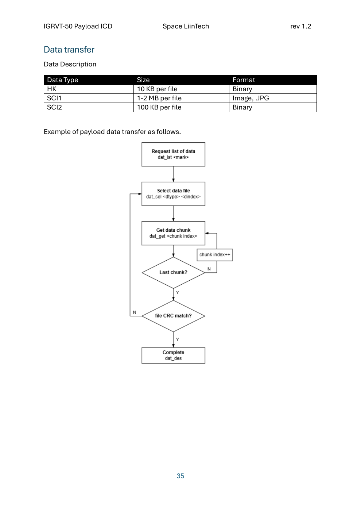

# icd1.2

Reference for **BEE-DAL ICD revision 1.2**, transcribed from [BEE-DAL_ICDr1p2_EE-TMTC.pdf](assets/icd/BEE-DAL_ICDr1p2_EE-TMTC.pdf), originally titled *IGRVT-50 Payload ICD*, Space LiinTech. The detailed PDF frame table order, column names, values, units and notes are preserved; tables split across pages are joined for readability. The PDF contains 31 pages, with printed page numbers **5–35**.

The **“RS-422 frame — additional detail”** sections explain TC/TM framing without modifying the ICD tables. Each implemented command now includes its **current DAL payload structure directly below its heading**, before the PDF frame tables. Offsets in those payload tables start at payload byte 0 (frame byte 5); integers are little-endian unless stated otherwise. These DAL field definitions complete opaque arrays in the PDF without changing native lengths or primitive types. See also the [payload contracts](icd-v1p2-payload-contracts.md), [console mapping](icd-v1p2-console-mapping.md) and [remaining TODO](icd-revision-changes.md).

[Electrical specifications](#electrical-specifications) · [RS-422 configuration](#rs-422-configuration) · [Package format](#package-format) · [TM ACK](#tm-ack-package) · [CRC](#crc-16-and-crc-32) · [Command summary](#tmtc-summary) · [DAL extensions](#current-dal-extensions) · [Storage folders](#current-data-storage) · [Data description / flow](#data-description) · [Source notes](#source-notes)

<style>
.rst-content table {border-collapse:collapse;width:100%;background:#fff;color:#111;margin:16px 0;}
.rst-content table thead th {background:#000!important;color:#fff!important;font-weight:600;border:1px solid #000;}
.rst-content table tbody td {background:#fff!important;color:#111;border:1px solid #000;white-space:normal;vertical-align:top;}
.rst-content table td a {color:#155a8a;text-decoration:underline;}
.rst-content .wy-table-responsive table td,.rst-content .wy-table-responsive table th {white-space:normal;}
</style>

## Electrical Specifications

### Electrical Interface Connector

Source: [printed page 5 / PDF 1](assets/icd/BEE-DAL_ICDr1p2_EE-TMTC.pdf#page=1).

**Table 1: BEE-DAL Electrical Interface Connector Information**

| Item | Description |
| --- | --- |
| Connector type | Sub D 9 pin vacuum connector |
| Connector Model / Manufacturer | FA13603 / Solid Sealing Technology |
| Mating Feedthrough / Manufacturer | FA13118 / Solid Sealing Technology |

Current rating: max. 5A per contact

**Table 2: BEE-DAL Interface Connector Pin Description**

| Pin | Name | Description |
| --- | --- | --- |
| 1 | IO | BEE-DAL IO debug pin |
| 2 | RX- / B | BEE-DAL RS-422 RX- inverting receiver input |
| 3 | TX+ / Y | BEE-DAL RS-422 TX+ driver output |
| 4 | GND | GND |
| 5 | GND | GND |
| 6 | RX+ / A | BEE-DAL RS-422 RX+ receiver input |
| 7 | TX- / Z | BEE-DAL RS-422 TX- inverting driver output |
| 8 | VIN | Input voltage |
| 9 | VIN | Input voltage |

### Power Interface

Source: [printed page 6 / PDF 2](assets/icd/BEE-DAL_ICDr1p2_EE-TMTC.pdf#page=2).

**Table 3: BEE-DAL Electrical Power Characteristics**

| Parameter | Min. | Typ. | Max. | Unit |
| --- | --- | --- | --- | --- |
| Supply voltage | 11.2 | 12.0 | 13.5 | V |
| Current consumption | 300 | 1000 | 1250 | mA |
| Power consumption | 3.6 | 12.0 | <sup>1</sup>15.0 | W |
| <sup>2</sup>Inrush current | - | - | 1500 | mA |

<sup>1</sup> Payload interlock limits maximum power consumption to 60 seconds<br>
<sup>2</sup> Inrush current maximum duration is 5 seconds

**Table 4: BEE-DAL Power Consumption Analysis**

| Payload Mode | Average Power | Peak Power | Duration / Duty Cycle |
| --- | --- | --- | --- |
| Off / safe state | 0 | - | - |
| Boot / initialization | 3 W | 8 W | 60s / 100% |
| Standby | 5 W | - | - / 100% |
| Nominal operation | 12 W | 15 W | - / 100% |
| Data transfer | 8 W | 10 W | - / 100% |
| Fault / recovery | TBD | TBD | TBD |
| Ground checkout | TBD | TBD | TBD |

### Signal Interface

**Table 5: BEE-DAL Signal Interface Characteristics**

<table class="docutils"><thead><tr><th colspan="2">Parameter</th><th>Min.</th><th>Typ.</th><th>Max.</th><th>Unit</th></tr></thead><tbody>
<tr><td rowspan="5">RS-422</td><td>Transceiver</td><td colspan="3">Analog Devices LTC2865</td><td></td></tr>
<tr><td>Operational voltage</td><td>3.0</td><td>-</td><td>5.5</td><td>V</td></tr>
<tr><td>ESD protection</td><td colspan="3">±15kV</td><td>-</td></tr>
<tr><td>Datarate</td><td>-</td><td>921,600</td><td>16,000,000</td><td>bps</td></tr>
<tr><td>Protocol</td><td colspan="3">Native, KISS</td><td>-</td></tr>
</tbody></table>

## RS-422 configuration

Source: [printed page 7 / PDF 3](assets/icd/BEE-DAL_ICDr1p2_EE-TMTC.pdf#page=3).

BEE-DAL payload TMTC communication, which operates over RS-422 with below configurations.

**UART configuration**

- 8N1, parity none, baud rate 921600
- LSB transmitted first

**Transport protocol configuration**

- Multiple bytes order: Little Endian
- Package timeout: 2000 ms

## Package format

Source: [printed page 8 / PDF 4](assets/icd/BEE-DAL_ICDr1p2_EE-TMTC.pdf#page=4).

### TC package format

| Name | START | TYPE | ADDRESS | LENGTH | PAYLOAD | CRC-16 |
| --- | --- | --- | --- | --- | --- | --- |
| Size (B) | 1 | 1 | 1 | 2 | N | 2 |
| Byte offset | 0 | 1 | 2 | 3 | 5 | 5+N |

START byte: 0xA5

TYPE:

- [0x00: PING](#type-00)
- [0x01: System configuration](#type-01)
- [0x02: Experiment control](#type-02)
- [0x03: Data transfer](#type-03)
- [0x04: Payload telemetry](#type-04)
- 0x05: SFU — no detailed command tables are provided in the PDF.

LENGTH: 0-65535

- If LENGTH = 0, CRC-16 shall be 0xFFFF

### TM package format

| Name | START | ACK / ERR | ADDRESS / ERRCODE | LENGTH | PAYLOAD | CRC-16 |
| --- | --- | --- | --- | --- | --- | --- |
| Size (B) | 1 | 1 | 1 | 2 | N | 2 |
| Byte offset | 0 | 1 | 2 | 3 | 5 | 5+N |

ACK / ERR:

- ACK: copy of TC TYPE and ADDRESS
- ERR: 0xFF

ERRCODE:

- 0x00: TC invalid
- 0x01: Data error
- 0x02: Memory error
- 0x03: Unknown error

### TM ACK package

| | Data Type | Size (B) | Byte offset | Value |
| --- | --- | --- | --- | --- |
| START | U8 | 1 | 0 | 0xA5 |
| ACK/ERR | U8 | 1 | 1 | TC TYPE |
| ADDR/ERRCODE | U8 | 1 | 2 | TC ADDR |
| LENGTH | U16 | 2 | 3 | 4 |
| System uptime (sec) | U32 | 4 | 5 | - |
| CRC-16 | U16 | 2 | 9 | - |

**RS-422 frame — additional detail:** The ACK package is **11 bytes** long, with a 4-byte uptime payload. It applies only when the command TM section specifies “TM ACK package”; data-bearing responses use their command-specific tables.

```text
A5 TYPE ADDR 04 00 U0 U1 U2 U3 CRC_LO CRC_HI
```

`U0..U3` encode uptime as a little-endian U32. An ACK acknowledges the command; it does not by itself prove completion of an asynchronous operation.

### CRC-16 and CRC-32

Source: [printed page 9 / PDF 5](assets/icd/BEE-DAL_ICDr1p2_EE-TMTC.pdf#page=5).

**CRC-16 CCSDS**

- Polynomial: 0x1021
- Initial value: 0xFFFF
- In/out reflection: false/false
- Output XOR value: 0x0000

**CRC-32 ISO-HDLC**

- Polynomial: 0x04C11DB7
- Initial value: 0xFFFFFFFF
- In/out reflection: true/true
- Output XOR value: 0xFFFFFFFF

### Additional frame conventions

Each frame contains **N + 7 bytes**: a 5-byte header, N payload bytes and a 2-byte CRC16. `LENGTH` counts only the payload. Hex values are shown in transmission order; U16/U32 fields send the least-significant byte first. Examples: LENGTH 32 = `20 00`, LENGTH 130 = `82 00`, LENGTH 32768 = `00 80`.

`P[N]` represents exactly N payload bytes as specified by the command table; `L0 L1` is little-endian LENGTH; `CRC_LO CRC_HI` is little-endian CRC16. For opaque payloads, the PDF does not define individual bytes: sensor masks, valve maps and bitfields cannot be inferred from command names.

**Source distinction:** The PDF specifies CRC parameters but does not explicitly state which bytes the CRC covers. The calculated hex examples on this page use **CRC16 over the payload**, matching the current DAL implementation; START/TYPE/ADDR/LENGTH are excluded. An empty payload has CRC `FF FF`, as required by the PDF.

Example error frame from the **current DAL implementation**, not a separate error-payload table in the PDF:

```text
A5 FF ERRCODE 00 00 FF FF
```

[Back to command summary](#tmtc-summary).

## TMTC Summary

**31 of 42 native ICD commands have an executable FSW handler; 11 are not implemented and return `ERR 03`.** Linked command names open their current payload definitions and PDF TC/TM tables. Unimplemented names have no hyperlink. “Implemented” describes software support; hardware read/write errors can still produce an error frame. `tm_get` has the required 57-byte layout, but its MLX full-frame average remains unavailable.

**Table 8: BEE-DAL TMTC Summary** — [printed pages 10–11 / PDF 6–7](assets/icd/BEE-DAL_ICDr1p2_EE-TMTC.pdf#page=6).

Select a command name for payload fields and frame tables; select Response for its TM envelope. The final three columns are added DAL implementation information, not columns from the PDF. `sen_cfg` is normalized from the PDF typo `sen_ cfg`. The `thp_en` response follows its detailed one-byte TM table rather than the summary wording “ACK”; see [source notes](#source-notes).

| Type | Address | Name | Description | Response | TC payload (B) | TM payload (B) | FSW status |
| --- | --- | --- | --- | --- | ---: | ---: | --- |
| 0x00 | 0x00 | [ping](#cmd-00-00) | Communication check | [ACK](#cmd-00-00-tm) | 0 | 4 | Implemented |
| 0x01 | 0x00 | [sys_info](#cmd-01-00) | System information | [info data](#cmd-01-00-tm) | 0 / 1 | 96 | Implemented |
| 0x01 | 0x01 | [sys_rtc_cfg](#cmd-01-01) | Configure system clock | [current epoch](#cmd-01-01-tm) | 0 / 4 | 4 | Implemented |
| 0x01 | 0x02 | [pwr_adj_cfg](#cmd-01-02) | Configure adjustable power | [power config status](#cmd-01-02-tm) | 0 / 8 | 8 | Implemented |
| 0x01 | 0x03 | [pwr_en](#cmd-01-03) | Enable/Disable power lines | [power en status](#cmd-01-03-tm) | 0 / 2 | 2 | Implemented |
| 0x01 | 0x04 | [pwr_stat](#cmd-01-04) | Get system power statuses | [power status](#cmd-01-04-tm) | 1 | N ≤ 200 | Implemented |
| 0x01 | 0x05 | [sen_cfg](#cmd-01-05) | Sensor configuration | [sensor config](#cmd-01-05-tm) | 0 / 8 | 8 | Implemented |
| 0x01 | 0x06 | [sen_stat](#cmd-01-06) | Sensor status | [sensor status](#cmd-01-06-tm) | 1 | 8–58 | Implemented |
| 0x01 | 0x10 | [uvc_cfg](#cmd-01-10) | UVC configuration | [UVC config](#cmd-01-10-tm) | 0 / 32 | 32 | Implemented |
| 0x01 | 0x11 | [uvc_ctl](#cmd-01-11) | UVC control | [ACK](#cmd-01-11-tm) | 8 | 4 | Implemented |
| 0x01 | 0x12 | [uvc_stat](#cmd-01-12) | UVC status | [UVC status](#cmd-01-12-tm) | 0 | 6 | Implemented |
| 0x01 | 0x13 | [thm_cfg](#cmd-01-13) | Thermal configuration | [Thermal config](#cmd-01-13-tm) | 0 / 32 | 32 | Implemented |
| 0x01 | 0x14 | [thm_ctl](#cmd-01-14) | Thermal control | [ACK](#cmd-01-14-tm) | 8 | 4 | Implemented |
| 0x01 | 0x15 | [thm_stat](#cmd-01-15) | Thermal status | [Thermal status](#cmd-01-15-tm) | 0 | 8 | Implemented |
| 0x01 | 0x16 | [fld_cfg](#cmd-01-16) | Fluidic configuration | [Fluidic config](#cmd-01-16-tm) | 0 / 32 | 32 | Implemented |
| 0x01 | 0x17 | [fld_ctl](#cmd-01-17) | Fluidic control | [ACK](#cmd-01-17-tm) | 8 | 4 | Implemented |
| 0x01 | 0x18 | [fld_stat](#cmd-01-18) | Fluidic status | [Fluidic status](#cmd-01-18-tm) | 0 | 16 | Implemented |
| 0x01 | 0x19 | rba_cfg | RBA configuration | RBA config | 0 / 32 | 32 | Not implemented — ERR 03 |
| 0x01 | 0x1A | [rba_ctl](#cmd-01-1a) | RBA control | [ACK](#cmd-01-1a-tm) | 8 | 4 | Implemented |
| 0x01 | 0x1B | [rba_stat](#cmd-01-1b) | RBA status | [RBA status](#cmd-01-1b-tm) | 0 | 16 | Implemented |
| 0x01 | 0x20 | lev_calib | LEV calibration | LEV calib data | 0 / 130 | 130 | Not implemented — ERR 03 |
| 0x01 | 0x21 | lev_cfg | LEV configuration | LEV config | 0 / 32 | 32 | Not implemented — ERR 03 |
| 0x01 | 0x22 | lev_ctl | LEV control | ACK | 8 | 4 | Not implemented — ERR 03 |
| 0x01 | 0x23 | lev_stat | LEV status | LEV status | 0 | 16 | Not implemented — ERR 03 |
| 0x02 | 0x00 | [exp_stat](#cmd-02-00) | EXPeriment status | [EXP status](#cmd-02-00-tm) | 0 | 1 | Implemented |
| 0x02 | 0x01 | [exp_cfg](#cmd-02-01) | EXP configuration | [EXP config](#cmd-02-01-tm) | 0 / 32 | 32 | Implemented |
| 0x02 | 0x02 | [exp_ctl](#cmd-02-02) | EXP control | [ACK](#cmd-02-02-tm) | 8 | 4 | Implemented |
| 0x02 | 0x03 | [thp_cfg](#cmd-02-03) | Thermal profile configuration | [THP config](#cmd-02-03-tm) | 0 / 32 | 32 | Implemented |
| 0x02 | 0x04 | [thp_en](#cmd-02-04) | Thermal profile enable | [Profile status (1 byte)](#cmd-02-04-tm) | 0 / 1 | 1 | Implemented |
| 0x02 | 0x05 | mon_cfg | Monitoring configuration | MON config | 0 / 32 | 32 | Not implemented — ERR 03 |
| 0x02 | 0x06 | mon_en | Monitoring enable | ACK | 0 / 1 | 1 | Not implemented — ERR 03 |
| 0x02 | 0x07 | rsv_op1 | Reserved operation #1 | ACK | 32 | 4 | Not implemented — ERR 03 |
| 0x02 | 0x08 | rsv_op2 | Reserved operation #2 | RSV #2 response | 32 | 32 | Not implemented — ERR 03 |
| 0x02 | 0x09 | rsv_op3 | Reserved operation #3 | RSV #3 response | 0 / 32 | 32 | Not implemented — ERR 03 |
| 0x03 | 0x00 | [dat_lst](#cmd-03-00) | Get number of data files | [count of data files by type](#cmd-03-00-tm) | 1 | 12 | Implemented |
| 0x03 | 0x01 | [dat_sel](#cmd-03-01) | Select file to download | [file metadata](#cmd-03-01-tm) | 7 | 41 | Implemented |
| 0x03 | 0x02 | [dat_get](#cmd-03-02) | Download (chunks) data | [(chunks) data](#cmd-03-02-tm) | 4 | N | Implemented |
| 0x03 | 0x03 | [dat_des](#cmd-03-03) | Release current file | [ACK](#cmd-03-03-tm) | 0 | 4 | Implemented |
| 0x03 | 0x04 | [dat_del](#cmd-03-04) | Delete file data | [count of data files](#cmd-03-04-tm) | 5 | 12 | Implemented |
| 0x03 | 0x05 | [dat_mrk](#cmd-03-05) | Mark data file | [ACK](#cmd-03-05-tm) | 1 | 4 | Implemented |
| 0x04 | 0x00 | [tm_get](#cmd-04-00) | Payload telemetry get | [TM data](#cmd-04-00-tm) | 0 | 57 | Implemented; MLX mean unavailable |
| 0x04 | 0x01 | tm_cfg | Payload TM configuration | TM config | 0 / 8 | 8 | Not implemented — ERR 03 |

All lengths above count payload bytes only. A complete frame adds 7 bytes. An unavailable command has no successful TM; its listed TM length is the PDF contract for future implementation.

## Current DAL extensions

These use the same framing but are **not commands defined by the PDF**. They preserve richer DALTUI controls without overloading native ICD payloads. Update FSW and DALTUI together.

| TYPE/ADDR | Purpose | TC → TM payload bytes | Console use |
| --- | --- | --- | --- |
| 01/30 | Targeted UVC profile GET | camera U8 (1) → profile (32) | `uvc_cfg <camera> get` |
| 01/31 | UVC job status | camera U8 + request U32 (5) → camera/state/error/reserved/request U32 (8) | `uvc_stat <camera> get <id>` |
| 01/32 | Board power selection/readback | board U8 (1), or board/select U16/on U16/force U8 (6) → board/on U16/known U16/failed U16 (7) | `pwr_en <board> get` or existing board/output/set syntax |
| 01/33 | Motor job commands/result | Same motor request (8) → ticket U32 (4), immediate stop/disable (0), or result (12) | `rba_job <action…>`; result is ticket U32, state U8, reserved[3], position I32 |
| 01/34 | Pump job commands | Same fluidic request (8) → ticket U32 (4), or immediate acceptance (0) | `fld_job pump …` |
| 01/35 | Capture with rich reply | Same capture request (8) → camera/state/error/reserved/request U32 (8) | `uvc_job <camera> capture <id>` |
| 01/36 | Fluidic configuration page | Existing page request (32) → page (32) | `fld_cfg get <page>` |
| 02/10 | Targeted thermal profile GET | Existing kind/profile query (32) → profile (32) | `thp_cfg heater get <profile>` / `thp_cfg ir get <led>` |
| 02/12 | Experiment configuration page | Existing page request (32) → page (32) | `pc_cfg get <page>` |

No selector bytes are added to native empty GETs. Default GET targets are camera 1 for `uvc_cfg` and heater profile/channel 0 for `thp_cfg`/`thp_en`. Extensions are explicit alternatives when a client needs a different target, richer validity, a page cursor or asynchronous job details.

<a id="current-data-storage"></a>

## Current data categories and OBC folders

The native Data Transfer commands use the following category mapping. Paths are relative to `DAL_DATA_DIR`, default `/home/bee/data`. Files remain in their original folders.

| Type | Category | Content | OBC folders |
| ---: | --- | --- | --- |
| 0 | HK | Housekeeping CSV files | `logs/hk/` |
| 1 | SCI1 | USB/MIPI camera images and EXP IR camera frames | `images/usb/`, `images/mipi/`, `images/exp/` |
| 2 | SCI2 | LWL firmware and PC experiment logs | `logs/lwl/`, `logs/pc/` |

`dat_lst` returns counts; `dat_sel` returns metadata; repeated `dat_get` downloads chunks. [File collection procedure](obc-file-collection.md).

## TMTC Tables

<a id="type-00"></a>

### PING (TYPE = 0x00)

<a id="cmd-00-00"></a>

**FSW: Implemented.** [Current payload fields](#cmd-00-00-payload). Native TC/TM envelope follows ICD v1.2; DAL field assignments are identified below.

#### ping (0x00)

Communication check.

[Command summary](#tmtc-summary) · [TC](#cmd-00-00-tc) · [TM](#cmd-00-00-tm) · [Frame RS-422](#cmd-00-00-frame) · [PDF printed page 12](assets/icd/BEE-DAL_ICDr1p2_EE-TMTC.pdf#page=8)

<a id="cmd-00-00-payload"></a>

##### Current DAL payload

**TC:** empty payload (LENGTH 0).

**TM:** exactly 4 bytes: U32 LE system uptime in seconds at payload offset 0. This acknowledges submission/acceptance, not physical completion; no job ID is returned by this native command.

[Back to command summary](#tmtc-summary) · [PDF TC envelope](#cmd-00-00-tc) · [PDF TM envelope](#cmd-00-00-tm)

<a id="cmd-00-00-tc"></a>

##### TC

|  | Data Type | Size (B) | Byte offset | Value |
| --- | --- | --- | --- | --- |
| START | U8 | 1 | 0 | 0xA5 |
| TYPE | U8 | 1 | 1 | 0x00 |
| ADDR | U8 | 1 | 2 | 0x00 |
| LENGTH | U16 | 2 | 3 | 0 |
| CRC-16 | U16 | 2 | 5 | 0xFFFF |


<a id="cmd-00-00-tm"></a>

##### TM

[Current TM field structure, units and validity](#cmd-00-00-payload) · [Command summary](#tmtc-summary)

[TM ACK package](#tm-ack-package)

**Expanded from the PDF TM ACK package, with TYPE/ADDR set for this command:**

|  | Data Type | Size (B) | Byte offset | Value |
| --- | --- | --- | --- | --- |
| START | U8 | 1 | 0 | 0xA5 |
| ACK/ERR | U8 | 1 | 1 | 0x00 |
| ADDR/ERRCODE | U8 | 1 | 2 | 0x00 |
| LENGTH | U16 | 2 | 3 | 4 |
| System uptime (sec) | U32 | 4 | 5 | - |
| CRC-16 | U16 | 2 | 9 | - |


<a id="cmd-00-00-frame"></a>

##### RS-422 frame — additional detail

| Direction / operation | Frame in byte order | Total bytes | CRC16 offset |
| --- | --- | --- | --- |
| TC | `A5 00 00 00 00 FF FF` | 7 | 5 |
| TM ACK package | `A5 00 00 04 00 U0 U1 U2 U3 CRC_LO CRC_HI` | 11 | 9 |

`U0..U3` = uptime U32 LE; CRC16 is at offset 9. This ACK has a 4-byte payload, not an empty TM.

[↑ Command summary](#tmtc-summary) · [↑ TYPE group 0x00](#type-00)

<a id="type-01"></a>

### System Configuration (TYPE = 0x01)

<a id="cmd-01-00"></a>

**FSW: Implemented.** [Current payload fields](#cmd-01-00-payload). Native TC/TM envelope follows ICD v1.2; DAL field assignments are identified below.

#### sys_info (0x00)

Get system information.

[Command summary](#tmtc-summary) · [TC](#cmd-01-00-tc) · [TM](#cmd-01-00-tm) · [Frame RS-422](#cmd-01-00-frame) · [PDF printed page 12](assets/icd/BEE-DAL_ICDr1p2_EE-TMTC.pdf#page=8)

<a id="cmd-01-00-payload"></a>

##### Current DAL payload

GET is empty. SET is exactly `01` (one byte) and performs the same non-actuating identity/connectivity checks against OBC, EXP and PDU, returning their availability in the 96-byte report. This checks identity communication, not motor actuation, sensor calibration or a destructive hardware test.

The existing report has a 12-byte header and three 28-byte records. Header: schema U8 at 0, record count U8 at 1, online mask U8 at 2 (PDU bit 0, EXP bit 1, OBC bit 2), diagnostic U8 at 3, epoch U32 at 4, four reserved zero bytes at 8. Diagnostic is zero for GET; for self-test it is `80 OR online_mask`. A record is board ID U8, online U8, hardware version U8[3], firmware version U8[3], build identifier char[20]. IDs are PDU=1, EXP=2, OBC=3. Unavailable version bytes are `FF`. [Record interpretation](icd-v1p2-console-mapping.md#sys_info-0x00).

Console: `sys_info` or `sys_info self_test`.

| Payload offset | Type | Meaning |
| ---: | --- | --- |
| 0 | U8 | Report schema, 1 |
| 1 | U8 | Record count, 3 |
| 2 | U8 | Online mask: bit 0 PDU, 1 EXP, 2 OBC |
| 3 | U8 | GET: 0; self-test: `0x80 OR online_mask` |
| 4 | U32 | UTC Unix epoch, seconds |
| 8–11 | U8[4] | Reserved zero |
| 12 + 28×i | U8 | Board ID: PDU 1, EXP 2, OBC 3 |
| 13 + 28×i | U8 | Online flag |
| 14 + 28×i | U8[3] | Hardware major/minor/patch |
| 17 + 28×i | U8[3] | Firmware major/minor/patch |
| 20 + 28×i | char[20] | Build identifier, zero padded |

[Back to command summary](#tmtc-summary) · [PDF TC envelope](#cmd-01-00-tc) · [PDF TM envelope](#cmd-01-00-tm)

<a id="cmd-01-00-tc"></a>

##### TC

|  | Data Type | Size (B) | Byte offset | Value |
| --- | --- | --- | --- | --- |
| START | U8 | 1 | 0 | 0xA5 |
| TYPE | U8 | 1 | 1 | 0x01 |
| ADDR | U8 | 1 | 2 | 0x00 |
| LENGTH | U16 | 2 | 3 | <sup>1</sup>0/1 |
| TC Payload | U8 | 0/1 | 5 | - |
| CRC-16 | U16 | 2 | 5/6 | - |


**1**
TC LENGTH:

- 0: get command
- 1: set command, write 0x1 to TC Payload will perform a system self-test

<a id="cmd-01-00-tm"></a>

##### TM

[Current TM field structure, units and validity](#cmd-01-00-payload) · [Command summary](#tmtc-summary)

|  | Data Type | Size (B) | Byte offset | Value |
| --- | --- | --- | --- | --- |
| START | U8 | 1 | 0 | 0xA5 |
| ACK/ERR | U8 | 1 | 1 | 0x01 |
| ADDR/ERRCODE | U8 | 1 | 2 | 0x00 |
| LENGTH | U16 | 2 | 3 | 96 |
| TM Payload | U8 | 96 | 5 | - |
| CRC-16 | U16 | 2 | 101 | - |


<a id="cmd-01-00-frame"></a>

##### RS-422 frame — additional detail

| Direction / operation | Frame in byte order | Total bytes | CRC16 offset |
| --- | --- | --- | --- |
| TC GET | `A5 01 00 00 00 FF FF` | 7 | 5 |
| TC self-test | `A5 01 00 01 00 P[1] CRC_LO CRC_HI` | 8 | 6 |
| TM data | `A5 01 00 60 00 P[96] CRC_LO CRC_HI` | 103 | 101 |

GET has no payload because the TC table allows LENGTH = 0. SET carries exactly the specified number of bytes; no GET payload is added.

`P[...]` is a placeholder, not an ASCII string to transmit. The PDF table specifies the opaque field size. For implemented commands, the **Current DAL payload** section above defines its byte meanings.

[↑ Command summary](#tmtc-summary) · [↑ TYPE group 0x01](#type-01)

<a id="cmd-01-01"></a>

**FSW: Implemented.** [Current payload fields](#cmd-01-01-payload). Native TC/TM envelope follows ICD v1.2; DAL field assignments are identified below.

#### sys_rtc_cfg (0x01)

Configure system clock

[Command summary](#tmtc-summary) · [TC](#cmd-01-01-tc) · [TM](#cmd-01-01-tm) · [Frame RS-422](#cmd-01-01-frame) · [PDF printed page 13](assets/icd/BEE-DAL_ICDr1p2_EE-TMTC.pdf#page=9)

<a id="cmd-01-01-payload"></a>

##### Current DAL payload

**TC GET:** empty. **TC SET:** U32 LE UTC Unix epoch at offset 0. **TM:** U32 LE resulting UTC Unix epoch at offset 0. Console: `sys_rtc` / `sys_rtc_cfg [epoch|now]`. SET changes the OBC clock and attempts to update the hardware RTC.

[Back to command summary](#tmtc-summary) · [PDF TC envelope](#cmd-01-01-tc) · [PDF TM envelope](#cmd-01-01-tm)

<a id="cmd-01-01-tc"></a>

##### TC

|  | Data Type | Size (B) | Byte offset | Value |
| --- | --- | --- | --- | --- |
| START | U8 | 1 | 0 | 0xA5 |
| TYPE | U8 | 1 | 1 | 0x01 |
| ADDR | U8 | 1 | 2 | 0x01 |
| LENGTH | U16 | 2 | 3 | <sup>1</sup>0/4 |
| Unix epoch (UTC) | U32 | 0/4 | 5 | - |
| CRC-16 | U16 | 2 | 5/9 | - |


**1**
TC LENGTH:

- 0: get command
- 4: set command with Unix epoch (4B)

<a id="cmd-01-01-tm"></a>

##### TM

[Current TM field structure, units and validity](#cmd-01-01-payload) · [Command summary](#tmtc-summary)

|  | Data Type | Size (B) | Byte offset | Value |
| --- | --- | --- | --- | --- |
| START | U8 | 1 | 0 | 0xA5 |
| ACK/ERR | U8 | 1 | 1 | 0x01 |
| ADDR/ERRCODE | U8 | 1 | 2 | 0x01 |
| LENGTH | U16 | 2 | 3 | 4 |
| System epoch | U32 | 4 | 5 | - |
| CRC-16 | U16 | 2 | 9 | - |


<a id="cmd-01-01-frame"></a>

##### RS-422 frame — additional detail

| Direction / operation | Frame in byte order | Total bytes | CRC16 offset |
| --- | --- | --- | --- |
| TC GET | `A5 01 01 00 00 FF FF` | 7 | 5 |
| TC SET | `A5 01 01 04 00 P[4] CRC_LO CRC_HI` | 11 | 9 |
| TM data | `A5 01 01 04 00 P[4] CRC_LO CRC_HI` | 11 | 9 |

GET has no payload because the TC table allows LENGTH = 0. SET carries exactly the specified number of bytes; no GET payload is added.

[↑ Command summary](#tmtc-summary) · [↑ TYPE group 0x01](#type-01)

<a id="cmd-01-02"></a>

**FSW: Implemented.** [Current payload fields](#cmd-01-02-payload). Native TC/TM envelope follows ICD v1.2; DAL field assignments are identified below.

#### pwr_adj_cfg (0x02)

Configure adjustable power

[Command summary](#tmtc-summary) · [TC](#cmd-01-02-tc) · [TM](#cmd-01-02-tm) · [Frame RS-422](#cmd-01-02-frame) · [PDF printed page 13](assets/icd/BEE-DAL_ICDr1p2_EE-TMTC.pdf#page=9)

<a id="cmd-01-02-payload"></a>

##### Current DAL payload

GET has no payload. SET has exactly eight bytes:

| Payload offset | Type | Meaning |
| --- | --- | --- |
| 0 | U16 | VOUT target, mV, 800–20000 |
| 2 | U8[6] | Reserved; must be zero |

TM remains four U16 words: setpoint mV, measured voltage mV, measured current mA, flags. Flags: bit 0 TRANS on, 1 VOUT on, 2 setpoint valid, 3 measured voltage valid, 4 measured current valid, 5 VOUT state valid. Invalid values use `FFFF`; read flags before using a value. TPS measurements can be unavailable while TRANS is off. Console `pdu_vout get|set <mV>` and `pwr_adj_cfg get|set <mV>` both use this native 0/8-byte contract.

[Back to command summary](#tmtc-summary) · [PDF TC envelope](#cmd-01-02-tc) · [PDF TM envelope](#cmd-01-02-tm)

<a id="cmd-01-02-tc"></a>

##### TC

|  | Data Type | Size (B) | Byte offset | Value |
| --- | --- | --- | --- | --- |
| START | U8 | 1 | 0 | 0xA5 |
| TYPE | U8 | 1 | 1 | 0x01 |
| ADDR | U8 | 1 | 2 | 0x02 |
| LENGTH | U16 | 2 | 3 | <sup>1</sup>0/8 |
| TC Payload | U8 | 0/8 | 5 | - |
| CRC-16 | U16 | 2 | 5/13 | - |


**1**
TC LENGTH:

- 0: get command
- 8: set command with 8B TC payload

<a id="cmd-01-02-tm"></a>

##### TM

[Current TM field structure, units and validity](#cmd-01-02-payload) · [Command summary](#tmtc-summary)

|  | Data Type | Size (B) | Byte offset | Value |
| --- | --- | --- | --- | --- |
| START | U8 | 1 | 0 | 0xA5 |
| ACK/ERR | U8 | 1 | 1 | 0x01 |
| ADDR/ERRCODE | U8 | 1 | 2 | 0x02 |
| LENGTH | U16 | 2 | 3 | 8 |
| TM Payload | U8 | 8 | 5 | - |
| CRC-16 | U16 | 2 | 13 | - |


<a id="cmd-01-02-frame"></a>

##### RS-422 frame — additional detail

| Direction / operation | Frame in byte order | Total bytes | CRC16 offset |
| --- | --- | --- | --- |
| TC GET | `A5 01 02 00 00 FF FF` | 7 | 5 |
| TC SET | `A5 01 02 08 00 P[8] CRC_LO CRC_HI` | 15 | 13 |
| TM data | `A5 01 02 08 00 P[8] CRC_LO CRC_HI` | 15 | 13 |

GET has no payload because the TC table allows LENGTH = 0. SET carries exactly the specified number of bytes; no GET payload is added.

`P[...]` is a placeholder, not an ASCII string to transmit. The PDF table specifies the opaque field size. For implemented commands, the **Current DAL payload** section above defines its byte meanings.

[↑ Command summary](#tmtc-summary) · [↑ TYPE group 0x01](#type-01)

<a id="cmd-01-03"></a>

**FSW: Implemented.** [Current payload fields](#cmd-01-03-payload). Native TC/TM envelope follows ICD v1.2; DAL field assignments are identified below.

#### pwr_en (0x03)

Enable/Disable power lines

[Command summary](#tmtc-summary) · [TC](#cmd-01-03-tc) · [TM](#cmd-01-03-tm) · [Frame RS-422](#cmd-01-03-frame) · [PDF printed page 14](assets/icd/BEE-DAL_ICDr1p2_EE-TMTC.pdf#page=10)

<a id="cmd-01-03-payload"></a>

##### Current DAL payload

The PDF leaves the meaning of its U16 payload unspecified. DAL defines a masked write so changing one rail never implicitly changes all other rails.

TC SET is one U16: bits 0–12 select rails, bit 13 is the requested state (1 on, 0 off), bit 14 forces EXP off, bit 15 is reserved zero. At least one rail must be selected. Force is allowed only for an OFF request selecting exclusively EXP rails. A single request applies the same state to every selected rail. Mixed on/off changes require separate requests.

| Global bits | Rails, in ascending order |
| --- | --- |
| 0–7 | OBC AI, FPGA, USB1, USB2, USB3, USB4, MIPI1, MIPI2 |
| 8–10 | EXP 12V_EXP, SLN_HD, MOTOR |
| 11–12 | PDU VOUT, TRANS |

TC GET is empty. TM is one U16: bits 0–12 are readback ON states in the same order; bits 13, 14, 15 say whether the entire OBC, EXP, PDU board readback is valid. Do not interpret OFF from an invalid board as a verified measurement; use `pwr_stat` for detailed per-rail validity. Selected write failures return an error. Multi-board writes are not transactional: completed changes are not rolled back if another board fails. PDU and EXP retain their existing hardware interlocks.

Console: `pwr_en get`, `pwr_en on <global_mask>`, `pwr_en off <global_mask> [force]`. Example `pwr_en on 0x4` turns on OBC USB1. The existing board/select/on console syntax uses the separate `01/32` extension below to retain per-rail known/failed masks.

[Back to command summary](#tmtc-summary) · [PDF TC envelope](#cmd-01-03-tc) · [PDF TM envelope](#cmd-01-03-tm)

<a id="cmd-01-03-tc"></a>

##### TC

|  | Data Type | Size (B) | Byte offset | Value |
| --- | --- | --- | --- | --- |
| START | U8 | 1 | 0 | 0xA5 |
| TYPE | U8 | 1 | 1 | 0x01 |
| ADDR | U8 | 1 | 2 | 0x03 |
| LENGTH | U16 | 2 | 3 | <sup>1</sup>0/2 |
| TC Payload | U16 | 0/2 | 5 | - |
| CRC-16 | U16 | 2 | 5/7 | - |


**1**
TC LENGTH:

- 0: get command
- 2: set command with 2B TC payload

<a id="cmd-01-03-tm"></a>

##### TM

[Current TM field structure, units and validity](#cmd-01-03-payload) · [Command summary](#tmtc-summary)

|  | Data Type | Size (B) | Byte offset | Value |
| --- | --- | --- | --- | --- |
| START | U8 | 1 | 0 | 0xA5 |
| ACK/ERR | U8 | 1 | 1 | 0x01 |
| ADDR/ERRCODE | U8 | 1 | 2 | 0x03 |
| LENGTH | U16 | 2 | 3 | 2 |
| TM Payload | U16 | 2 | 5 | - |
| CRC-16 | U16 | 2 | 7 | - |


<a id="cmd-01-03-frame"></a>

##### RS-422 frame — additional detail

| Direction / operation | Frame in byte order | Total bytes | CRC16 offset |
| --- | --- | --- | --- |
| TC GET | `A5 01 03 00 00 FF FF` | 7 | 5 |
| TC SET | `A5 01 03 02 00 P[2] CRC_LO CRC_HI` | 9 | 7 |
| TM data | `A5 01 03 02 00 P[2] CRC_LO CRC_HI` | 9 | 7 |

GET has no payload because the TC table allows LENGTH = 0. SET carries exactly the specified number of bytes; no GET payload is added.

`P[...]` is a placeholder, not an ASCII string to transmit. The PDF table specifies the opaque field size. For implemented commands, the **Current DAL payload** section above defines its byte meanings.

[↑ Command summary](#tmtc-summary) · [↑ TYPE group 0x01](#type-01)

<a id="cmd-01-04"></a>

**FSW: Implemented.** [Current payload fields](#cmd-01-04-payload). Native TC/TM envelope follows ICD v1.2; DAL field assignments are identified below.

#### pwr_stat (0x04)

System power status

[Command summary](#tmtc-summary) · [TC](#cmd-01-04-tc) · [TM](#cmd-01-04-tm) · [Frame RS-422](#cmd-01-04-frame) · [PDF printed page 14](assets/icd/BEE-DAL_ICDr1p2_EE-TMTC.pdf#page=10)

<a id="cmd-01-04-payload"></a>

##### Current DAL payload

Console: `pwr_stat all`, `pwr_stat monitor`, `pwr_stat enable`, or `pwr_stat error`. The selector applies to the complete OBC/EXP/PDU power report; it does not select a board. The old `pwr_stat <board> get [mask]` syntax and three-byte wire request are rejected. DALTUI and the Python PC client now use the native selector.

**TC: one-byte payload, eight-byte frame**

| Field | Type | Size | Frame offset | Value |
| --- | --- | ---: | ---: | --- |
| START | U8 | 1 | 0 | `A5` |
| TYPE | U8 | 1 | 1 | `01` |
| ADDR | U8 | 1 | 2 | `04` |
| LENGTH | U16 LE | 2 | 3 | 1 |
| Power report type | U8 | 1 | 5 | 0 all, 1 monitor, 2 enable, 3 error |
| CRC-16 | U16 LE | 2 | 6 | CRC over the one selector byte |

Other lengths (including the old two/three-byte forms) and selectors above 3 return `FF/00`.

**TM: bounded aggregate report**

The PDF leaves the U16 status-array contents undefined. The following word-aligned layout is the DAL implementation of that array; it is not additional field detail supplied by the PDF.

| Field | Type | Size | Frame offset | Value |
| --- | --- | ---: | ---: | --- |
| START | U8 | 1 | 0 | `A5` |
| ACK/ERR | U8 | 1 | 1 | `01` |
| ADDR/ERRCODE | U8 | 1 | 2 | `04` |
| LENGTH | U16 LE | 2 | 3 | N, at most 200 |
| Report payload | U16 words | N | 5 | Header, source records and PDU status trailer below |
| CRC-16 | U16 LE | 2 | 5+N | CRC over N payload bytes |

| Payload offset | Type | Meaning |
| ---: | --- | --- |
| 0 | U16 LE | `0x0200 \| report`: version 2 in high byte, report selector in low byte |
| 2 | U16 LE | Number of source records K |
| 4 | U16 LE | Availability-error summary; see below |
| 6 + 6×i | U16 LE | Source descriptor |
| 8 + 6×i | U16 LE | Voltage in mV; zero if invalid |
| 10 + 6×i | U16 LE bits interpreted as I16 | Current in mA; zero if invalid |

`N = 22 + 6×K` (6-byte header, K source records, 16-byte PDU status trailer). Source descriptor bits: 0–3 source index, 4–6 board (3 OBC, 4 EXP, 5 PDU), 7–11 validity/state flags, 12–15 reserved zero. Flags after shifting right seven bits:

| Flag | Meaning |
| --- | --- |
| `01` | Control state known |
| `02` | Control ON (meaningful only with `01`) |
| `04` | Voltage valid |
| `08` | Current valid |
| `10` | Fresh source data |

Voltages outside U16 range and currents outside I16 range have their validity bit cleared, rather than overflowing. Negative current is preserved. A zero reading without its valid bit is unavailable, not a measured zero. The compact report has no per-source age or epoch field; freshness follows the existing source-cache policy.

| Board | Source indices |
| --- | --- |
| OBC (3) | 0–7: 5V_SAMA7, 5V_FPGA, 3V3, 5V_AI, PMIC_3V3, PMIC_DDR_1V35, PMIC_CORE_1V15, PMIC_CPU_1V15; 8–15: AI power, FPGA power, USB1–4 power, MIPI1–2 power |
| EXP (4) | 0–3: 12V_MOTOR, 12V_EXP, 5V_EXP, 5V_SLN_HD; 4–6: EXP12V, SLN_HD, MOTOR enables |
| PDU (5) | 0 VOUT, 1 TRANS, 2 INPUT_12V, 3 INPUT_5V; only VOUT/TRANS have current and enable state |

| Selector | Records | TM payload length |
| --- | --- | --- |
| 0 all | All 27 sources | 184 bytes |
| 1 monitor | 16 voltage-monitor sources | 118 bytes |
| 2 enable | 13 controllable sources | 100 bytes |
| 3 error | Sources missing an expected voltage/current/control readback | 22–184 bytes |

The service enforces the 200-byte cap before sending. Records are ordered by board, then source index. EXP PAC1934 voltage/current validity comes from RPARAM table 2 sensor group 7: valid-mask bit 7, status 2, and combined snapshot/sample age no greater than 30000 ms. Groups 8 and 9 are flow sensors; their failures do not invalidate PAC1934 readings. DALTUI polls `all` once per round and distributes records to all three boards; after a control action it can request another aggregate read.

**Error-report limitation**

The error summary applies to all sources, independent of which records were selected: bit 0 expected voltage unavailable, bit 1 expected current unavailable, bit 2 control state unknown. Bit 15 is always set to mean **hardware fault-latch information is unavailable in this API**; all other bits are reserved zero.

Thus `pwr_stat error` reports readback availability errors. An empty record list does **not** prove that hardware fault latches are clear. The existing source API does not expose those latches; this limitation is explicit instead of inventing a healthy status. No missing current is reported for voltage-only PDU inputs, and no missing voltage is reported for enable-only switches.

**PDU status trailer: binary telemetry on both console and RS-422**


At payload offset **T = 6 + 6×K**, every report contains the following 16 bytes. K counts source records only. Report `all` has N = 184 bytes, total frame 191 bytes, CRC16 at frame offset 189. The TC remains `A5 01 04 01 00 00 F0 E1`; the TM starts `A5 01 04 B8 00`. No legacy payload decoding is retained.

| Trailer offset | Type | Field |
| ---: | --- | --- |
| 0 | U16 LE | Validity mask |
| 2 | U16 LE | PDU status flags, copied from Modbus input register 20 |
| 4 | U8 | Mode: 0 NORMAL, 1 MANUAL, 2 WARNING, 3 ERROR |
| 5 | U8 | TPS state: 0 UNKNOWN, 1 UNPOWERED, 2 STARTING, 3 READY, 4 COMM_ERROR |
| 6 | I16 LE | Board temperature, 0.1°C; use only when valid |
| 8 | U32 LE | PDU sample age in ms; `FFFFFFFF` when unavailable |
| 12 | U16 LE | VOUT setpoint in mV; use only when valid |
| 14 | U16 LE | Reserved, zero |

Validity bits: bit 0 status flags; bit 1 mode; bit 2 temperature; bit 3 TRANS state (source record 1); bit 4 VOUT enable (source record 0); bit 5 setpoint; bit 6 input-register rail block. Rail measurements also have their individual source-record voltage/current validity bits. A successful read of the rail block does not make a `FFFF` sentinel a valid measurement.

PDU status flag bits: 0 heartbeat LED output; 1 TRANS output; 2 TRANS eFuse fault; 3 MCU eFuse fault; 4 TRANS fault latch; 5 MCU fault latch; 6 setpoint mismatch. DALTUI copies these bits rather than synthesizing a fault word from initial values.

FSW reads FC04 offset 19 count 12 and FC02 offset 10 count 1 independently. TRANS feedback takes precedence when available. A confirmed TRANS OFF skips TPS coil reads, sets UNPOWERED, and invalidates VOUT enable/setpoint without dropping temperature, mode or valid PAC readings. UNPOWERED is a normal state; an unknown VOUT enable in this state is not included as an expected-control failure in report `error`.

With TRANS ON, FSW reads VOUT using FC01 offset 0 count 1. Read success sets READY; failure during the first 2000 ms after observing TRANS ON sets STARTING, and later failure sets COMM_ERROR. An unknown TRANS state sets UNKNOWN and does not trigger a TPS read. The polling interval is approximately five seconds plus transaction time; STARTING may therefore be observed for one polling cycle. Neither a status read nor this state machine turns on any output.

Each partial snapshot carries its own validity. If neither input telemetry nor TRANS feedback is available, the trailer has a zero mask, UNKNOWN and age `FFFFFFFF`. Individual Modbus failures log function code, offset/count and a validated exception code where available. FSW uses one PDU cache copy for both source records and the trailer.

DALTUI receives temperature, mode, TPS state and sample age through `pwr_stat` in physical COM/UART mode as well as console mode. Invalid measurements show N/A rather than zero. PDU ONLINE is based on its status validity, independently of identity/version availability. Live boot/event fields remain N/A because this trailer does not provide them.

`pdu_vout` (`01/02`) keeps its existing 8-byte payload. Flags bit 5 (`0x20`) now identifies a valid VOUT-enable readback. Without it the enable state is unknown; flags bit 1 is not treated as confirmed OFF. The setpoint-valid bit is clear while TPS is not READY.

[Back to command summary](#tmtc-summary) · [PDF TC envelope](#cmd-01-04-tc) · [PDF TM envelope](#cmd-01-04-tm)

<a id="cmd-01-04-tc"></a>

##### TC

|  | Data Type | Size (B) | Byte offset | Value |
| --- | --- | --- | --- | --- |
| START | U8 | 1 | 0 | 0xA5 |
| TYPE | U8 | 1 | 1 | 0x01 |
| ADDR | U8 | 1 | 2 | 0x04 |
| LENGTH | U16 | 2 | 3 | 1 |
| <sup>1</sup>Power report type | U8 | 1 | 5 | - |
| CRC-16 | U16 | 2 | 6 | - |


**1**
Power report type:

- 0: All statuses
- 1: Monitor status
- 2: Enable status
- 3: Error status

<a id="cmd-01-04-tm"></a>

##### TM

[Current TM field structure, units and validity](#cmd-01-04-payload) · [Command summary](#tmtc-summary)

|  | Data Type | Size (B) | Byte offset | Value |
| --- | --- | --- | --- | --- |
| START | U8 | 1 | 0 | 0xA5 |
| ACK/ERR | U8 | 1 | 1 | 0x01 |
| ADDR/ERRCODE | U8 | 1 | 2 | 0x04 |
| LENGTH | U16 | 2 | 3 | N |
| <sup>1</sup>TM Payload | U16 | N | 5 | - |
| CRC-16 | U16 | 2 | 5+N | - |


**1**
Payload size is limit to 200B


<a id="cmd-01-04-frame"></a>

##### RS-422 frame — additional detail

| Direction / operation | Frame in byte order | Total bytes | CRC16 offset |
| --- | --- | --- | --- |
| TC | `A5 01 04 01 00 P[1] CRC_LO CRC_HI` | 8 | 6 |
| TM data | `A5 01 04 L0 L1 P[N] CRC_LO CRC_HI` | N + 7 | 5 + N |

TC always carries a **1-byte report type**; there is no empty-TC variant. TM carries N bytes, limited to **200 bytes** by the PDF, giving a maximum frame size of 207 bytes. The PDF does not define the report content as bitfields.

`P[...]` is a placeholder, not an ASCII string to transmit. The PDF table specifies the opaque field size. For implemented commands, the **Current DAL payload** section above defines its byte meanings.

Example TC (not executed automatically):

```text
A5 01 04 01 00 00 F0 E1
```

[↑ Command summary](#tmtc-summary) · [↑ TYPE group 0x01](#type-01)

<a id="cmd-01-05"></a>

**FSW: Implemented.** [Current payload fields](#cmd-01-05-payload). Native TC/TM envelope follows ICD v1.2; DAL field assignments are identified below.

#### sen_cfg (0x05)

Configure sensor

[Command summary](#tmtc-summary) · [TC](#cmd-01-05-tc) · [TM](#cmd-01-05-tm) · [Frame RS-422](#cmd-01-05-frame) · [PDF printed page 15](assets/icd/BEE-DAL_ICDr1p2_EE-TMTC.pdf#page=11)

<a id="cmd-01-05-payload"></a>

##### Current DAL payload

**TC GET:** empty, returns both BME and IMU configuration. **TC SET:** exactly 8 bytes, configuring only one sensor/operation:

| Payload byte | BME (`sensor_type=1`) | IMU (`sensor_type=2`) |
| ---: | --- | --- |
| 0 | 1 | 2 |
| 1 | 0 | Operation: 0 accel, 1 gyro, 2 free-fall, 3 wake-up |
| 2 | Temperature oversampling code | ODR code or threshold |
| 3 | Pressure oversampling code | Scale code or duration |
| 4 | Humidity oversampling code | 0 |
| 5 | Filter code | 0 |
| 6–7 | 0 | 0 |

**TM:** exactly 8 bytes, packed effective configuration of both sensors:

| Payload byte | Bit assignment |
| ---: | --- |
| 0 | bits 0–2 BME temperature oversampling; 3–5 pressure oversampling; 6 BME config valid; 7 reserved |
| 1 | bits 0–2 BME humidity oversampling; 3–5 filter; 6–7 reserved |
| 2 | bits 0–2 accel ODR; 3–4 accel scale; 5–7 gyro ODR |
| 3 | bits 0–2 gyro scale; 3–7 reserved (IMU remains polling-only, mode/event zero) |
| 4 | bits 0–5 free-fall duration; 6–7 wake-up duration |
| 5 | bits 0–5 wake-up threshold; 6–7 reserved |
| 6 | bits 0–2 free-fall threshold; 3–4 reserved; 5 IMU config valid; 6–7 reserved |
| 7 | Reserved, zero |

Reserved bits/bytes must be zero. Validity flags identify actual readback; unavailable sensor fields are zero with validity clear. SET returns success only after completion and matching readback. [Value codes and apply rules](icd-v1p2-console-mapping.md#native-sensor-command-register).

[Back to command summary](#tmtc-summary) · [PDF TC envelope](#cmd-01-05-tc) · [PDF TM envelope](#cmd-01-05-tm)

<a id="cmd-01-05-tc"></a>

##### TC

|  | Data Type | Size (B) | Byte offset | Value |
| --- | --- | --- | --- | --- |
| START | U8 | 1 | 0 | 0xA5 |
| TYPE | U8 | 1 | 1 | 0x01 |
| ADDR | U8 | 1 | 2 | 0x05 |
| LENGTH | U16 | 2 | 3 | <sup>1</sup>0/8 |
| TC Payload | U8 | 0/8 | 5 | - |
| CRC-16 | U16 | 2 | 5/13 | - |


**1**
TC LENGTH:

- 0: get command
- 8: set command with 8B TC payload

<a id="cmd-01-05-tm"></a>

##### TM

[Current TM field structure, units and validity](#cmd-01-05-payload) · [Command summary](#tmtc-summary)

|  | Data Type | Size (B) | Byte offset | Value |
| --- | --- | --- | --- | --- |
| START | U8 | 1 | 0 | 0xA5 |
| ACK/ERR | U8 | 1 | 1 | 0x01 |
| ADDR/ERRCODE | U8 | 1 | 2 | 0x05 |
| LENGTH | U16 | 2 | 3 | 8 |
| TM Payload | U8 | 8 | 5 | - |
| CRC-16 | U16 | 2 | 13 | - |


<a id="cmd-01-05-frame"></a>

##### RS-422 frame — additional detail

| Direction / operation | Frame in byte order | Total bytes | CRC16 offset |
| --- | --- | --- | --- |
| TC GET | `A5 01 05 00 00 FF FF` | 7 | 5 |
| TC SET | `A5 01 05 08 00 P[8] CRC_LO CRC_HI` | 15 | 13 |
| TM data | `A5 01 05 08 00 P[8] CRC_LO CRC_HI` | 15 | 13 |

GET has no payload because the TC table allows LENGTH = 0. SET carries exactly the specified number of bytes; no GET payload is added.

`P[...]` is a placeholder, not an ASCII string to transmit. The PDF table specifies the opaque field size. For implemented commands, the **Current DAL payload** section above defines its byte meanings.

[↑ Command summary](#tmtc-summary) · [↑ TYPE group 0x01](#type-01)

<a id="cmd-01-06"></a>

**FSW: Implemented.** [Current payload fields](#cmd-01-06-payload). Native TC/TM envelope follows ICD v1.2; DAL field assignments are identified below.

#### sen_stat (0x06)

Sensor status

[Command summary](#tmtc-summary) · [TC](#cmd-01-06-tc) · [TM](#cmd-01-06-tm) · [Frame RS-422](#cmd-01-06-frame) · [PDF printed page 16](assets/icd/BEE-DAL_ICDr1p2_EE-TMTC.pdf#page=12)

<a id="cmd-01-06-payload"></a>

##### Current DAL payload

TC is one U8 selector, exactly as the PDF: 0 all, 1 temperature, 2 BME, 3 IMU, 4 flow. Each group is a U16 validity mask followed by fixed I16 channel values. Bit `i` validates value `i`. Invalid values are `-32768` (`0080` in wire byte order), never an invented zero. Values outside I16 range become invalid. There is no schema header or pagination in these native reports.

| Selector | TM bytes | Value order and units |
| --- | ---: | --- |
| 1 | 24 | OBC board, OBC NTC1–4, PDU board, EXP board, EXP NTC1–4; all 0.01 °C |
| 2 | 8 | EXP BME temperature 0.01 °C, pressure 10 Pa, humidity 0.01 %RH |
| 3 | 16 | EXP IMU temperature 0.01 °C, acceleration XYZ mg, gyro XYZ degrees/s |
| 4 | 10 | EXP SLF1 flow µL/min, SLF1 temperature 0.01 °C, SLF2 flow µL/min, SLF2 temperature 0.01 °C |
| 0 | 58 | Concatenate groups 1, 2, 3, 4, including each group's validity mask |

Within each group, the mask is at offset 0 and value `i` (zero based) is at offset `2 + 2×i`. In the all-sensor report, groups 1/2/3/4 start at offsets 0/24/32/48 respectively.

The values come from existing OBC/EXP/PDU snapshots. No new camera capture is triggered. Unavailable or expired cache channels have clear mask bits and invalid sentinels. The separate paginated board/group/source report remains `01/07`.

[Back to command summary](#tmtc-summary) · [PDF TC envelope](#cmd-01-06-tc) · [PDF TM envelope](#cmd-01-06-tm)

<a id="cmd-01-06-tc"></a>

##### TC

|  | Data Type | Size (B) | Byte offset | Value |
| --- | --- | --- | --- | --- |
| START | U8 | 1 | 0 | 0xA5 |
| TYPE | U8 | 1 | 1 | 0x01 |
| ADDR | U8 | 1 | 2 | 0x06 |
| LENGTH | U16 | 2 | 3 | 1 |
| <sup>1</sup>Sensor report type | U8 | 1 | 5 | - |
| CRC-16 | U16 | 2 | 6 | - |


**1**
Sensor report Type:

- 0: All sensor data
- 1: Temperature sensor data
- 2: BME sensor data
- 3: IMU sensor data
- 4: Flow sensor data

<a id="cmd-01-06-tm"></a>

##### TM

[Current TM field structure, units and validity](#cmd-01-06-payload) · [Command summary](#tmtc-summary)

|  | Data Type | Size (B) | Byte offset | Value |
| --- | --- | --- | --- | --- |
| START | U8 | 1 | 0 | 0xA5 |
| ACK/ERR | U8 | 1 | 1 | 0x01 |
| ADDR/ERRCODE | U8 | 1 | 2 | 0x06 |
| LENGTH | U16 | 2 | 3 | N |
| <sup>1</sup>TM Payload | I16 | N | 5 | - |
| CRC-16 | U16 | 2 | 5+N | - |


**1**
Payload size is limit to 200B


<a id="cmd-01-06-frame"></a>

##### RS-422 frame — additional detail

| Direction / operation | Frame in byte order | Total bytes | CRC16 offset |
| --- | --- | --- | --- |
| TC | `A5 01 06 01 00 P[1] CRC_LO CRC_HI` | 8 | 6 |
| TM data | `A5 01 06 L0 L1 P[N] CRC_LO CRC_HI` | N + 7 | 5 + N |

TC always carries a **1-byte report type**; there is no empty-TC variant. TM carries N bytes, limited to **200 bytes** by the PDF, giving a maximum frame size of 207 bytes. The PDF does not define the report content as bitfields.

`P[...]` is a placeholder, not an ASCII string to transmit. The PDF table specifies the opaque field size. For implemented commands, the **Current DAL payload** section above defines its byte meanings.

Example TC (not executed automatically):

```text
A5 01 06 01 00 02 B2 C1
```

[↑ Command summary](#tmtc-summary) · [↑ TYPE group 0x01](#type-01)

<a id="cmd-01-10"></a>

**FSW: Implemented.** [Current payload fields](#cmd-01-10-payload). Native TC/TM envelope follows ICD v1.2; DAL field assignments are identified below.

#### uvc_cfg (0x10)

UVC subsystem configure

[Command summary](#tmtc-summary) · [TC](#cmd-01-10-tc) · [TM](#cmd-01-10-tm) · [Frame RS-422](#cmd-01-10-frame) · [PDF printed page 16](assets/icd/BEE-DAL_ICDr1p2_EE-TMTC.pdf#page=12)

<a id="cmd-01-10-payload"></a>

##### Current DAL payload

**TC GET:** empty; default camera 1. **TC SET / TM:** the 32-byte profile below. The field-mask bits follow the field order from FOURCC to LED duty; width and height have separate bits, FPS has one bit.

| Payload offset | Type | Meaning |
| ---: | --- | --- |
| 0 | U8 | Camera 1–4 |
| 1 | U8 | Schema = 1 |
| 2 | U16 | Selected-field mask: bits 0–12, bits 13–15 zero |
| 4 | char[4] | FOURCC, MJPG |
| 8 / 10 | U16 / U16 | Width / height, pixels |
| 12 / 14 | U16 / U16 | FPS numerator / denominator |
| 16 | U8 | Exposure mode: 0 auto, 1 manual |
| 17 | U32 | Exposure time, V4L2 absolute exposure units (100 µs) |
| 21 | U16 | Gain, camera control units |
| 23 | U8 | Autofocus: 0 off, 1 on |
| 24 | U16 | Focus, camera control units |
| 26 | U8 | Automatic white balance: 0 off, 1 on |
| 27 | U16 | White-balance temperature, K |
| 29 | I16 | Brightness, camera control units |
| 31 | U8 | LED duty, 0–100% |

To read a different camera profile, use extension `01/30` (`uvc_cfg <camera> get`). Camera-specific control ranges are validated by the USB camera tool.

[Back to command summary](#tmtc-summary) · [PDF TC envelope](#cmd-01-10-tc) · [PDF TM envelope](#cmd-01-10-tm)

<a id="cmd-01-10-tc"></a>

##### TC

|  | Data Type | Size (B) | Byte offset | Value |
| --- | --- | --- | --- | --- |
| START | U8 | 1 | 0 | 0xA5 |
| TYPE | U8 | 1 | 1 | 0x01 |
| ADDR | U8 | 1 | 2 | 0x10 |
| LENGTH | U16 | 2 | 3 | <sup>1</sup>0/32 |
| TC Payload | U8 | 0/32 | 5 | - |
| CRC-16 | U16 | 2 | 5/37 | - |


**1**
TC LENGTH:

- 0: get command
- 32: set command with 32B TC payload

<a id="cmd-01-10-tm"></a>

##### TM

[Current TM field structure, units and validity](#cmd-01-10-payload) · [Command summary](#tmtc-summary)

|  | Data Type | Size (B) | Byte offset | Value |
| --- | --- | --- | --- | --- |
| START | U8 | 1 | 0 | 0xA5 |
| ACK/ERR | U8 | 1 | 1 | 0x01 |
| ADDR/ERRCODE | U8 | 1 | 2 | 0x10 |
| LENGTH | U16 | 2 | 3 | 32 |
| TM Payload | U8 | 32 | 5 | - |
| CRC-16 | U16 | 2 | 37 | - |


<a id="cmd-01-10-frame"></a>

##### RS-422 frame — additional detail

| Direction / operation | Frame in byte order | Total bytes | CRC16 offset |
| --- | --- | --- | --- |
| TC GET | `A5 01 10 00 00 FF FF` | 7 | 5 |
| TC SET | `A5 01 10 20 00 P[32] CRC_LO CRC_HI` | 39 | 37 |
| TM data | `A5 01 10 20 00 P[32] CRC_LO CRC_HI` | 39 | 37 |

GET has no payload because the TC table allows LENGTH = 0. SET carries exactly the specified number of bytes; no GET payload is added.

`P[...]` is a placeholder, not an ASCII string to transmit. The PDF table specifies the opaque field size. For implemented commands, the **Current DAL payload** section above defines its byte meanings.

[↑ Command summary](#tmtc-summary) · [↑ TYPE group 0x01](#type-01)

<a id="cmd-01-11"></a>

**FSW: Implemented.** [Current payload fields](#cmd-01-11-payload). Native TC/TM envelope follows ICD v1.2; DAL field assignments are identified below.

#### uvc_ctl (0x11)

UVC subsystem manual control

[Command summary](#tmtc-summary) · [TC](#cmd-01-11-tc) · [TM](#cmd-01-11-tm) · [Frame RS-422](#cmd-01-11-frame) · [PDF printed page 17](assets/icd/BEE-DAL_ICDr1p2_EE-TMTC.pdf#page=13)

<a id="cmd-01-11-payload"></a>

##### Current DAL payload

**TC:** exactly 8 bytes.

| Payload offset | Type | Meaning |
| ---: | --- | --- |
| 0 | U8 | Camera 1–4 |
| 1 | U8 | Operation 1: capture |
| 2 | U16 | Reserved zero |
| 4 | U32 | Nonzero caller-supplied request ID |

**TM:** exactly 4 bytes: U32 LE system uptime in seconds at payload offset 0. This acknowledges submission/acceptance, not physical completion; no job ID is returned by this native command.

The worker saves JPEG by default at `/home/bee/data/images/usb/USB{camera-1}_{request_id:08}.jpg`; override its image root with `DAL_UVC_DATA_DIR`. Read native `uvc_stat` for the latest aggregate or extension `01/31` for this particular request. Extension `01/35` returns a rich capture job reply.

[Back to command summary](#tmtc-summary) · [PDF TC envelope](#cmd-01-11-tc) · [PDF TM envelope](#cmd-01-11-tm)

<a id="cmd-01-11-tc"></a>

##### TC

|  | Data Type | Size (B) | Byte offset | Value |
| --- | --- | --- | --- | --- |
| START | U8 | 1 | 0 | 0xA5 |
| TYPE | U8 | 1 | 1 | 0x01 |
| ADDR | U8 | 1 | 2 | 0x11 |
| LENGTH | U16 | 2 | 3 | 8 |
| TC Payload | U8 | 8 | 5 | - |
| CRC-16 | U16 | 2 | 13 | - |


<a id="cmd-01-11-tm"></a>

##### TM

[Current TM field structure, units and validity](#cmd-01-11-payload) · [Command summary](#tmtc-summary)

[TM ACK package](#tm-ack-package)

**Expanded from the PDF TM ACK package, with TYPE/ADDR set for this command:**

|  | Data Type | Size (B) | Byte offset | Value |
| --- | --- | --- | --- | --- |
| START | U8 | 1 | 0 | 0xA5 |
| ACK/ERR | U8 | 1 | 1 | 0x01 |
| ADDR/ERRCODE | U8 | 1 | 2 | 0x11 |
| LENGTH | U16 | 2 | 3 | 4 |
| System uptime (sec) | U32 | 4 | 5 | - |
| CRC-16 | U16 | 2 | 9 | - |


<a id="cmd-01-11-frame"></a>

##### RS-422 frame — additional detail

| Direction / operation | Frame in byte order | Total bytes | CRC16 offset |
| --- | --- | --- | --- |
| TC | `A5 01 11 08 00 P[8] CRC_LO CRC_HI` | 15 | 13 |
| TM ACK package | `A5 01 11 04 00 U0 U1 U2 U3 CRC_LO CRC_HI` | 11 | 9 |

`U0..U3` = uptime U32 LE; CRC16 is at offset 9. This ACK has a 4-byte payload, not an empty TM.

`P[...]` is a placeholder, not an ASCII string to transmit. The PDF table specifies the opaque field size. For implemented commands, the **Current DAL payload** section above defines its byte meanings.

[↑ Command summary](#tmtc-summary) · [↑ TYPE group 0x01](#type-01)

<a id="cmd-01-12"></a>

**FSW: Implemented.** [Current payload fields](#cmd-01-12-payload). Native TC/TM envelope follows ICD v1.2; DAL field assignments are identified below.

#### uvc_stat (0x12)

UVC subsystem status

[Command summary](#tmtc-summary) · [TC](#cmd-01-12-tc) · [TM](#cmd-01-12-tm) · [Frame RS-422](#cmd-01-12-frame) · [PDF printed page 17](assets/icd/BEE-DAL_ICDr1p2_EE-TMTC.pdf#page=13)

<a id="cmd-01-12-payload"></a>

##### Current DAL payload

**TC:** empty payload (LENGTH 0).

**TM:** three U16 LE words, 6 bytes:

| Payload offset | Type | Meaning |
| ---: | --- | --- |
| 0 | U16 | Four state nibbles for cameras 1–4: 0 unknown, 1 queued, 2 capturing, 3 saved, 4 failed |
| 2 | U16 | Four error nibbles: 0 none, 1 capture/LED failure, 2 missing/empty output file |
| 4 | U16 | Known-job mask: bits 0–3 cameras 1–4; bits 4–15 zero |

Each camera reports its latest job since FSW startup. A clear known bit means no job is available. This native TM contains no request ID, filename or image bytes.

[Back to command summary](#tmtc-summary) · [PDF TC envelope](#cmd-01-12-tc) · [PDF TM envelope](#cmd-01-12-tm)

<a id="cmd-01-12-tc"></a>

##### TC

|  | Data Type | Size (B) | Byte offset | Value |
| --- | --- | --- | --- | --- |
| START | U8 | 1 | 0 | 0xA5 |
| TYPE | U8 | 1 | 1 | 0x01 |
| ADDR | U8 | 1 | 2 | 0x12 |
| LENGTH | U16 | 2 | 3 | 0 |
| CRC-16 | U16 | 2 | 5 | - |


<a id="cmd-01-12-tm"></a>

##### TM

[Current TM field structure, units and validity](#cmd-01-12-payload) · [Command summary](#tmtc-summary)

|  | Data Type | Size (B) | Byte offset | Value |
| --- | --- | --- | --- | --- |
| START | U8 | 1 | 0 | 0xA5 |
| ACK/ERR | U8 | 1 | 1 | 0x01 |
| ADDR/ERRCODE | U8 | 1 | 2 | 0x12 |
| LENGTH | U16 | 2 | 3 | 6 |
| UVC status | U16 | 6 | 5 | - |
| CRC-16 | U16 | 2 | 11 | - |


<a id="cmd-01-12-frame"></a>

##### RS-422 frame — additional detail

| Direction / operation | Frame in byte order | Total bytes | CRC16 offset |
| --- | --- | --- | --- |
| TC | `A5 01 12 00 00 FF FF` | 7 | 5 |
| TM data | `A5 01 12 06 00 P[6] CRC_LO CRC_HI` | 13 | 11 |

[↑ Command summary](#tmtc-summary) · [↑ TYPE group 0x01](#type-01)

<a id="cmd-01-13"></a>

**FSW: Implemented.** [Current payload fields](#cmd-01-13-payload). Native TC/TM envelope follows ICD v1.2; DAL field assignments are identified below.

#### thm_cfg (0x13)

Thermal subsystem configure

[Command summary](#tmtc-summary) · [TC](#cmd-01-13-tc) · [TM](#cmd-01-13-tm) · [Frame RS-422](#cmd-01-13-frame) · [PDF printed page 18](assets/icd/BEE-DAL_ICDr1p2_EE-TMTC.pdf#page=14)

<a id="cmd-01-13-payload"></a>

##### Current DAL payload

**TC GET:** empty. **TC SET / TM:** exactly 32 bytes:

| Payload offset | Bytes | Field | Meaning |
| ---: | ---: | --- | --- |
| 0 | 1 | Schema | `1` |
| 1 | 1 | Update mask / reply mask | Bits 0–3 select heaters 0–3; bits 4–5 select IR LEDs 0–1; bits 6–7 zero. Reply is `0x3F`. |
| 2–17 | 4 × 4 | Heater records | Per heater: max manual duty U8 percent (0–100), slew U8 percentage points/s (0–100; 0 disables ramp), max manual on time U16 in 10 ms units (1–60000). |
| 18–31 | 2 × 7 | IR records | Per IR LED: max duty U8 percent (0–25), maximum time at maximum duty U8 ms (1–100), PWM frequency U32 Hz (100–100000), min off time U8 in 100 ms units (0–255). |

The set mask selects changed records; the TM returns all six (`0x3F`). These are the current binary manual-limit constraints; they are distinct from the richer EXP IR CLI controls.

[Back to command summary](#tmtc-summary) · [PDF TC envelope](#cmd-01-13-tc) · [PDF TM envelope](#cmd-01-13-tm)

<a id="cmd-01-13-tc"></a>

##### TC

|  | Data Type | Size (B) | Byte offset | Value |
| --- | --- | --- | --- | --- |
| START | U8 | 1 | 0 | 0xA5 |
| TYPE | U8 | 1 | 1 | 0x01 |
| ADDR | U8 | 1 | 2 | 0x13 |
| LENGTH | U16 | 2 | 3 | <sup>1</sup>0/32 |
| TC Payload | U8 | 0/32 | 5 | - |
| CRC-16 | U16 | 2 | 5/37 | - |


**1**
TC LENGTH:

- 0: get command
- 32: set command with 32B TC payload

<a id="cmd-01-13-tm"></a>

##### TM

[Current TM field structure, units and validity](#cmd-01-13-payload) · [Command summary](#tmtc-summary)

|  | Data Type | Size (B) | Byte offset | Value |
| --- | --- | --- | --- | --- |
| START | U8 | 1 | 0 | 0xA5 |
| ACK/ERR | U8 | 1 | 1 | 0x01 |
| ADDR/ERRCODE | U8 | 1 | 2 | 0x13 |
| LENGTH | U16 | 2 | 3 | 32 |
| TM Payload | U8 | 32 | 5 | - |
| CRC-16 | U16 | 2 | 37 | - |


<a id="cmd-01-13-frame"></a>

##### RS-422 frame — additional detail

| Direction / operation | Frame in byte order | Total bytes | CRC16 offset |
| --- | --- | --- | --- |
| TC GET | `A5 01 13 00 00 FF FF` | 7 | 5 |
| TC SET | `A5 01 13 20 00 P[32] CRC_LO CRC_HI` | 39 | 37 |
| TM data | `A5 01 13 20 00 P[32] CRC_LO CRC_HI` | 39 | 37 |

GET has no payload because the TC table allows LENGTH = 0. SET carries exactly the specified number of bytes; no GET payload is added.

`P[...]` is a placeholder, not an ASCII string to transmit. The PDF table specifies the opaque field size. For implemented commands, the **Current DAL payload** section above defines its byte meanings.

[↑ Command summary](#tmtc-summary) · [↑ TYPE group 0x01](#type-01)

<a id="cmd-01-14"></a>

**FSW: Implemented.** [Current payload fields](#cmd-01-14-payload). Native TC/TM envelope follows ICD v1.2; DAL field assignments are identified below.

#### thm_ctl (0x14)

Thermal subsystem manual control

[Command summary](#tmtc-summary) · [TC](#cmd-01-14-tc) · [TM](#cmd-01-14-tm) · [Frame RS-422](#cmd-01-14-frame) · [PDF printed page 18](assets/icd/BEE-DAL_ICDr1p2_EE-TMTC.pdf#page=14)

<a id="cmd-01-14-payload"></a>

##### Current DAL payload

**TC:** exactly 8 bytes:

| TC payload offset | Bytes | Field | Values |
| ---: | ---: | --- | --- |
| 0 | 1 | Output type | `0` heater, `1` IR LED |
| 1 | 1 | Channel | Heater `0–3`, IR LED `0–1` |
| 2 | 1 | Action | `0` off, `1` set manual duty, `2` start camera feedback (IR only) |
| 3 | 1 | Duty | `0` for off/feedback start; nonzero percent for set; IR hard maximum 25% |
| 4–7 | 4 | Duration | U32 LE milliseconds for heater set (1–600000); zero for IR and off |

**TM:** exactly 4 bytes: U32 LE system uptime in seconds at payload offset 0. This acknowledges submission/acceptance, not physical completion; no job ID is returned by this native command.

The EXP service can reject manual heater commands while a profile owns that heater. Read `thm_stat` for applied output state.

[Back to command summary](#tmtc-summary) · [PDF TC envelope](#cmd-01-14-tc) · [PDF TM envelope](#cmd-01-14-tm)

<a id="cmd-01-14-tc"></a>

##### TC

|  | Data Type | Size (B) | Byte offset | Value |
| --- | --- | --- | --- | --- |
| START | U8 | 1 | 0 | 0xA5 |
| TYPE | U8 | 1 | 1 | 0x01 |
| ADDR | U8 | 1 | 2 | 0x14 |
| LENGTH | U16 | 2 | 3 | 8 |
| TC Payload | U8 | 8 | 5 | - |
| CRC-16 | U16 | 2 | 13 | - |


<a id="cmd-01-14-tm"></a>

##### TM

[Current TM field structure, units and validity](#cmd-01-14-payload) · [Command summary](#tmtc-summary)

[TM ACK package](#tm-ack-package)

**Expanded from the PDF TM ACK package, with TYPE/ADDR set for this command:**

|  | Data Type | Size (B) | Byte offset | Value |
| --- | --- | --- | --- | --- |
| START | U8 | 1 | 0 | 0xA5 |
| ACK/ERR | U8 | 1 | 1 | 0x01 |
| ADDR/ERRCODE | U8 | 1 | 2 | 0x14 |
| LENGTH | U16 | 2 | 3 | 4 |
| System uptime (sec) | U32 | 4 | 5 | - |
| CRC-16 | U16 | 2 | 9 | - |


<a id="cmd-01-14-frame"></a>

##### RS-422 frame — additional detail

| Direction / operation | Frame in byte order | Total bytes | CRC16 offset |
| --- | --- | --- | --- |
| TC | `A5 01 14 08 00 P[8] CRC_LO CRC_HI` | 15 | 13 |
| TM ACK package | `A5 01 14 04 00 U0 U1 U2 U3 CRC_LO CRC_HI` | 11 | 9 |

`U0..U3` = uptime U32 LE; CRC16 is at offset 9. This ACK has a 4-byte payload, not an empty TM.

`P[...]` is a placeholder, not an ASCII string to transmit. The PDF table specifies the opaque field size. For implemented commands, the **Current DAL payload** section above defines its byte meanings.

[↑ Command summary](#tmtc-summary) · [↑ TYPE group 0x01](#type-01)

<a id="cmd-01-15"></a>

**FSW: Implemented.** [Current payload fields](#cmd-01-15-payload). Native TC/TM envelope follows ICD v1.2; DAL field assignments are identified below.

#### thm_stat (0x15)

Thermal subsystem status

[Command summary](#tmtc-summary) · [TC](#cmd-01-15-tc) · [TM](#cmd-01-15-tm) · [Frame RS-422](#cmd-01-15-frame) · [PDF printed page 19](assets/icd/BEE-DAL_ICDr1p2_EE-TMTC.pdf#page=15)

<a id="cmd-01-15-payload"></a>

##### Current DAL payload

**TC:** empty payload (LENGTH 0).

**TM:** exactly 8 bytes:

| Payload byte | Meaning |
| ---: | --- |
| 0–3 | Heater 0–3 |
| 4–5 | IR LED 0–1 |
| 6–7 | Reserved, zero |

Each of the six channel bytes contains running in bit 7 and duty percent in bits 0–6. Running with zero duty and duty above 100 are invalid. Bytes 6–7 are reserved zero, not extra channels.

[Back to command summary](#tmtc-summary) · [PDF TC envelope](#cmd-01-15-tc) · [PDF TM envelope](#cmd-01-15-tm)

<a id="cmd-01-15-tc"></a>

##### TC

|  | Data Type | Size (B) | Byte offset | Value |
| --- | --- | --- | --- | --- |
| START | U8 | 1 | 0 | 0xA5 |
| TYPE | U8 | 1 | 1 | 0x01 |
| ADDR | U8 | 1 | 2 | 0x15 |
| LENGTH | U16 | 2 | 3 | 0 |
| CRC-16 | U16 | 2 | 5 | - |


<a id="cmd-01-15-tm"></a>

##### TM

[Current TM field structure, units and validity](#cmd-01-15-payload) · [Command summary](#tmtc-summary)

|  | Data Type | Size (B) | Byte offset | Value |
| --- | --- | --- | --- | --- |
| START | U8 | 1 | 0 | 0xA5 |
| ACK/ERR | U8 | 1 | 1 | 0x01 |
| ADDR/ERRCODE | U8 | 1 | 2 | 0x15 |
| LENGTH | U16 | 2 | 3 | 8 |
| THM status | U16 | 8 | 5 | - |
| CRC-16 | U16 | 2 | 13 | - |


<a id="cmd-01-15-frame"></a>

##### RS-422 frame — additional detail

| Direction / operation | Frame in byte order | Total bytes | CRC16 offset |
| --- | --- | --- | --- |
| TC | `A5 01 15 00 00 FF FF` | 7 | 5 |
| TM data | `A5 01 15 08 00 P[8] CRC_LO CRC_HI` | 15 | 13 |

[↑ Command summary](#tmtc-summary) · [↑ TYPE group 0x01](#type-01)

<a id="cmd-01-16"></a>

**FSW: Implemented.** [Current payload fields](#cmd-01-16-payload). Native TC/TM envelope follows ICD v1.2; DAL field assignments are identified below.

#### fld_cfg (0x16)

Fluidic subsystem configure

[Command summary](#tmtc-summary) · [TC](#cmd-01-16-tc) · [TM](#cmd-01-16-tm) · [Frame RS-422](#cmd-01-16-frame) · [PDF printed page 19](assets/icd/BEE-DAL_ICDr1p2_EE-TMTC.pdf#page=15)

<a id="cmd-01-16-payload"></a>

##### Current DAL payload

**TC GET:** empty, returns JSON page 0. **TC SET:** 32 bytes, byte 0 = 1; reserved bytes zero. **TM:** accepted set echo (32 bytes), JSON page (32 bytes), or group-9 result as specified below. JSON TM has total length U16 at offset 0, byte offset U16 at 2, and up to 28 UTF-8 bytes at 4–31, zero padded. Subsequent pages use DAL extensions.

| TC SET offset | Bytes | Meaning |
| ---: | ---: | --- |
| 0 | 1 | `1` |
| 1 | 1 | Group: `1` valve map; `2` valve pulse; `3` flow channel; `4` flow log interval; `5` route; `6` profile field; `7` boot resume; `8` U11 pump driver type; [`9` pump detection](icd-v1p2-console-mapping.md#fld_cfg-pump-detection) |
| 2 | 1 | Route kind: `0` standby, `1` test, `2` replace, `3` circulation, `4` ground; or profile target: `0` global, `1` test, `2` replace, `3` circulation |
| 3 | 1 | Route case `0` A / `1` B, or ground preset `0` protein_a, `1` protein_b, `2` precip_respol, `3` precip_rsvb; for profile, field ID below |
| 4–7 | 4 | Group value U32: pulse/interval in ms, channel `0–1`, resume `0–1`, pump type `0` lowdriver/`1` highdriver, or profile value. For route use byte 4 as V1–V4 open mask. For valve map use bytes 2–5 as four distinct U35 pair indices `0–3`. |
| 8–31 | 24 | Zero; reserved |

| Profile field ID | Name | Targets | Wire value |
| ---: | --- | --- | --- |
| 1 | `duration` | test, replace | U32 ms |
| 2 | `minflow` | test, replace, circulation | U32 milli-µL/min |
| 3 | `flow_action` | test, replace, circulation | `0` none, `1` warn, `2` stop |
| 4 | `pump_freq` | test, replace, circulation | U32 Hz, constrained by selected U11 driver |
| 5 | `pump_volt` | test, replace, circulation | U32 Vpp, constrained by selected U11 driver |
| 6 | `volume` | test, replace, circulation | U32 milli-µL |
| 7–9 | `pump_on`, `pump_off`, `cycles` | circulation | U32 ms, ms, count; zero cycles means continuous |
| 10 | `pump_off_settle` | global | U32 ms |
| 11 | `run_mode` | global | `0` time, `1` volume |
| 12 | `max_pump_on` | global | U32 ms |

**Group 9 — pump detection/result**, TC and TM remain 32 bytes:

| Payload offset | Size | Detect TC | Result TC | TM response |
| ---: | ---: | --- | --- | --- |
| 0 | 1 | `1` | `1` | `1` schema |
| 1 | 1 | `9` | `9` | `9` pump detection group |
| 2 | 1 | `0` | `1` | Echoed operation |
| 3 | 1 | Target: `0` U11, `1` U15 | `0xFF` (ticket is not target-specific) | Echoed target selector |
| 4–7 | 4 | Zero | Nonzero MCU request ID U32 LE | MCU request ID U32 LE; zero for immediate completion or a rejected submission |
| 8 | 1 | Zero | Zero | Result code below |
| 9–12 | 4 | Zero | Zero | MCU driver error U32 LE if supplied by `pump_result` |
| 13–31 | 19 | Zero | Zero | Zero, reserved |

Read subsequent JSON pages with `01/36` (`fld_cfg get <page>`). Group 9 result codes: 0 queued, 1 accepted, 2 done, 3 refused, 4 I/O error, 5 power lost, 6 cancelled, 7 busy, 8 interlocked, 9 not ready, 10 invalid, 11 unknown. Hardware constraints: [pump detection](icd-v1p2-console-mapping.md#fld_cfg-pump-detection).

[Back to command summary](#tmtc-summary) · [PDF TC envelope](#cmd-01-16-tc) · [PDF TM envelope](#cmd-01-16-tm)

<a id="cmd-01-16-tc"></a>

##### TC

|  | Data Type | Size (B) | Byte offset | Value |
| --- | --- | --- | --- | --- |
| START | U8 | 1 | 0 | 0xA5 |
| TYPE | U8 | 1 | 1 | 0x01 |
| ADDR | U8 | 1 | 2 | 0x16 |
| LENGTH | U16 | 2 | 3 | <sup>1</sup>0/32 |
| TC Payload | U8 | 0/32 | 5 | - |
| CRC-16 | U16 | 2 | 5/37 | - |


**1**
TC LENGTH:

- 0: get command
- 32: set command with 32B TC payload

<a id="cmd-01-16-tm"></a>

##### TM

[Current TM field structure, units and validity](#cmd-01-16-payload) · [Command summary](#tmtc-summary)

|  | Data Type | Size (B) | Byte offset | Value |
| --- | --- | --- | --- | --- |
| START | U8 | 1 | 0 | 0xA5 |
| ACK/ERR | U8 | 1 | 1 | 0x01 |
| ADDR/ERRCODE | U8 | 1 | 2 | 0x16 |
| LENGTH | U16 | 2 | 3 | 32 |
| TM Payload | U8 | 32 | 5 | - |
| CRC-16 | U16 | 2 | 37 | - |


<a id="cmd-01-16-frame"></a>

##### RS-422 frame — additional detail

| Direction / operation | Frame in byte order | Total bytes | CRC16 offset |
| --- | --- | --- | --- |
| TC GET | `A5 01 16 00 00 FF FF` | 7 | 5 |
| TC SET | `A5 01 16 20 00 P[32] CRC_LO CRC_HI` | 39 | 37 |
| TM data | `A5 01 16 20 00 P[32] CRC_LO CRC_HI` | 39 | 37 |

GET has no payload because the TC table allows LENGTH = 0. SET carries exactly the specified number of bytes; no GET payload is added.

`P[...]` is a placeholder, not an ASCII string to transmit. The PDF table specifies the opaque field size. For implemented commands, the **Current DAL payload** section above defines its byte meanings.

[↑ Command summary](#tmtc-summary) · [↑ TYPE group 0x01](#type-01)

<a id="cmd-01-17"></a>

**FSW: Implemented.** [Current payload fields](#cmd-01-17-payload). Native TC/TM envelope follows ICD v1.2; DAL field assignments are identified below.

#### fld_ctl (0x17)

Fluidic subsystem manual control

[Command summary](#tmtc-summary) · [TC](#cmd-01-17-tc) · [TM](#cmd-01-17-tm) · [Frame RS-422](#cmd-01-17-frame) · [PDF printed page 20](assets/icd/BEE-DAL_ICDr1p2_EE-TMTC.pdf#page=16)

<a id="cmd-01-17-payload"></a>

##### Current DAL payload

**TC:** exactly 8 bytes:

| Byte | Field | Values |
|---:|---|---|
| 0 | Device | `0` valves; `1` U11; `2` U15 |
| 1 | Action | Valves: `0` set all; pumps: `0` off, `1` on, `2` frequency, `3` voltage |
| 2 | Channel | U15 voltage output `0–3`; zero otherwise |
| 3 | Valve mask | For valves, bits 0–3 are V1–V4, `1` = open/position B, `0` = closed/position A; zero for pumps |
| 4–7 | Value | Frequency in Hz or voltage in Vpp; zero for other actions |

**TM:** exactly 4 bytes: U32 LE system uptime in seconds at payload offset 0. This acknowledges submission/acceptance, not physical completion; no job ID is returned by this native command.

U11 frequency: 8–1992 Hz; voltage: 0–150 Vpp. U15 shared frequency: 50–800 Hz; per-channel voltage: 0–250 Vpp. Use extension `01/34` (`fld_job`) when a pump request ID is needed. Valve directions are commanded states; no physical position feedback is fitted.

[Back to command summary](#tmtc-summary) · [PDF TC envelope](#cmd-01-17-tc) · [PDF TM envelope](#cmd-01-17-tm)

<a id="cmd-01-17-tc"></a>

##### TC

|  | Data Type | Size (B) | Byte offset | Value |
| --- | --- | --- | --- | --- |
| START | U8 | 1 | 0 | 0xA5 |
| TYPE | U8 | 1 | 1 | 0x01 |
| ADDR | U8 | 1 | 2 | 0x17 |
| LENGTH | U16 | 2 | 3 | 8 |
| TC Payload | U8 | 8 | 5 | - |
| CRC-16 | U16 | 2 | 13 | - |


<a id="cmd-01-17-tm"></a>

##### TM

[Current TM field structure, units and validity](#cmd-01-17-payload) · [Command summary](#tmtc-summary)

[TM ACK package](#tm-ack-package)

**Expanded from the PDF TM ACK package, with TYPE/ADDR set for this command:**

|  | Data Type | Size (B) | Byte offset | Value |
| --- | --- | --- | --- | --- |
| START | U8 | 1 | 0 | 0xA5 |
| ACK/ERR | U8 | 1 | 1 | 0x01 |
| ADDR/ERRCODE | U8 | 1 | 2 | 0x17 |
| LENGTH | U16 | 2 | 3 | 4 |
| System uptime (sec) | U32 | 4 | 5 | - |
| CRC-16 | U16 | 2 | 9 | - |


<a id="cmd-01-17-frame"></a>

##### RS-422 frame — additional detail

| Direction / operation | Frame in byte order | Total bytes | CRC16 offset |
| --- | --- | --- | --- |
| TC | `A5 01 17 08 00 P[8] CRC_LO CRC_HI` | 15 | 13 |
| TM ACK package | `A5 01 17 04 00 U0 U1 U2 U3 CRC_LO CRC_HI` | 11 | 9 |

`U0..U3` = uptime U32 LE; CRC16 is at offset 9. This ACK has a 4-byte payload, not an empty TM.

`P[...]` is a placeholder, not an ASCII string to transmit. The PDF table specifies the opaque field size. For implemented commands, the **Current DAL payload** section above defines its byte meanings.

[↑ Command summary](#tmtc-summary) · [↑ TYPE group 0x01](#type-01)

<a id="cmd-01-18"></a>

**FSW: Implemented.** [Current payload fields](#cmd-01-18-payload). Native TC/TM envelope follows ICD v1.2; DAL field assignments are identified below.

#### fld_stat (0x18)

Fluidic subsystem status

[Command summary](#tmtc-summary) · [TC](#cmd-01-18-tc) · [TM](#cmd-01-18-tm) · [Frame RS-422](#cmd-01-18-frame) · [PDF printed page 20](assets/icd/BEE-DAL_ICDr1p2_EE-TMTC.pdf#page=16)

<a id="cmd-01-18-payload"></a>

##### Current DAL payload

**TC:** empty payload (LENGTH 0).

**TM:** exactly 16 bytes:

| Byte | Field | Meaning |
|---:|---|---|
| 0 | Valve commanded mask | Bits 0–3: V1–V4 commanded open/position B; zero means closed/position A |
| 1 | Valve valid mask | Bits 0–3: commanded position is known for V1–V4 |
| 2 | Actuator flags | Bit 0 rail on; 1 U11 initialized; 2 U11 enabled; 3 U15 initialized; 4 U15 enabled; 5 valve busy; 6 valve driver ready; 7 pump busy |
| 3 | U11 driver type | `0` unconfigured, `1` Lowdriver, `2` Highdriver |
| 4–5 | U11 frequency | Hz, U16 LE |
| 6 | U11 voltage | Vpp |
| 7–8 | U15 shared frequency | Hz, U16 LE |
| 9–12 | U15 channel voltages | Channels 0–3, one Vpp byte each |
| 13–15 | Reserved | Zero |

Valve masks indicate commanded position and validity, not verified physical position. Poll a pump job result for completion of a queued request.

[Back to command summary](#tmtc-summary) · [PDF TC envelope](#cmd-01-18-tc) · [PDF TM envelope](#cmd-01-18-tm)

<a id="cmd-01-18-tc"></a>

##### TC

|  | Data Type | Size (B) | Byte offset | Value |
| --- | --- | --- | --- | --- |
| START | U8 | 1 | 0 | 0xA5 |
| TYPE | U8 | 1 | 1 | 0x01 |
| ADDR | U8 | 1 | 2 | 0x18 |
| LENGTH | U16 | 2 | 3 | 0 |
| CRC-16 | U16 | 2 | 5 | - |


<a id="cmd-01-18-tm"></a>

##### TM

[Current TM field structure, units and validity](#cmd-01-18-payload) · [Command summary](#tmtc-summary)

|  | Data Type | Size (B) | Byte offset | Value |
| --- | --- | --- | --- | --- |
| START | U8 | 1 | 0 | 0xA5 |
| ACK/ERR | U8 | 1 | 1 | 0x01 |
| ADDR/ERRCODE | U8 | 1 | 2 | 0x18 |
| LENGTH | U16 | 2 | 3 | 16 |
| FLD status | U16 | 16 | 5 | - |
| CRC-16 | U16 | 2 | 21 | - |


<a id="cmd-01-18-frame"></a>

##### RS-422 frame — additional detail

| Direction / operation | Frame in byte order | Total bytes | CRC16 offset |
| --- | --- | --- | --- |
| TC | `A5 01 18 00 00 FF FF` | 7 | 5 |
| TM data | `A5 01 18 10 00 P[16] CRC_LO CRC_HI` | 23 | 21 |

[↑ Command summary](#tmtc-summary) · [↑ TYPE group 0x01](#type-01)

<a id="cmd-01-19"></a>

**Not implemented:** current FSW returns `ERR 03`; the tables below are the PDF reference only.

#### rba_cfg (0x19)

RBA subsystem configure

[Command summary](#tmtc-summary) · [TC](#cmd-01-19-tc) · [TM](#cmd-01-19-tm) · [Frame RS-422](#cmd-01-19-frame) · [PDF printed page 21](assets/icd/BEE-DAL_ICDr1p2_EE-TMTC.pdf#page=17)

<a id="cmd-01-19-tc"></a>

##### TC

|  | Data Type | Size (B) | Byte offset | Value |
| --- | --- | --- | --- | --- |
| START | U8 | 1 | 0 | 0xA5 |
| TYPE | U8 | 1 | 1 | 0x01 |
| ADDR | U8 | 1 | 2 | 0x19 |
| LENGTH | U16 | 2 | 3 | <sup>1</sup>0/32 |
| TC Payload | U8 | 0/32 | 5 | - |
| CRC-16 | U16 | 2 | 5/37 | - |


**1**
TC LENGTH:

- 0: get command
- 32: set command with 32B TC payload

<a id="cmd-01-19-tm"></a>

##### TM

|  | Data Type | Size (B) | Byte offset | Value |
| --- | --- | --- | --- | --- |
| START | U8 | 1 | 0 | 0xA5 |
| ACK/ERR | U8 | 1 | 1 | 0x01 |
| ADDR/ERRCODE | U8 | 1 | 2 | 0x19 |
| LENGTH | U16 | 2 | 3 | 32 |
| TM Payload | U8 | 32 | 5 | - |
| CRC-16 | U16 | 2 | 37 | - |


<a id="cmd-01-19-frame"></a>

##### RS-422 frame — additional detail

| Direction / operation | Frame in byte order | Total bytes | CRC16 offset |
| --- | --- | --- | --- |
| TC GET | `A5 01 19 00 00 FF FF` | 7 | 5 |
| TC SET | `A5 01 19 20 00 P[32] CRC_LO CRC_HI` | 39 | 37 |
| TM data | `A5 01 19 20 00 P[32] CRC_LO CRC_HI` | 39 | 37 |

GET has no payload because the TC table allows LENGTH = 0. SET carries exactly the specified number of bytes; no GET payload is added.

`P[...]` is a placeholder, not an ASCII string to transmit. The PDF table specifies the opaque field size. For implemented commands, the **Current DAL payload** section above defines its byte meanings.

[↑ Command summary](#tmtc-summary) · [↑ TYPE group 0x01](#type-01)

<a id="cmd-01-1a"></a>

**FSW: Implemented.** [Current payload fields](#cmd-01-1a-payload). Native TC/TM envelope follows ICD v1.2; DAL field assignments are identified below.

#### rba_ctl (0x1A)

RBA subsystem manual control

[Command summary](#tmtc-summary) · [TC](#cmd-01-1a-tc) · [TM](#cmd-01-1a-tm) · [Frame RS-422](#cmd-01-1a-frame) · [PDF printed page 21](assets/icd/BEE-DAL_ICDr1p2_EE-TMTC.pdf#page=17)

<a id="cmd-01-1a-payload"></a>

##### Current DAL payload

**TC:** exactly 8 bytes:

| Payload byte | Field | Encoding |
| ---: | --- | --- |
| 0 | Operation | 1 init, 2 move, 3 goto, 4 jog, 5 home, 6 stop, 7 disable, 9 stop_hold; 8 reserved for the job extension |
| 1 | Motor | 0 or 1 for motion; 0, 1, or 2 (`all`) for stop; 0 or 1 for stop_hold; 2 for init and disable |
| 2 | Speed | U8, 1–200 steps/s for move/goto/jog; 0 uses configured speed; zero for all other operations |
| 3 | Reserved | Zero |
| 4–7 | Argument | LE S32 steps for move, LE S32 target for goto, +1 (`01 00 00 00`) CW or −1 (`FF FF FF FF`) CCW for jog; zero otherwise |

**TM:** exactly 4 bytes: U32 LE system uptime in seconds at payload offset 0. This acknowledges submission/acceptance, not physical completion; no job ID is returned by this native command.

Operation 8 (result) is rejected at this native address; use `01/33` (`rba_job result <id>`). Native stop, stop-hold and disable also return the 4-byte uptime ACK. Explicit speed is 1–200 steps/s; speed 0 selects configured speed. A stop-hold request keeps the winding phase energized until another operation, power loss or fault.

[Back to command summary](#tmtc-summary) · [PDF TC envelope](#cmd-01-1a-tc) · [PDF TM envelope](#cmd-01-1a-tm)

<a id="cmd-01-1a-tc"></a>

##### TC

|  | Data Type | Size (B) | Byte offset | Value |
| --- | --- | --- | --- | --- |
| START | U8 | 1 | 0 | 0xA5 |
| TYPE | U8 | 1 | 1 | 0x01 |
| ADDR | U8 | 1 | 2 | 0x1A |
| LENGTH | U16 | 2 | 3 | 8 |
| TC Payload | U8 | 8 | 5 | - |
| CRC-16 | U16 | 2 | 13 | - |


<a id="cmd-01-1a-tm"></a>

##### TM

[Current TM field structure, units and validity](#cmd-01-1a-payload) · [Command summary](#tmtc-summary)

[TM ACK package](#tm-ack-package)

**Expanded from the PDF TM ACK package, with TYPE/ADDR set for this command:**

|  | Data Type | Size (B) | Byte offset | Value |
| --- | --- | --- | --- | --- |
| START | U8 | 1 | 0 | 0xA5 |
| ACK/ERR | U8 | 1 | 1 | 0x01 |
| ADDR/ERRCODE | U8 | 1 | 2 | 0x1A |
| LENGTH | U16 | 2 | 3 | 4 |
| System uptime (sec) | U32 | 4 | 5 | - |
| CRC-16 | U16 | 2 | 9 | - |


<a id="cmd-01-1a-frame"></a>

##### RS-422 frame — additional detail

| Direction / operation | Frame in byte order | Total bytes | CRC16 offset |
| --- | --- | --- | --- |
| TC | `A5 01 1A 08 00 P[8] CRC_LO CRC_HI` | 15 | 13 |
| TM ACK package | `A5 01 1A 04 00 U0 U1 U2 U3 CRC_LO CRC_HI` | 11 | 9 |

`U0..U3` = uptime U32 LE; CRC16 is at offset 9. This ACK has a 4-byte payload, not an empty TM.

`P[...]` is a placeholder, not an ASCII string to transmit. The PDF table specifies the opaque field size. For implemented commands, the **Current DAL payload** section above defines its byte meanings.

[↑ Command summary](#tmtc-summary) · [↑ TYPE group 0x01](#type-01)

<a id="cmd-01-1b"></a>

**FSW: Implemented.** [Current payload fields](#cmd-01-1b-payload). Native TC/TM envelope follows ICD v1.2; DAL field assignments are identified below.

#### rba_stat (0x1B)

RBA subsystem status

[Command summary](#tmtc-summary) · [TC](#cmd-01-1b-tc) · [TM](#cmd-01-1b-tm) · [Frame RS-422](#cmd-01-1b-frame) · [PDF printed page 22](assets/icd/BEE-DAL_ICDr1p2_EE-TMTC.pdf#page=18)

<a id="cmd-01-1b-payload"></a>

##### Current DAL payload

**TC:** empty payload (LENGTH 0).

**TM:** exactly 16 bytes:

| TM payload byte | Field | Encoding |
| ---: | --- | --- |
| 0 | Driver/limit flags | Bit 0 initialized; 1 asleep; 2 faulted; 3 diagnostic mode; 4 burn-wire reservation; 5 optical inputs powered; bits 6–7 zero |
| 1 | Limit active mask | Bits 0–3 correspond to optical inputs 0–3; a bit is set only when that input is valid and active; bits 4–7 zero |
| 2 | Limit valid mask | Bits 0–3 correspond to optical inputs 0–3 and indicate a current, valid sample; bits 4–7 zero |
| 3 | Motor flags | Bit 0 motor 0 position reference valid; 1 motor 1 reference valid; 2 motor 0 direction negative; 3 motor 1 direction negative; bits 4–7 zero |
| 4 | Motor 0 state | 0 stopped, 1 moving, 2 continuous jog, 3 homing, 4 holding, 5 error |
| 5 | Motor 1 state | Same values as motor 0 |
| 6–9 | Motor 0 position | S32 LE, steps; meaningful as an absolute reference only when byte 3 bit 0 is set |
| 10–13 | Motor 1 position | S32 LE, steps; meaningful as an absolute reference only when byte 3 bit 1 is set |
| 14 | Motor 0 applied speed | U8, steps/s, 0–200 |
| 15 | Motor 1 applied speed | U8, steps/s, 0–200 |

A limit is meaningful only when its valid bit is set. Absolute motor position requires the corresponding reference-valid flag. Use extension `rba_job result` for a particular motion result.

[Back to command summary](#tmtc-summary) · [PDF TC envelope](#cmd-01-1b-tc) · [PDF TM envelope](#cmd-01-1b-tm)

<a id="cmd-01-1b-tc"></a>

##### TC

|  | Data Type | Size (B) | Byte offset | Value |
| --- | --- | --- | --- | --- |
| START | U8 | 1 | 0 | 0xA5 |
| TYPE | U8 | 1 | 1 | 0x01 |
| ADDR | U8 | 1 | 2 | 0x1B |
| LENGTH | U16 | 2 | 3 | 0 |
| CRC-16 | U16 | 2 | 5 | - |


<a id="cmd-01-1b-tm"></a>

##### TM

[Current TM field structure, units and validity](#cmd-01-1b-payload) · [Command summary](#tmtc-summary)

|  | Data Type | Size (B) | Byte offset | Value |
| --- | --- | --- | --- | --- |
| START | U8 | 1 | 0 | 0xA5 |
| ACK/ERR | U8 | 1 | 1 | 0x01 |
| ADDR/ERRCODE | U8 | 1 | 2 | 0x1B |
| LENGTH | U16 | 2 | 3 | 16 |
| RBA status | U16 | 16 | 5 | - |
| CRC-16 | U16 | 2 | 21 | - |


<a id="cmd-01-1b-frame"></a>

##### RS-422 frame — additional detail

| Direction / operation | Frame in byte order | Total bytes | CRC16 offset |
| --- | --- | --- | --- |
| TC | `A5 01 1B 00 00 FF FF` | 7 | 5 |
| TM data | `A5 01 1B 10 00 P[16] CRC_LO CRC_HI` | 23 | 21 |

[↑ Command summary](#tmtc-summary) · [↑ TYPE group 0x01](#type-01)

<a id="cmd-01-20"></a>

**Not implemented:** current FSW returns `ERR 03`; the tables below are the PDF reference only.

#### lev_calib (0x20)

LEV subsystem calibration

[Command summary](#tmtc-summary) · [TC](#cmd-01-20-tc) · [TM](#cmd-01-20-tm) · [Frame RS-422](#cmd-01-20-frame) · [PDF printed page 22](assets/icd/BEE-DAL_ICDr1p2_EE-TMTC.pdf#page=18)

<a id="cmd-01-20-tc"></a>

##### TC

|  | Data Type | Size (B) | Byte offset | Value |
| --- | --- | --- | --- | --- |
| START | U8 | 1 | 0 | 0xA5 |
| TYPE | U8 | 1 | 1 | 0x01 |
| ADDR | U8 | 1 | 2 | 0x20 |
| LENGTH | U16 | 2 | 3 | <sup>1</sup>0/130 |
| TC Payload | U8 | 0/130 | 5 | - |
| CRC-16 | U16 | 2 | 5/135 | - |


**1**
TC LENGTH:

- 0: get command
- 130: set command with 130B TC payload

<a id="cmd-01-20-tm"></a>

##### TM

|  | Data Type | Size (B) | Byte offset | Value |
| --- | --- | --- | --- | --- |
| START | U8 | 1 | 0 | 0xA5 |
| ACK/ERR | U8 | 1 | 1 | 0x01 |
| ADDR/ERRCODE | U8 | 1 | 2 | 0x20 |
| LENGTH | U16 | 2 | 3 | 130 |
| TM Payload | U8 | 130 | 5 | - |
| CRC-16 | U16 | 2 | 135 | - |


<a id="cmd-01-20-frame"></a>

##### RS-422 frame — additional detail

| Direction / operation | Frame in byte order | Total bytes | CRC16 offset |
| --- | --- | --- | --- |
| TC GET | `A5 01 20 00 00 FF FF` | 7 | 5 |
| TC SET | `A5 01 20 82 00 P[130] CRC_LO CRC_HI` | 137 | 135 |
| TM data | `A5 01 20 82 00 P[130] CRC_LO CRC_HI` | 137 | 135 |

GET has no payload because the TC table allows LENGTH = 0. SET carries exactly the specified number of bytes; no GET payload is added.

`P[...]` is a placeholder, not an ASCII string to transmit. The PDF table specifies the opaque field size. For implemented commands, the **Current DAL payload** section above defines its byte meanings.

[↑ Command summary](#tmtc-summary) · [↑ TYPE group 0x01](#type-01)

<a id="cmd-01-21"></a>

**Not implemented:** current FSW returns `ERR 03`; the tables below are the PDF reference only.

#### lev_cfg (0x21)

LEV subsystem configure

[Command summary](#tmtc-summary) · [TC](#cmd-01-21-tc) · [TM](#cmd-01-21-tm) · [Frame RS-422](#cmd-01-21-frame) · [PDF printed page 23](assets/icd/BEE-DAL_ICDr1p2_EE-TMTC.pdf#page=19)

<a id="cmd-01-21-tc"></a>

##### TC

|  | Data Type | Size (B) | Byte offset | Value |
| --- | --- | --- | --- | --- |
| START | U8 | 1 | 0 | 0xA5 |
| TYPE | U8 | 1 | 1 | 0x01 |
| ADDR | U8 | 1 | 2 | 0x21 |
| LENGTH | U16 | 2 | 3 | <sup>1</sup>0/32 |
| TC Payload | U8 | 0/32 | 5 | - |
| CRC-16 | U16 | 2 | 5/37 | - |


**1**
TC LENGTH:

- 0: get command
- 32: set command with 32B TC payload

<a id="cmd-01-21-tm"></a>

##### TM

|  | Data Type | Size (B) | Byte offset | Value |
| --- | --- | --- | --- | --- |
| START | U8 | 1 | 0 | 0xA5 |
| ACK/ERR | U8 | 1 | 1 | 0x01 |
| ADDR/ERRCODE | U8 | 1 | 2 | 0x21 |
| LENGTH | U16 | 2 | 3 | 32 |
| TM Payload | U8 | 32 | 5 | - |
| CRC-16 | U16 | 2 | 37 | - |


<a id="cmd-01-21-frame"></a>

##### RS-422 frame — additional detail

| Direction / operation | Frame in byte order | Total bytes | CRC16 offset |
| --- | --- | --- | --- |
| TC GET | `A5 01 21 00 00 FF FF` | 7 | 5 |
| TC SET | `A5 01 21 20 00 P[32] CRC_LO CRC_HI` | 39 | 37 |
| TM data | `A5 01 21 20 00 P[32] CRC_LO CRC_HI` | 39 | 37 |

GET has no payload because the TC table allows LENGTH = 0. SET carries exactly the specified number of bytes; no GET payload is added.

`P[...]` is a placeholder, not an ASCII string to transmit. The PDF table specifies the opaque field size. For implemented commands, the **Current DAL payload** section above defines its byte meanings.

[↑ Command summary](#tmtc-summary) · [↑ TYPE group 0x01](#type-01)

<a id="cmd-01-22"></a>

**Not implemented:** current FSW returns `ERR 03`; the tables below are the PDF reference only.

#### lev_ctl (0x22)

LEV subsystem manual control

[Command summary](#tmtc-summary) · [TC](#cmd-01-22-tc) · [TM](#cmd-01-22-tm) · [Frame RS-422](#cmd-01-22-frame) · [PDF printed page 23](assets/icd/BEE-DAL_ICDr1p2_EE-TMTC.pdf#page=19)

<a id="cmd-01-22-tc"></a>

##### TC

|  | Data Type | Size (B) | Byte offset | Value |
| --- | --- | --- | --- | --- |
| START | U8 | 1 | 0 | 0xA5 |
| TYPE | U8 | 1 | 1 | 0x01 |
| ADDR | U8 | 1 | 2 | 0x22 |
| LENGTH | U16 | 2 | 3 | 8 |
| TC Payload | U8 | 8 | 5 | - |
| CRC-16 | U16 | 2 | 13 | - |


<a id="cmd-01-22-tm"></a>

##### TM

[TM ACK package](#tm-ack-package)

**Expanded from the PDF TM ACK package, with TYPE/ADDR set for this command:**

|  | Data Type | Size (B) | Byte offset | Value |
| --- | --- | --- | --- | --- |
| START | U8 | 1 | 0 | 0xA5 |
| ACK/ERR | U8 | 1 | 1 | 0x01 |
| ADDR/ERRCODE | U8 | 1 | 2 | 0x22 |
| LENGTH | U16 | 2 | 3 | 4 |
| System uptime (sec) | U32 | 4 | 5 | - |
| CRC-16 | U16 | 2 | 9 | - |


<a id="cmd-01-22-frame"></a>

##### RS-422 frame — additional detail

| Direction / operation | Frame in byte order | Total bytes | CRC16 offset |
| --- | --- | --- | --- |
| TC | `A5 01 22 08 00 P[8] CRC_LO CRC_HI` | 15 | 13 |
| TM ACK package | `A5 01 22 04 00 U0 U1 U2 U3 CRC_LO CRC_HI` | 11 | 9 |

`U0..U3` = uptime U32 LE; CRC16 is at offset 9. This ACK has a 4-byte payload, not an empty TM.

`P[...]` is a placeholder, not an ASCII string to transmit. The PDF table specifies the opaque field size. For implemented commands, the **Current DAL payload** section above defines its byte meanings.

[↑ Command summary](#tmtc-summary) · [↑ TYPE group 0x01](#type-01)

<a id="cmd-01-23"></a>

**Not implemented:** current FSW returns `ERR 03`; the tables below are the PDF reference only.

#### lev_stat (0x23)

LEV subsystem status

[Command summary](#tmtc-summary) · [TC](#cmd-01-23-tc) · [TM](#cmd-01-23-tm) · [Frame RS-422](#cmd-01-23-frame) · [PDF printed page 24](assets/icd/BEE-DAL_ICDr1p2_EE-TMTC.pdf#page=20)

<a id="cmd-01-23-tc"></a>

##### TC

|  | Data Type | Size (B) | Byte offset | Value |
| --- | --- | --- | --- | --- |
| START | U8 | 1 | 0 | 0xA5 |
| TYPE | U8 | 1 | 1 | 0x01 |
| ADDR | U8 | 1 | 2 | 0x23 |
| LENGTH | U16 | 2 | 3 | 0 |
| CRC-16 | U16 | 2 | 5 | - |


<a id="cmd-01-23-tm"></a>

##### TM

|  | Data Type | Size (B) | Byte offset | Value |
| --- | --- | --- | --- | --- |
| START | U8 | 1 | 0 | 0xA5 |
| ACK/ERR | U8 | 1 | 1 | 0x01 |
| ADDR/ERRCODE | U8 | 1 | 2 | 0x23 |
| LENGTH | U16 | 2 | 3 | 16 |
| LEV status | U16 | 16 | 5 | - |
| CRC-16 | U16 | 2 | 21 | - |


<a id="cmd-01-23-frame"></a>

##### RS-422 frame — additional detail

| Direction / operation | Frame in byte order | Total bytes | CRC16 offset |
| --- | --- | --- | --- |
| TC | `A5 01 23 00 00 FF FF` | 7 | 5 |
| TM data | `A5 01 23 10 00 P[16] CRC_LO CRC_HI` | 23 | 21 |

[↑ Command summary](#tmtc-summary) · [↑ TYPE group 0x01](#type-01)

<a id="type-02"></a>

### Experiment Control (TYPE = 0x02)

<a id="cmd-02-00"></a>

**FSW: Implemented.** [Current payload fields](#cmd-02-00-payload). Native TC/TM envelope follows ICD v1.2; DAL field assignments are identified below.

#### exp_stat (0x00)

EXPeriment status

[Command summary](#tmtc-summary) · [TC](#cmd-02-00-tc) · [TM](#cmd-02-00-tm) · [Frame RS-422](#cmd-02-00-frame) · [PDF printed page 24](assets/icd/BEE-DAL_ICDr1p2_EE-TMTC.pdf#page=20)

<a id="cmd-02-00-payload"></a>

##### Current DAL payload

**TC:** empty payload (LENGTH 0).

**TM:** one U8 status at offset 0:

| TM status bit | Meaning |
| ---: | --- |
| 0–2 | MCU state enum: 0 Standby, 1 Test, 2 Replace, 3 Circulation, 4 Stopping, 5 Error, 6 ONGROUND; 7 reserved |
| 3 | PC activated |
| 4 | Last error is nonzero; the specific error is not encoded |
| 5 | Active case B (otherwise A; interpret only while a case is active) |
| 6 | Circulation pump-on phase; interpret only in Circulation |
| 7 | Pump-off settle pending (`pending_settle_ms > 0`) |

Console aliases: `exp_stat` and `pc_stat`. This is experiment state, separate from the valve/pump actuator status.

[Back to command summary](#tmtc-summary) · [PDF TC envelope](#cmd-02-00-tc) · [PDF TM envelope](#cmd-02-00-tm)

<a id="cmd-02-00-tc"></a>

##### TC

|  | Data Type | Size (B) | Byte offset | Value |
| --- | --- | --- | --- | --- |
| START | U8 | 1 | 0 | 0xA5 |
| TYPE | U8 | 1 | 1 | 0x02 |
| ADDR | U8 | 1 | 2 | 0x00 |
| LENGTH | U16 | 2 | 3 | 0 |
| CRC-16 | U16 | 2 | 5 | - |


<a id="cmd-02-00-tm"></a>

##### TM

[Current TM field structure, units and validity](#cmd-02-00-payload) · [Command summary](#tmtc-summary)

|  | Data Type | Size (B) | Byte offset | Value |
| --- | --- | --- | --- | --- |
| START | U8 | 1 | 0 | 0xA5 |
| ACK/ERR | U8 | 1 | 1 | 0x02 |
| ADDR/ERRCODE | U8 | 1 | 2 | 0x00 |
| LENGTH | U16 | 2 | 3 | 1 |
| EXP status | U8 | 1 | 5 | - |
| CRC-16 | U16 | 2 | 6 | - |


<a id="cmd-02-00-frame"></a>

##### RS-422 frame — additional detail

| Direction / operation | Frame in byte order | Total bytes | CRC16 offset |
| --- | --- | --- | --- |
| TC | `A5 02 00 00 00 FF FF` | 7 | 5 |
| TM data | `A5 02 00 01 00 P[1] CRC_LO CRC_HI` | 8 | 6 |

[↑ Command summary](#tmtc-summary) · [↑ TYPE group 0x02](#type-02)

<a id="cmd-02-01"></a>

**FSW: Implemented.** [Current payload fields](#cmd-02-01-payload). Native TC/TM envelope follows ICD v1.2; DAL field assignments are identified below.

#### exp_cfg (0x01)

EXP configure

[Command summary](#tmtc-summary) · [TC](#cmd-02-01-tc) · [TM](#cmd-02-01-tm) · [Frame RS-422](#cmd-02-01-frame) · [PDF printed page 25](assets/icd/BEE-DAL_ICDr1p2_EE-TMTC.pdf#page=21)

<a id="cmd-02-01-payload"></a>

##### Current DAL payload

**TC GET:** empty, returns JSON page 0. **TC SET:** 32 bytes, byte 0 = 1; reserved bytes zero. **TM:** accepted set echo (32 bytes), JSON page (32 bytes). JSON TM has total length U16 at offset 0, byte offset U16 at 2, and up to 28 UTF-8 bytes at 4–31, zero padded. Subsequent pages use DAL extensions.

| TC SET offset | Meaning |
| ---: | --- |
| 0 | `1` |
| 1 | Group: 1 valve map, 2 valve pulse, 3 flow channel, 4 flow log interval, 5 route, 6 profile, 7 boot resume, 10 data logging, 11 load default profile |
| 2 | Route kind 0 standby/1 test/2 replace/3 circulation/4 ground, or profile target 0 global/1 test/2 replace/3 circulation; zero for other groups |
| 3 | Route case/preset, or profile field ID below; zero for other groups |
| 4–7 | U32 value; route mask in byte 4; valve map in bytes 2–5; profile name uses bytes 4–26 and a zero terminator |
| 8–31 | Zero except the profile name field, which uses bytes 8–26 |

Profile field IDs 1–12 match `fld_cfg`; additional IDs:

| ID | Field | Target | Wire value |
| ---: | --- | --- | --- |
| 13 | `flow_check` | Test, Replace, Circulation | U32, 0 off / 1 on |
| 14 | `flow_delay` | Test, Replace, Circulation | U32 ms |
| 15 | `fail_samples` | Test, Replace | U32, 1–100 consecutive failures |
| 16 | `pump_enable` | Test, Replace, Circulation | U32, 0 off / 1 on |
| 17 | `name` | Global | ASCII 1–23 characters in bytes 4–26, zero terminated; bytes 27–31 zero |

Groups 8–9 (pump type/detection) are rejected here. Subsequent JSON pages use extension `02/12` (`pc_cfg get <page>`). Console aliases: `exp_cfg`, `pc_cfg`.

[Back to command summary](#tmtc-summary) · [PDF TC envelope](#cmd-02-01-tc) · [PDF TM envelope](#cmd-02-01-tm)

<a id="cmd-02-01-tc"></a>

##### TC

|  | Data Type | Size (B) | Byte offset | Value |
| --- | --- | --- | --- | --- |
| START | U8 | 1 | 0 | 0xA5 |
| TYPE | U8 | 1 | 1 | 0x02 |
| ADDR | U8 | 1 | 2 | 0x01 |
| LENGTH | U16 | 2 | 3 | <sup>1</sup>0/32 |
| TC Payload | U8 | 0/32 | 5 | - |
| CRC-16 | U16 | 2 | 5/37 | - |


**1**
TC LENGTH:

- 0: get command
- 32: set command with 32B TC payload

<a id="cmd-02-01-tm"></a>

##### TM

[Current TM field structure, units and validity](#cmd-02-01-payload) · [Command summary](#tmtc-summary)

|  | Data Type | Size (B) | Byte offset | Value |
| --- | --- | --- | --- | --- |
| START | U8 | 1 | 0 | 0xA5 |
| ACK/ERR | U8 | 1 | 1 | 0x02 |
| ADDR/ERRCODE | U8 | 1 | 2 | 0x01 |
| LENGTH | U16 | 2 | 3 | 32 |
| TM Payload | U8 | 32 | 5 | - |
| CRC-16 | U16 | 2 | 37 | - |


<a id="cmd-02-01-frame"></a>

##### RS-422 frame — additional detail

| Direction / operation | Frame in byte order | Total bytes | CRC16 offset |
| --- | --- | --- | --- |
| TC GET | `A5 02 01 00 00 FF FF` | 7 | 5 |
| TC SET | `A5 02 01 20 00 P[32] CRC_LO CRC_HI` | 39 | 37 |
| TM data | `A5 02 01 20 00 P[32] CRC_LO CRC_HI` | 39 | 37 |

GET has no payload because the TC table allows LENGTH = 0. SET carries exactly the specified number of bytes; no GET payload is added.

`P[...]` is a placeholder, not an ASCII string to transmit. The PDF table specifies the opaque field size. For implemented commands, the **Current DAL payload** section above defines its byte meanings.

[↑ Command summary](#tmtc-summary) · [↑ TYPE group 0x02](#type-02)

<a id="cmd-02-02"></a>

**FSW: Implemented.** [Current payload fields](#cmd-02-02-payload). Native TC/TM envelope follows ICD v1.2; DAL field assignments are identified below.

#### exp_ctl (0x02)

EXP control

[Command summary](#tmtc-summary) · [TC](#cmd-02-02-tc) · [TM](#cmd-02-02-tm) · [Frame RS-422](#cmd-02-02-frame) · [PDF printed page 25](assets/icd/BEE-DAL_ICDr1p2_EE-TMTC.pdf#page=21)

<a id="cmd-02-02-payload"></a>

##### Current DAL payload

**TC:** exactly 8 bytes:

| Payload byte | Field | Values |
| ---: | --- | --- |
| 0 | Operation | `1` activate; `2` deactivate; `3` test; `4` replace; `5` circulation; `6` ground route; `7` standby; `8` stop; `9` reset error |
| 1 | Selection | For Test/Replace/Circulation: `0` both (default), `1` Case A, `2` Case B. For ground: `0` protein_a, `1` protein_b, `2` precip_respol, `3` precip_rsvb. For other operations: `0` |
| 2–7 | Reserved | All zero; OBC rejects nonzero bytes |

**TM:** exactly 4 bytes: U32 LE system uptime in seconds at payload offset 0. This acknowledges submission/acceptance, not physical completion; no job ID is returned by this native command.

Console aliases: `exp_ctl`, `pc_ctl`. Use `exp_stat`/`pc_stat` after submission to confirm resulting experiment state.

[Back to command summary](#tmtc-summary) · [PDF TC envelope](#cmd-02-02-tc) · [PDF TM envelope](#cmd-02-02-tm)

<a id="cmd-02-02-tc"></a>

##### TC

|  | Data Type | Size (B) | Byte offset | Value |
| --- | --- | --- | --- | --- |
| START | U8 | 1 | 0 | 0xA5 |
| TYPE | U8 | 1 | 1 | 0x02 |
| ADDR | U8 | 1 | 2 | 0x02 |
| LENGTH | U16 | 2 | 3 | 8 |
| TC Payload | U8 | 8 | 5 | - |
| CRC-16 | U16 | 2 | 13 | - |


<a id="cmd-02-02-tm"></a>

##### TM

[Current TM field structure, units and validity](#cmd-02-02-payload) · [Command summary](#tmtc-summary)

[TM ACK package](#tm-ack-package)

**Expanded from the PDF TM ACK package, with TYPE/ADDR set for this command:**

|  | Data Type | Size (B) | Byte offset | Value |
| --- | --- | --- | --- | --- |
| START | U8 | 1 | 0 | 0xA5 |
| ACK/ERR | U8 | 1 | 1 | 0x02 |
| ADDR/ERRCODE | U8 | 1 | 2 | 0x02 |
| LENGTH | U16 | 2 | 3 | 4 |
| System uptime (sec) | U32 | 4 | 5 | - |
| CRC-16 | U16 | 2 | 9 | - |


<a id="cmd-02-02-frame"></a>

##### RS-422 frame — additional detail

| Direction / operation | Frame in byte order | Total bytes | CRC16 offset |
| --- | --- | --- | --- |
| TC | `A5 02 02 08 00 P[8] CRC_LO CRC_HI` | 15 | 13 |
| TM ACK package | `A5 02 02 04 00 U0 U1 U2 U3 CRC_LO CRC_HI` | 11 | 9 |

`U0..U3` = uptime U32 LE; CRC16 is at offset 9. This ACK has a 4-byte payload, not an empty TM.

`P[...]` is a placeholder, not an ASCII string to transmit. The PDF table specifies the opaque field size. For implemented commands, the **Current DAL payload** section above defines its byte meanings.

[↑ Command summary](#tmtc-summary) · [↑ TYPE group 0x02](#type-02)

<a id="cmd-02-03"></a>

**FSW: Implemented.** [Current payload fields](#cmd-02-03-payload). Native TC/TM envelope follows ICD v1.2; DAL field assignments are identified below.

#### thp_cfg (0x03)

Thermal profile configure

[Command summary](#tmtc-summary) · [TC](#cmd-02-03-tc) · [TM](#cmd-02-03-tm) · [Frame RS-422](#cmd-02-03-frame) · [PDF printed page 26](assets/icd/BEE-DAL_ICDr1p2_EE-TMTC.pdf#page=22)

<a id="cmd-02-03-payload"></a>

##### Current DAL payload

**TC GET:** empty, reads heater profile 0. **TC SET / TM:** 32 bytes, with the following layout. Native SET requires action 1; action 0 in the TM identifies GET readback.

| Payload offset | Field | Heater (`kind=0`) | IR LED (`kind=1`) |
| ---: | --- | --- | --- |
| 0 | Action U8 | 0 get; 1 set | Same |
| 1 | Kind U8 | 0 | 1 |
| 2 | Index U8 | Heater/profile 0–3 | LED 0–1 |
| 3–4 | U8 fields | Main NTC; secondary NTC | Camera; ROI x |
| 5–7 | U8/I16 fields | Target I16 at 5–6; delta starts at 7 | ROI y; width; height |
| 8–13 | Temperature and timeout | Delta ends at 8; cutoff I16 at 9–10; timeout U16 at 11–12; resume U8 at 13 | Target I16 at 8–9; cutoff I16 at 10–11; max rise I16 at 12–13 |
| 14–15 | U8/U16 | Slew up U8; slew down U8 | Sample period U16, 250–10000 ms |
| 16–19 | U16/F32/U8 | Kp F32 | Sample timeout U16 at 16–17; max duty U8 at 18 (1–25%); slew U8 at 19 (1–100) |
| 20–23 | F32 | Ki | Kp |
| 24–27 | F32 | Kd | Ki |
| 28–31 | Reserved/F32 | Zero | Kd |

All integers and IEEE-754 F32 gains are little-endian. Temperatures are 0.01 °C; slew is percentage points/s. Gains must be finite and nonnegative. Heater timeout: 1–60000 ms. IR ROI must fit 32×24; sample period 250–10000 ms; timeout must exceed sample period. Native IR profile duty ceiling is 1–25%. A selected profile GET uses extension `02/10`, not a 32-byte GET at native `02/03`.

[Back to command summary](#tmtc-summary) · [PDF TC envelope](#cmd-02-03-tc) · [PDF TM envelope](#cmd-02-03-tm)

<a id="cmd-02-03-tc"></a>

##### TC

|  | Data Type | Size (B) | Byte offset | Value |
| --- | --- | --- | --- | --- |
| START | U8 | 1 | 0 | 0xA5 |
| TYPE | U8 | 1 | 1 | 0x02 |
| ADDR | U8 | 1 | 2 | 0x03 |
| LENGTH | U16 | 2 | 3 | <sup>1</sup>0/32 |
| TC Payload | U8 | 0/32 | 5 | - |
| CRC-16 | U16 | 2 | 5/37 | - |


**1**
TC LENGTH:

- 0: get command
- 32: set command with 32B TC payload

<a id="cmd-02-03-tm"></a>

##### TM

[Current TM field structure, units and validity](#cmd-02-03-payload) · [Command summary](#tmtc-summary)

|  | Data Type | Size (B) | Byte offset | Value |
| --- | --- | --- | --- | --- |
| START | U8 | 1 | 0 | 0xA5 |
| ACK/ERR | U8 | 1 | 1 | 0x02 |
| ADDR/ERRCODE | U8 | 1 | 2 | 0x03 |
| LENGTH | U16 | 2 | 3 | 32 |
| TM Payload | U8 | 32 | 5 | - |
| CRC-16 | U16 | 2 | 37 | - |


<a id="cmd-02-03-frame"></a>

##### RS-422 frame — additional detail

| Direction / operation | Frame in byte order | Total bytes | CRC16 offset |
| --- | --- | --- | --- |
| TC GET | `A5 02 03 00 00 FF FF` | 7 | 5 |
| TC SET | `A5 02 03 20 00 P[32] CRC_LO CRC_HI` | 39 | 37 |
| TM data | `A5 02 03 20 00 P[32] CRC_LO CRC_HI` | 39 | 37 |

GET has no payload because the TC table allows LENGTH = 0. SET carries exactly the specified number of bytes; no GET payload is added.

`P[...]` is a placeholder, not an ASCII string to transmit. The PDF table specifies the opaque field size. For implemented commands, the **Current DAL payload** section above defines its byte meanings.

[↑ Command summary](#tmtc-summary) · [↑ TYPE group 0x02](#type-02)

<a id="cmd-02-04"></a>

**FSW: Implemented.** [Current payload fields](#cmd-02-04-payload). Native TC/TM envelope follows ICD v1.2; DAL field assignments are identified below.

#### thp_en (0x04)

Thermal profile enable

[Command summary](#tmtc-summary) · [TC](#cmd-02-04-tc) · [TM](#cmd-02-04-tm) · [Frame RS-422](#cmd-02-04-frame) · [PDF printed page 26](assets/icd/BEE-DAL_ICDr1p2_EE-TMTC.pdf#page=22)

<a id="cmd-02-04-payload"></a>

##### Current DAL payload

Native `thp_en` (`02/04`, console alias `thp_ctl`) accepts empty GET or one-byte SET and returns one byte, following the detailed PDF TM table. Empty GET reads heater 0 status. For SET: bits 0–1 channel, bit 2 kind (heater 0 / IR 1), bits 3–4 action (0 status, 1 start, 2 stop, 3 heater resume), bits 5–7 zero. Heater channels 0–3 and IR channels 0–1 are valid. TM: phase bits 0–2, reason bits 3–5, configured bit 6, running bit 7. [State codes](icd-v1p2-console-mapping.md#thp_ctl-0x04).

[Back to command summary](#tmtc-summary) · [PDF TC envelope](#cmd-02-04-tc) · [PDF TM envelope](#cmd-02-04-tm)

<a id="cmd-02-04-tc"></a>

##### TC

|  | Data Type | Size (B) | Byte offset | Value |
| --- | --- | --- | --- | --- |
| START | U8 | 1 | 0 | 0xA5 |
| TYPE | U8 | 1 | 1 | 0x02 |
| ADDR | U8 | 1 | 2 | 0x04 |
| LENGTH | U16 | 2 | 3 | <sup>1</sup>0/1 |
| TC Payload | U8 | 0/1 | 5 | - |
| CRC-16 | U16 | 2 | 5/6 | - |


**1**
TC LENGTH:

- 0: get command
- 1: set command with 1B TC payload

<a id="cmd-02-04-tm"></a>

##### TM

[Current TM field structure, units and validity](#cmd-02-04-payload) · [Command summary](#tmtc-summary)

|  | Data Type | Size (B) | Byte offset | Value |
| --- | --- | --- | --- | --- |
| START | U8 | 1 | 0 | 0xA5 |
| ACK/ERR | U8 | 1 | 1 | 0x02 |
| ADDR/ERRCODE | U8 | 1 | 2 | 0x04 |
| LENGTH | U16 | 2 | 3 | 1 |
| TM Payload | U8 | 1 | 5 | - |
| CRC-16 | U16 | 2 | 6 | - |


<a id="cmd-02-04-frame"></a>

##### RS-422 frame — additional detail

| Direction / operation | Frame in byte order | Total bytes | CRC16 offset |
| --- | --- | --- | --- |
| TC GET | `A5 02 04 00 00 FF FF` | 7 | 5 |
| TC SET | `A5 02 04 01 00 P[1] CRC_LO CRC_HI` | 8 | 6 |
| TM data | `A5 02 04 01 00 P[1] CRC_LO CRC_HI` | 8 | 6 |

GET has no payload because the TC table allows LENGTH = 0. SET carries exactly the specified number of bytes; no GET payload is added.

The summary states “ACK”, but the detailed PDF TM table returns a **1-byte TM Payload**. The frame here follows the detailed table; it is not replaced with an uptime ACK.

`P[...]` is a placeholder, not an ASCII string to transmit. The PDF table specifies the opaque field size. For implemented commands, the **Current DAL payload** section above defines its byte meanings.

[↑ Command summary](#tmtc-summary) · [↑ TYPE group 0x02](#type-02)

<a id="cmd-02-05"></a>

**Not implemented:** current FSW returns `ERR 03`; the tables below are the PDF reference only.

#### mon_cfg (0x05)

Monitoring configure

[Command summary](#tmtc-summary) · [TC](#cmd-02-05-tc) · [TM](#cmd-02-05-tm) · [Frame RS-422](#cmd-02-05-frame) · [PDF printed page 27](assets/icd/BEE-DAL_ICDr1p2_EE-TMTC.pdf#page=23)

<a id="cmd-02-05-tc"></a>

##### TC

|  | Data Type | Size (B) | Byte offset | Value |
| --- | --- | --- | --- | --- |
| START | U8 | 1 | 0 | 0xA5 |
| TYPE | U8 | 1 | 1 | 0x02 |
| ADDR | U8 | 1 | 2 | 0x05 |
| LENGTH | U16 | 2 | 3 | <sup>1</sup>0/32 |
| TC Payload | U8 | 0/32 | 5 | - |
| CRC-16 | U16 | 2 | 5/37 | - |


**1**
TC LENGTH:

- 0: get command
- 32: set command with 32B TC payload

<a id="cmd-02-05-tm"></a>

##### TM

|  | Data Type | Size (B) | Byte offset | Value |
| --- | --- | --- | --- | --- |
| START | U8 | 1 | 0 | 0xA5 |
| ACK/ERR | U8 | 1 | 1 | 0x02 |
| ADDR/ERRCODE | U8 | 1 | 2 | 0x05 |
| LENGTH | U16 | 2 | 3 | 32 |
| TM Payload | U8 | 32 | 5 | - |
| CRC-16 | U16 | 2 | 37 | - |


<a id="cmd-02-05-frame"></a>

##### RS-422 frame — additional detail

| Direction / operation | Frame in byte order | Total bytes | CRC16 offset |
| --- | --- | --- | --- |
| TC GET | `A5 02 05 00 00 FF FF` | 7 | 5 |
| TC SET | `A5 02 05 20 00 P[32] CRC_LO CRC_HI` | 39 | 37 |
| TM data | `A5 02 05 20 00 P[32] CRC_LO CRC_HI` | 39 | 37 |

GET has no payload because the TC table allows LENGTH = 0. SET carries exactly the specified number of bytes; no GET payload is added.

`P[...]` is a placeholder, not an ASCII string to transmit. The PDF table specifies the opaque field size. For implemented commands, the **Current DAL payload** section above defines its byte meanings.

[↑ Command summary](#tmtc-summary) · [↑ TYPE group 0x02](#type-02)

<a id="cmd-02-06"></a>

**Not implemented:** current FSW returns `ERR 03`; the tables below are the PDF reference only.

#### mon_en (0x06)

Monitoring enable

[Command summary](#tmtc-summary) · [TC](#cmd-02-06-tc) · [TM](#cmd-02-06-tm) · [Frame RS-422](#cmd-02-06-frame) · [PDF printed page 27](assets/icd/BEE-DAL_ICDr1p2_EE-TMTC.pdf#page=23)

<a id="cmd-02-06-tc"></a>

##### TC

|  | Data Type | Size (B) | Byte offset | Value |
| --- | --- | --- | --- | --- |
| START | U8 | 1 | 0 | 0xA5 |
| TYPE | U8 | 1 | 1 | 0x02 |
| ADDR | U8 | 1 | 2 | 0x06 |
| LENGTH | U16 | 2 | 3 | <sup>1</sup>0/1 |
| TC Payload | U8 | 0/1 | 5 | - |
| CRC-16 | U16 | 2 | 5/6 | - |


**1**
TC LENGTH:

- 0: get command
- 1: set command with 1B TC payload

<a id="cmd-02-06-tm"></a>

##### TM

|  | Data Type | Size (B) | Byte offset | Value |
| --- | --- | --- | --- | --- |
| START | U8 | 1 | 0 | 0xA5 |
| ACK/ERR | U8 | 1 | 1 | 0x02 |
| ADDR/ERRCODE | U8 | 1 | 2 | 0x06 |
| LENGTH | U16 | 2 | 3 | 1 |
| TM Payload | U8 | 1 | 5 | - |
| CRC-16 | U16 | 2 | 6 | - |


<a id="cmd-02-06-frame"></a>

##### RS-422 frame — additional detail

| Direction / operation | Frame in byte order | Total bytes | CRC16 offset |
| --- | --- | --- | --- |
| TC GET | `A5 02 06 00 00 FF FF` | 7 | 5 |
| TC SET | `A5 02 06 01 00 P[1] CRC_LO CRC_HI` | 8 | 6 |
| TM data | `A5 02 06 01 00 P[1] CRC_LO CRC_HI` | 8 | 6 |

GET has no payload because the TC table allows LENGTH = 0. SET carries exactly the specified number of bytes; no GET payload is added.

The summary states “ACK”, but the detailed PDF TM table returns a **1-byte TM Payload**. The frame here follows the detailed table; it is not replaced with an uptime ACK.

`P[...]` is a placeholder, not an ASCII string to transmit. The PDF table specifies the opaque field size. For implemented commands, the **Current DAL payload** section above defines its byte meanings.

[↑ Command summary](#tmtc-summary) · [↑ TYPE group 0x02](#type-02)

<a id="cmd-02-07"></a>

**Not implemented:** current FSW returns `ERR 03`; the tables below are the PDF reference only.

#### rsv_op1 (0x07)

Reserved op#1

[Command summary](#tmtc-summary) · [TC](#cmd-02-07-tc) · [TM](#cmd-02-07-tm) · [Frame RS-422](#cmd-02-07-frame) · [PDF printed page 28](assets/icd/BEE-DAL_ICDr1p2_EE-TMTC.pdf#page=24)

<a id="cmd-02-07-tc"></a>

##### TC

|  | Data Type | Size (B) | Byte offset | Value |
| --- | --- | --- | --- | --- |
| START | U8 | 1 | 0 | 0xA5 |
| TYPE | U8 | 1 | 1 | 0x02 |
| ADDR | U8 | 1 | 2 | 0x07 |
| LENGTH | U16 | 2 | 3 | 32 |
| TC Payload | U8 | 32 | 5 | - |
| CRC-16 | U16 | 2 | 37 | - |


<a id="cmd-02-07-tm"></a>

##### TM

[TM ACK package](#tm-ack-package)

**Expanded from the PDF TM ACK package, with TYPE/ADDR set for this command:**

|  | Data Type | Size (B) | Byte offset | Value |
| --- | --- | --- | --- | --- |
| START | U8 | 1 | 0 | 0xA5 |
| ACK/ERR | U8 | 1 | 1 | 0x02 |
| ADDR/ERRCODE | U8 | 1 | 2 | 0x07 |
| LENGTH | U16 | 2 | 3 | 4 |
| System uptime (sec) | U32 | 4 | 5 | - |
| CRC-16 | U16 | 2 | 9 | - |


<a id="cmd-02-07-frame"></a>

##### RS-422 frame — additional detail

| Direction / operation | Frame in byte order | Total bytes | CRC16 offset |
| --- | --- | --- | --- |
| TC | `A5 02 07 20 00 P[32] CRC_LO CRC_HI` | 39 | 37 |
| TM ACK package | `A5 02 07 04 00 U0 U1 U2 U3 CRC_LO CRC_HI` | 11 | 9 |

`U0..U3` = uptime U32 LE; CRC16 is at offset 9. This ACK has a 4-byte payload, not an empty TM.

`P[...]` is a placeholder, not an ASCII string to transmit. The PDF table specifies the opaque field size. For implemented commands, the **Current DAL payload** section above defines its byte meanings.

[↑ Command summary](#tmtc-summary) · [↑ TYPE group 0x02](#type-02)

<a id="cmd-02-08"></a>

**Not implemented:** current FSW returns `ERR 03`; the tables below are the PDF reference only.

#### rsv_op2 (0x08)

Reserved op#2

[Command summary](#tmtc-summary) · [TC](#cmd-02-08-tc) · [TM](#cmd-02-08-tm) · [Frame RS-422](#cmd-02-08-frame) · [PDF printed page 28](assets/icd/BEE-DAL_ICDr1p2_EE-TMTC.pdf#page=24)

<a id="cmd-02-08-tc"></a>

##### TC

|  | Data Type | Size (B) | Byte offset | Value |
| --- | --- | --- | --- | --- |
| START | U8 | 1 | 0 | 0xA5 |
| TYPE | U8 | 1 | 1 | 0x02 |
| ADDR | U8 | 1 | 2 | 0x08 |
| LENGTH | U16 | 2 | 3 | 32 |
| TC Payload | U8 | 32 | 5 | - |
| CRC-16 | U16 | 2 | 37 | - |


<a id="cmd-02-08-tm"></a>

##### TM

|  | Data Type | Size (B) | Byte offset | Value |
| --- | --- | --- | --- | --- |
| START | U8 | 1 | 0 | 0xA5 |
| ACK/ERR | U8 | 1 | 1 | 0x02 |
| ADDR/ERRCODE | U8 | 1 | 2 | 0x08 |
| LENGTH | U16 | 2 | 3 | 32 |
| TM Payload | U8 | 32 | 5 | - |
| CRC-16 | U16 | 2 | 37 | - |


<a id="cmd-02-08-frame"></a>

##### RS-422 frame — additional detail

| Direction / operation | Frame in byte order | Total bytes | CRC16 offset |
| --- | --- | --- | --- |
| TC | `A5 02 08 20 00 P[32] CRC_LO CRC_HI` | 39 | 37 |
| TM data | `A5 02 08 20 00 P[32] CRC_LO CRC_HI` | 39 | 37 |

`P[...]` is a placeholder, not an ASCII string to transmit. The PDF table specifies the opaque field size. For implemented commands, the **Current DAL payload** section above defines its byte meanings.

[↑ Command summary](#tmtc-summary) · [↑ TYPE group 0x02](#type-02)

<a id="cmd-02-09"></a>

**Not implemented:** current FSW returns `ERR 03`; the tables below are the PDF reference only.

#### rsv_op3 (0x09)

Reserved op#3

[Command summary](#tmtc-summary) · [TC](#cmd-02-09-tc) · [TM](#cmd-02-09-tm) · [Frame RS-422](#cmd-02-09-frame) · [PDF printed page 29](assets/icd/BEE-DAL_ICDr1p2_EE-TMTC.pdf#page=25)

<a id="cmd-02-09-tc"></a>

##### TC

|  | Data Type | Size (B) | Byte offset | Value |
| --- | --- | --- | --- | --- |
| START | U8 | 1 | 0 | 0xA5 |
| TYPE | U8 | 1 | 1 | 0x02 |
| ADDR | U8 | 1 | 2 | 0x09 |
| LENGTH | U16 | 2 | 3 | <sup>1</sup>0/32 |
| TC Payload | U8 | 0/32 | 5 | - |
| CRC-16 | U16 | 2 | 5/37 | - |


**1**
TC LENGTH:

- 0: get command
- 32: set command with 32B TC payload

<a id="cmd-02-09-tm"></a>

##### TM

|  | Data Type | Size (B) | Byte offset | Value |
| --- | --- | --- | --- | --- |
| START | U8 | 1 | 0 | 0xA5 |
| ACK/ERR | U8 | 1 | 1 | 0x02 |
| ADDR/ERRCODE | U8 | 1 | 2 | 0x09 |
| LENGTH | U16 | 2 | 3 | 32 |
| TM Payload | U8 | 32 | 5 | - |
| CRC-16 | U16 | 2 | 37 | - |


<a id="cmd-02-09-frame"></a>

##### RS-422 frame — additional detail

| Direction / operation | Frame in byte order | Total bytes | CRC16 offset |
| --- | --- | --- | --- |
| TC GET | `A5 02 09 00 00 FF FF` | 7 | 5 |
| TC SET | `A5 02 09 20 00 P[32] CRC_LO CRC_HI` | 39 | 37 |
| TM data | `A5 02 09 20 00 P[32] CRC_LO CRC_HI` | 39 | 37 |

GET has no payload because the TC table allows LENGTH = 0. SET carries exactly the specified number of bytes; no GET payload is added.

`P[...]` is a placeholder, not an ASCII string to transmit. The PDF table specifies the opaque field size. For implemented commands, the **Current DAL payload** section above defines its byte meanings.

[↑ Command summary](#tmtc-summary) · [↑ TYPE group 0x02](#type-02)

<a id="type-03"></a>

### Data Transfer (TYPE = 0x03)

<a id="cmd-03-00"></a>

**FSW: Implemented.** [Current payload fields](#cmd-03-00-payload). Native TC/TM envelope follows ICD v1.2; DAL field assignments are identified below.

#### dat_lst (0x00)

List data files by type, with/without mark filter.

[Command summary](#tmtc-summary) · [TC](#cmd-03-00-tc) · [TM](#cmd-03-00-tm) · [Frame RS-422](#cmd-03-00-frame) · [PDF printed page 30](assets/icd/BEE-DAL_ICDr1p2_EE-TMTC.pdf#page=26)

<a id="cmd-03-00-payload"></a>

##### Current DAL payload

**TC:** U8 mark filter at offset 0: `FF` all, `00` unmarked, `01`–`FE` matching mark. The byte is mandatory. **TM:**

| Payload offset | Type | Meaning |
| ---: | --- | --- |
| 0 | U32 | HK file count |
| 4 | U32 | SCI1 file count |
| 8 | U32 | SCI2 file count |

Listing creates a file-list snapshot and invalidates the selected file. See [data categories and storage](#current-data-storage).

[Back to command summary](#tmtc-summary) · [PDF TC envelope](#cmd-03-00-tc) · [PDF TM envelope](#cmd-03-00-tm)

<a id="cmd-03-00-tc"></a>

##### TC

|  | Data Type | Size (B) | Byte offset | Value |
| --- | --- | --- | --- | --- |
| START | U8 | 1 | 0 | 0xA5 |
| TYPE | U8 | 1 | 1 | 0x03 |
| ADDR | U8 | 1 | 2 | 0x00 |
| LENGTH | U16 | 2 | 3 | 1 |
| <sup>1</sup>Mark filter | U8 | 1 | 5 | 0xFF |
| CRC-16 | U16 | 2 | 6 | - |


**1**
Mark filter:

- 0xFF: no filter (list all files)
- 0x00: unmarked files only
- 0x01-0xFE: mark value

<a id="cmd-03-00-tm"></a>

##### TM

[Current TM field structure, units and validity](#cmd-03-00-payload) · [Command summary](#tmtc-summary)

|  | Data Type | Size (B) | Byte offset | Value |
| --- | --- | --- | --- | --- |
| START | U8 | 1 | 0 | 0xA5 |
| ACK/ERR | U8 | 1 | 1 | 0x03 |
| ADDR/ERRCODE | U8 | 1 | 2 | 0x00 |
| LENGTH | U16 | 2 | 3 | 12 |
| HK file count | U32 | 4 | 5 | - |
| SCI1 file count | U32 | 4 | 9 | - |
| SCI2 file count | U32 | 4 | 13 | - |
| CRC-16 | U16 | 2 | 17 | - |


<a id="cmd-03-00-frame"></a>

##### RS-422 frame — additional detail

| Direction / operation | Frame in byte order | Total bytes | CRC16 offset |
| --- | --- | --- | --- |
| TC | `A5 03 00 01 00 P[1] CRC_LO CRC_HI` | 8 | 6 |
| TM data | `A5 03 00 0C 00 P[12] CRC_LO CRC_HI` | 19 | 17 |

TC always contains **Mark filter U8**; `FF` means no filter, not an omitted payload. TM `P[12]` = HK count U32 LE → SCI1 count U32 LE → SCI2 count U32 LE.

Example TC (not executed automatically):

```text
A5 03 00 01 00 FF 00 FF
```

[↑ Command summary](#tmtc-summary) · [↑ TYPE group 0x03](#type-03)

<a id="cmd-03-01"></a>

**FSW: Implemented.** [Current payload fields](#cmd-03-01-payload). Native TC/TM envelope follows ICD v1.2; DAL field assignments are identified below.

#### dat_sel (0x01)

Select data file to process.

[Command summary](#tmtc-summary) · [TC](#cmd-03-01-tc) · [TM](#cmd-03-01-tm) · [Frame RS-422](#cmd-03-01-frame) · [PDF printed page 30](assets/icd/BEE-DAL_ICDr1p2_EE-TMTC.pdf#page=26)

<a id="cmd-03-01-payload"></a>

##### Current DAL payload

**TC:** exactly 7 bytes:

| Payload offset | Type | Meaning |
| ---: | --- | --- |
| 0 | U8 | Type: 0 HK, 1 SCI1, 2 SCI2 |
| 1 | U32 | Zero-based file index |
| 5 | U16 | Requested chunk size, 1–32768 bytes |

**TM:** exactly 41 bytes:

| Field | Type | Payload offset | Frame offset |
| --- | --- | --- | --- |
| Data type | U8 | 0 | 5 |
| Data index | U32 | 1 | 6 |
| Selected chunk size | U32 | 5 | 10 |
| File basename | STR(20) | 9 | 14 |
| File size | U32 | 29 | 34 |
| File CRC32, ISO-HDLC | U32 | 33 | 38 |
| Chunk count | U32 | 37 | 42 |

An empty file has zero chunks and CRC32 zero. File basename is limited to 20 bytes and is not a filesystem path. The TM chunk-size field is U32 even though the TC request is U16.

[Back to command summary](#tmtc-summary) · [PDF TC envelope](#cmd-03-01-tc) · [PDF TM envelope](#cmd-03-01-tm)

<a id="cmd-03-01-tc"></a>

##### TC

|  | Data Type | Size (B) | Byte offset | Value |
| --- | --- | --- | --- | --- |
| START | U8 | 1 | 0 | 0xA5 |
| TYPE | U8 | 1 | 1 | 0x03 |
| ADDR | U8 | 1 | 2 | 0x01 |
| LENGTH | U16 | 2 | 3 | 7 |
| <sup>1</sup>Data Type | U8 | 1 | 5 | 0-2 |
| Data Index | U32 | 4 | 6 | 0 – (2³²-1) |
| Chunk size (bytes) | U16 | 2 | 10 | 1 – 32768 |
| CRC-16 | U16 | 2 | 12 | - |


**1**
Data Type:

- 0: HK
- 1: SCI1
- 2: SCI2

Chunk size is limit to 32768B.


<a id="cmd-03-01-tm"></a>

##### TM

[Current TM field structure, units and validity](#cmd-03-01-payload) · [Command summary](#tmtc-summary)

|  | Data Type | Size (B) | Byte offset | Value |
| --- | --- | --- | --- | --- |
| START | U8 | 1 | 0 | 0xA5 |
| ACK/ERR | U8 | 1 | 1 | 0x03 |
| ADDR/ERRCODE | U8 | 1 | 2 | 0x01 |
| LENGTH | U16 | 2 | 3 | 41 |
| Data Type | U8 | 1 | 5 | - |
| Data Index | U32 | 4 | 6 | - |
| Chunk size (bytes) | U32 | 4 | 10 | - |
| File name | STR(20) | 20 | 14 | - |
| File size (bytes) | U32 | 4 | 34 | - |
| <sup>1</sup>File CRC-32 | U32 | 4 | 38 | - |
| <sup>2</sup>Chunk count | U32 | 4 | 42 | - |
| CRC-16 | U16 | 2 | 46 | - |


**1**
File CRC-32: CRC-32 ISO-HDLC


**2**
Chunk count = ROUNDUP(File size / Chunk size, 0)


<a id="cmd-03-01-frame"></a>

##### RS-422 frame — additional detail

| Direction / operation | Frame in byte order | Total bytes | CRC16 offset |
| --- | --- | --- | --- |
| TC | `A5 03 01 07 00 P[7] CRC_LO CRC_HI` | 14 | 12 |
| TM data | `A5 03 01 29 00 P[41] CRC_LO CRC_HI` | 48 | 46 |

TC `P[7]` = Data Type U8 → Data Index **U32 LE** → Chunk size **U16 LE**. TM chunk size is **U32**, not U16. The STR(20) filename occupies exactly 20 bytes. Total frame sizes: TC 14 bytes, TM 48 bytes.

Example TC (not executed automatically):

```text
A5 03 01 07 00 01 00 00 00 00 00 10 9E 5B
```

[↑ Command summary](#tmtc-summary) · [↑ TYPE group 0x03](#type-03)

<a id="cmd-03-02"></a>

**FSW: Implemented.** [Current payload fields](#cmd-03-02-payload). Native TC/TM envelope follows ICD v1.2; DAL field assignments are identified below.

#### dat_get (0x02)

Transfer data chunk of selected data file.

[Command summary](#tmtc-summary) · [TC](#cmd-03-02-tc) · [TM](#cmd-03-02-tm) · [Frame RS-422](#cmd-03-02-frame) · [PDF printed page 31](assets/icd/BEE-DAL_ICDr1p2_EE-TMTC.pdf#page=27)

<a id="cmd-03-02-payload"></a>

##### Current DAL payload

**TC:** U32 LE zero-based chunk index at offset 0. **TM:** N raw file bytes at offset 0, no extra header. N is at most the selected chunk size; the last chunk can be shorter. A valid selected file is required. Do not request chunks for an empty file. Verify the complete file CRC32 from `dat_sel` metadata.

[Back to command summary](#tmtc-summary) · [PDF TC envelope](#cmd-03-02-tc) · [PDF TM envelope](#cmd-03-02-tm)

<a id="cmd-03-02-tc"></a>

##### TC

|  | Data Type | Size (B) | Byte offset | Value |
| --- | --- | --- | --- | --- |
| START | U8 | 1 | 0 | 0xA5 |
| TYPE | U8 | 1 | 1 | 0x03 |
| ADDR | U8 | 1 | 2 | 0x02 |
| LENGTH | U16 | 2 | 3 | 4 |
| Chunk Index | U32 | 4 | 5 | 0 – (2³²-1) |
| CRC-16 | U16 | 2 | 9 | - |


<a id="cmd-03-02-tm"></a>

##### TM

[Current TM field structure, units and validity](#cmd-03-02-payload) · [Command summary](#tmtc-summary)

|  | Data Type | Size (B) | Byte offset | Value |
| --- | --- | --- | --- | --- |
| START | U8 | 1 | 0 | 0xA5 |
| ACK/ERR | U8 | 1 | 1 | 0x03 |
| ADDR/ERRCODE | U8 | 1 | 2 | 0x02 |
| LENGTH | U16 | 2 | 3 | N |
| Data Chunk | U8 | N | 5 | - |
| CRC-16 | U16 | 2 | 5+N | - |


<a id="cmd-03-02-frame"></a>

##### RS-422 frame — additional detail

| Direction / operation | Frame in byte order | Total bytes | CRC16 offset |
| --- | --- | --- | --- |
| TC | `A5 03 02 04 00 P[4] CRC_LO CRC_HI` | 11 | 9 |
| TM data | `A5 03 02 L0 L1 P[N] CRC_LO CRC_HI` | N + 7 | 5 + N |

TC `P[4]` = Chunk Index U32 LE. TM `P[N]` contains raw file bytes; N is at most the selected chunk size (≤32768). No object ID, filename or chunk index is inserted into TM. The final chunk may be shorter.

Example TC (not executed automatically):

```text
A5 03 02 04 00 00 00 00 00 C0 84
```

[↑ Command summary](#tmtc-summary) · [↑ TYPE group 0x03](#type-03)

<a id="cmd-03-03"></a>

**FSW: Implemented.** [Current payload fields](#cmd-03-03-payload). Native TC/TM envelope follows ICD v1.2; DAL field assignments are identified below.

#### dat_des (0x03)

Deselect current selected data file.

[Command summary](#tmtc-summary) · [TC](#cmd-03-03-tc) · [TM](#cmd-03-03-tm) · [Frame RS-422](#cmd-03-03-frame) · [PDF printed page 32](assets/icd/BEE-DAL_ICDr1p2_EE-TMTC.pdf#page=28)

<a id="cmd-03-03-payload"></a>

##### Current DAL payload

**TC:** empty payload (LENGTH 0).

**TM:** exactly 4 bytes: U32 LE system uptime in seconds at payload offset 0. This acknowledges submission/acceptance, not physical completion; no job ID is returned by this native command.

Releases the selected file.

[Back to command summary](#tmtc-summary) · [PDF TC envelope](#cmd-03-03-tc) · [PDF TM envelope](#cmd-03-03-tm)

<a id="cmd-03-03-tc"></a>

##### TC

|  | Data Type | Size (B) | Byte offset | Value |
| --- | --- | --- | --- | --- |
| START | U8 | 1 | 0 | 0xA5 |
| TYPE | U8 | 1 | 1 | 0x03 |
| ADDR | U8 | 1 | 2 | 0x03 |
| LENGTH | U16 | 2 | 3 | 0 |
| CRC-16 | U16 | 2 | 5 | 0xFFFF |


<a id="cmd-03-03-tm"></a>

##### TM

[Current TM field structure, units and validity](#cmd-03-03-payload) · [Command summary](#tmtc-summary)

[TM ACK package](#tm-ack-package)

**Expanded from the PDF TM ACK package, with TYPE/ADDR set for this command:**

|  | Data Type | Size (B) | Byte offset | Value |
| --- | --- | --- | --- | --- |
| START | U8 | 1 | 0 | 0xA5 |
| ACK/ERR | U8 | 1 | 1 | 0x03 |
| ADDR/ERRCODE | U8 | 1 | 2 | 0x03 |
| LENGTH | U16 | 2 | 3 | 4 |
| System uptime (sec) | U32 | 4 | 5 | - |
| CRC-16 | U16 | 2 | 9 | - |


<a id="cmd-03-03-frame"></a>

##### RS-422 frame — additional detail

| Direction / operation | Frame in byte order | Total bytes | CRC16 offset |
| --- | --- | --- | --- |
| TC | `A5 03 03 00 00 FF FF` | 7 | 5 |
| TM ACK package | `A5 03 03 04 00 U0 U1 U2 U3 CRC_LO CRC_HI` | 11 | 9 |

`U0..U3` = uptime U32 LE; CRC16 is at offset 9. This ACK has a 4-byte payload, not an empty TM.

[↑ Command summary](#tmtc-summary) · [↑ TYPE group 0x03](#type-03)

<a id="cmd-03-04"></a>

**FSW: Implemented.** [Current payload fields](#cmd-03-04-payload). Native TC/TM envelope follows ICD v1.2; DAL field assignments are identified below.

#### dat_del (0x04)

Delele data file at index, by type.

[Command summary](#tmtc-summary) · [TC](#cmd-03-04-tc) · [TM](#cmd-03-04-tm) · [Frame RS-422](#cmd-03-04-frame) · [PDF printed page 32](assets/icd/BEE-DAL_ICDr1p2_EE-TMTC.pdf#page=28)

<a id="cmd-03-04-payload"></a>

##### Current DAL payload

**TC:** U8 data type at offset 0 and U32 zero-based file index at offset 1 (5 bytes). **TM:** U32 counts at offsets 0/4/8 for HK/SCI1/SCI2 (12 bytes). Delete requires a valid current listing; deleting invalidates selection and can change indices. The active housekeeping CSV file cannot be deleted.

[Back to command summary](#tmtc-summary) · [PDF TC envelope](#cmd-03-04-tc) · [PDF TM envelope](#cmd-03-04-tm)

<a id="cmd-03-04-tc"></a>

##### TC

|  | Data Type | Size (B) | Byte offset | Value |
| --- | --- | --- | --- | --- |
| START | U8 | 1 | 0 | 0xA5 |
| TYPE | U8 | 1 | 1 | 0x03 |
| ADDR | U8 | 1 | 2 | 0x04 |
| LENGTH | U16 | 2 | 3 | 5 |
| Data Type | U8 | 1 | 5 | - |
| Data Index | U32 | 4 | 6 | - |
| CRC-16 | U16 | 2 | 10 | - |


<a id="cmd-03-04-tm"></a>

##### TM

[Current TM field structure, units and validity](#cmd-03-04-payload) · [Command summary](#tmtc-summary)

|  | Data Type | Size (B) | Byte offset | Value |
| --- | --- | --- | --- | --- |
| START | U8 | 1 | 0 | 0xA5 |
| ACK/ERR | U8 | 1 | 1 | 0x03 |
| ADDR/ERRCODE | U8 | 1 | 2 | 0x04 |
| LENGTH | U16 | 2 | 3 | 12 |
| HK Count | U32 | 4 | 5 | - |
| SCI1 Count | U32 | 4 | 9 | - |
| SCI2 Count | U32 | 4 | 13 | - |
| CRC-16 | U16 | 2 | 17 | - |


<a id="cmd-03-04-frame"></a>

##### RS-422 frame — additional detail

| Direction / operation | Frame in byte order | Total bytes | CRC16 offset |
| --- | --- | --- | --- |
| TC | `A5 03 04 05 00 P[5] CRC_LO CRC_HI` | 12 | 10 |
| TM data | `A5 03 04 0C 00 P[12] CRC_LO CRC_HI` | 19 | 17 |

TC `P[5]` = Data Type U8 → Data Index U32 LE. TM `P[12]` returns three U32 LE values: HK Count → SCI1 Count → SCI2 Count; it does not use an uptime ACK.

[↑ Command summary](#tmtc-summary) · [↑ TYPE group 0x03](#type-03)

<a id="cmd-03-05"></a>

**FSW: Implemented.** [Current payload fields](#cmd-03-05-payload). Native TC/TM envelope follows ICD v1.2; DAL field assignments are identified below.

#### dat_mrk (0x05)

Mark/label current selected data file.

[Command summary](#tmtc-summary) · [TC](#cmd-03-05-tc) · [TM](#cmd-03-05-tm) · [Frame RS-422](#cmd-03-05-frame) · [PDF printed page 32](assets/icd/BEE-DAL_ICDr1p2_EE-TMTC.pdf#page=28)

<a id="cmd-03-05-payload"></a>

##### Current DAL payload

**TC:** U8 mark at offset 0 (0–254). **TM:** uptime ACK as below.

**TM:** exactly 4 bytes: U32 LE system uptime in seconds at payload offset 0. This acknowledges submission/acceptance, not physical completion; no job ID is returned by this native command.

Requires a selected file. Mark 255 is reserved for the all-files filter. Console names: `dat_mrk`, alias `dat_mark`.

[Back to command summary](#tmtc-summary) · [PDF TC envelope](#cmd-03-05-tc) · [PDF TM envelope](#cmd-03-05-tm)

<a id="cmd-03-05-tc"></a>

##### TC

|  | Data Type | Size (B) | Byte offset | Value |
| --- | --- | --- | --- | --- |
| START | U8 | 1 | 0 | 0xA5 |
| TYPE | U8 | 1 | 1 | 0x03 |
| ADDR | U8 | 1 | 2 | 0x05 |
| LENGTH | U16 | 2 | 3 | 1 |
| Mark Value | U8 | 1 | 5 | - |
| CRC-16 | U16 | 2 | 6 | - |


<a id="cmd-03-05-tm"></a>

##### TM

[Current TM field structure, units and validity](#cmd-03-05-payload) · [Command summary](#tmtc-summary)

[TM ACK package](#tm-ack-package)

**Expanded from the PDF TM ACK package, with TYPE/ADDR set for this command:**

|  | Data Type | Size (B) | Byte offset | Value |
| --- | --- | --- | --- | --- |
| START | U8 | 1 | 0 | 0xA5 |
| ACK/ERR | U8 | 1 | 1 | 0x03 |
| ADDR/ERRCODE | U8 | 1 | 2 | 0x05 |
| LENGTH | U16 | 2 | 3 | 4 |
| System uptime (sec) | U32 | 4 | 5 | - |
| CRC-16 | U16 | 2 | 9 | - |


<a id="cmd-03-05-frame"></a>

##### RS-422 frame — additional detail

| Direction / operation | Frame in byte order | Total bytes | CRC16 offset |
| --- | --- | --- | --- |
| TC | `A5 03 05 01 00 P[1] CRC_LO CRC_HI` | 8 | 6 |
| TM ACK package | `A5 03 05 04 00 U0 U1 U2 U3 CRC_LO CRC_HI` | 11 | 9 |

`U0..U3` = uptime U32 LE; CRC16 is at offset 9. This ACK has a 4-byte payload, not an empty TM.

TC `P[1]` = Mark Value U8 for the currently selected file. The PDF does not specify a value range in this table; the current implementation accepts only 0–254, as documented in the [mapping](icd-v1p2-console-mapping.md#data-transfer-v12-type-0x03).

[↑ Command summary](#tmtc-summary) · [↑ TYPE group 0x03](#type-03)

<a id="type-04"></a>

### Telemetry (TYPE = 0x04)

<a id="cmd-04-00"></a>

**FSW: Implemented.** [Current payload fields](#cmd-04-00-payload). Native TC/TM envelope follows ICD v1.2; DAL field assignments are identified below.

#### tm_get (0x00)


[Command summary](#tmtc-summary) · [TC](#cmd-04-00-tc) · [TM](#cmd-04-00-tm) · [Frame RS-422](#cmd-04-00-frame) · [PDF printed page 33](assets/icd/BEE-DAL_ICDr1p2_EE-TMTC.pdf#page=29)

<a id="cmd-04-00-payload"></a>

##### Current DAL payload

`dal_flight_console tm_get` sends an empty TC: `A5 04 00 00 00 FF FF`. Nonempty requests return invalid-TC. The successful TM is `A5 04 00 39 00 P[57] CRC_LO CRC_HI`: **57 payload bytes, 64 total bytes, CRC16 at frame offset 62**. The field sequence and widths follow the [source ICD table](icd1.2.md#cmd-04-00-tm). No schema, validity header or extra payload fields are added.

| Payload offset | Type | Meaning / implemented units |
| ---: | --- | --- |
| 0 | U32 LE | Current OBC Linux epoch, seconds |
| 4 | I8 | System status: 0 complete, 1 partial telemetry |
| 5 | U32 LE | OBC boot count |
| 9 | I16[3] LE | Board temperatures, **PDU / EXP / OBC**, 0.01°C |
| 15 | I16[4] LE | **EXP** NTC0–3, 0.01°C |
| 23 | I16 LE | MLX full-frame average temperature, 0.01°C |
| 25 | I16 LE | **EXP** BME688 temperature, 0.01°C |
| 27 | U16 LE | EXP BME pressure, **10 Pa** |
| 29 | U16 LE | EXP BME relative humidity, **0.01%RH** |
| 31 | I16[7] LE | EXP IMU: temperature (0.01°C), ax/ay/az (mg), gx/gy/gz (°/s) |
| 45 | I16[2] LE | SLF1: temperature (0.01°C), flow (µL/min) |
| 49 | I16[2] LE | SLF2: temperature (0.01°C), flow (µL/min) |
| 53 | U16 LE | RBA status: motor 0 state in low byte, motor 1 state in high byte, from cached `rba_stat` bytes 4/5 |
| 55 | U16 LE | TA status: bits 0–3 heater 0–3 running; bits 4–5 IR 0–1 running; bits 6–15 zero |

The PDF does not specify these units, sentinels or status bit assignments. They are the DAL implementation mapping, documented here separately from the source tables. Motor state codes follow `rba_stat`; driver faults and full motor positions remain available through that command.

Invalid, missing, expired or out-of-range I16 measurements are `0x8000` (**−32768**); invalid U16 fields are `0xFFFF`. These codes are reserved and must be shown as unavailable. Signed negative temperatures, accelerations and flows are preserved. Pressure, gyro and flow narrowing truncate toward zero; values that still do not fit are invalidated rather than wrapped. No invalid field is silently presented as zero.


The command reads existing caches through the same per-sensor validity/age checks as `sen_stat`; it performs no EXP UART transaction, sensor acquisition or camera capture. BME, IMU, flow and NTC measurements are from EXP, not the OBC BME. PDU temperature remains available with TRANS OFF when the PDU status read is valid. RBA and TA status use fresh CSP table-12 groups.

**MLX average limitation:** the current FSW cache does not publish a verified full-frame thermal-camera average. This field therefore returns `0x8000`; a camera maximum/point temperature is never substituted. System status is consequently partial (`1`) in the current build. Adding an actual cached full-frame average is separate acquisition work. Missing EXP/PDU fields do not prevent delivery of valid OBC data, but a missing OBC housekeeping snapshot still returns DATA error because its boot count is unavailable.

The console displays all 24 16-bit fields and labels sentinel values `unavailable`; the Python PC client uses the same 57-byte format. `tm_obc_get` (`04/02`) remains the separate 64-byte OBC housekeeping payload. DALTUI currently polls `tm_obc_get`, sensor/status commands and `pwr_stat`; it does not poll `tm_get`, so no DALTUI binary change is needed for this migration.

[Back to command summary](#tmtc-summary) · [PDF TC envelope](#cmd-04-00-tc) · [PDF TM envelope](#cmd-04-00-tm)

<a id="cmd-04-00-tc"></a>

##### TC

|  | Data Type | Size (B) | Byte offset | Value |
| --- | --- | --- | --- | --- |
| START | U8 | 1 | 0 | 0xA5 |
| TYPE | U8 | 1 | 1 | 0x04 |
| ADDR | U8 | 1 | 2 | 0x00 |
| LENGTH | U16 | 2 | 3 | 0 |
| CRC-16 | U16 | 2 | 5 | 0xFFFF |


<a id="cmd-04-00-tm"></a>

##### TM

[Current TM field structure, units and validity](#cmd-04-00-payload) · [Command summary](#tmtc-summary)

|  | Data Type | Size (B) | Byte offset | Value |
| --- | --- | --- | --- | --- |
| START | U8 | 1 | 0 | 0xA5 |
| ACK/ERR | U8 | 1 | 1 | 0x04 |
| ADDR/ERRCODE | U8 | 1 | 2 | 0x00 |
| LENGTH | U16 | 2 | 3 | <mark>57</mark> |
| System time (Linux epoch) | U32 | 4 | 5 | - |
| System status | I8 | 1 | 9 | - |
| Bootcount | U32 | 4 | 10 | - |
| Onboard Temperature | I16 | 6 | 14 | [pdu, exp, obc] |
| NTC Temperature | I16 | 8 | 20 | NTC[0,1,2,3] |
| MLX Avg Temp | I16 | 2 | 28 |  |
| BME Temperature | I16 | 2 | 30 | - |
| BME Pressure | U16 | 2 | 32 | - |
| BME Humidity | U16 | 2 | 34 | - |
| IMU Sensor Data | I16 | 14 | 36 | [t,ax,ay,az,gx,gy,gz] |
| SLF1 Sensor Data | I16 | 4 | 50 | [temp, flow] |
| SLF2 Sensor Data | I16 | 4 | 54 | [temp, flow] |
| RBA Status | U16 | 2 | 58 | - |
| TA Status | U16 | 2 | 60 | - |
| CRC-16 | U16 | 2 | 62 | - |


<a id="cmd-04-00-frame"></a>

##### RS-422 frame — additional detail

| Direction / operation | Frame in byte order | Total bytes | CRC16 offset |
| --- | --- | --- | --- |
| TC | `A5 04 00 00 00 FF FF` | 7 | 5 |
| TM data | `A5 04 00 39 00 P[57] CRC_LO CRC_HI` | 64 | 62 |

TM has exactly **57 payload bytes**, totaling 64 bytes, with CRC16 at offset 62. I16 arrays contain Size / 2 elements; no validity header is added beyond the source fields. This PDF table does not specify the scaling/units of some measurements.

[↑ Command summary](#tmtc-summary) · [↑ TYPE group 0x04](#type-04)

<a id="cmd-04-01"></a>

**Not implemented:** current FSW returns `ERR 03`; the tables below are the PDF reference only.

#### tm_cfg (0x01)

Telemetry configure

[Command summary](#tmtc-summary) · [TC](#cmd-04-01-tc) · [TM](#cmd-04-01-tm) · [Frame RS-422](#cmd-04-01-frame) · [PDF printed page 34](assets/icd/BEE-DAL_ICDr1p2_EE-TMTC.pdf#page=30)

<a id="cmd-04-01-tc"></a>

##### TC

|  | Data Type | Size (B) | Byte offset | Value |
| --- | --- | --- | --- | --- |
| START | U8 | 1 | 0 | 0xA5 |
| TYPE | U8 | 1 | 1 | 0x04 |
| ADDR | U8 | 1 | 2 | 0x01 |
| LENGTH | U16 | 2 | 3 | <sup>1</sup>0/8 |
| TC Payload | U8 | 0/8 | 5 | - |
| CRC-16 | U16 | 2 | 5/13 | - |


**1**
TC LENGTH:

- 0: get command
- 8: set command with 8B TC payload

<a id="cmd-04-01-tm"></a>

##### TM

|  | Data Type | Size (B) | Byte offset | Value |
| --- | --- | --- | --- | --- |
| START | U8 | 1 | 0 | 0xA5 |
| ACK/ERR | U8 | 1 | 1 | 0x04 |
| ADDR/ERRCODE | U8 | 1 | 2 | 0x01 |
| LENGTH | U16 | 2 | 3 | 8 |
| TM Payload | U8 | 8 | 5 | - |
| CRC-16 | U16 | 2 | 13 | - |


<a id="cmd-04-01-frame"></a>

##### RS-422 frame — additional detail

| Direction / operation | Frame in byte order | Total bytes | CRC16 offset |
| --- | --- | --- | --- |
| TC GET | `A5 04 01 00 00 FF FF` | 7 | 5 |
| TC SET | `A5 04 01 08 00 P[8] CRC_LO CRC_HI` | 15 | 13 |
| TM data | `A5 04 01 08 00 P[8] CRC_LO CRC_HI` | 15 | 13 |

GET has no payload because the TC table allows LENGTH = 0. SET carries exactly the specified number of bytes; no GET payload is added.

`P[...]` is a placeholder, not an ASCII string to transmit. The PDF table specifies the opaque field size. For implemented commands, the **Current DAL payload** section above defines its byte meanings.

[↑ Command summary](#tmtc-summary) · [↑ TYPE group 0x04](#type-04)

## Data Description

Source: [printed page 35 / PDF 31](assets/icd/BEE-DAL_ICDr1p2_EE-TMTC.pdf#page=31).

| Data Type | Size | Format |
| --- | --- | --- |
| HK | 10 KB per file | Binary |
| SCI1 | 1-2 MB per file | Image, .JPG |
| SCI2 | 100 KB per file | Binary |

Example of payload data transfer as follows.

**Original PDF diagram:**

[](assets/icd/BEE-DAL_ICDr1p2_EE-TMTC.pdf#page=31)

**Follow the transfer flow:** [dat_lst](#cmd-03-00) → [dat_sel](#cmd-03-01) → repeat [dat_get](#cmd-03-02) by chunk index → verify file CRC32 → [dat_des](#cmd-03-03). If CRC does not match, select and download again. [dat_mrk](#cmd-03-05) and [dat_del](#cmd-03-04) are separate operations.

The implemented `pwr_stat` payload now includes a 16-byte PDU status trailer inside the existing N ≤ 200-byte TM limit; see its [current payload structure](#cmd-01-04-payload). The PDF tables above remain source transcriptions.

The implemented `tm_get` now follows the 57-byte source table. Units, unavailable values, status words and the MLX-average cache limitation are documented in its [current payload structure](#cmd-04-00-payload).

## Source notes

- The summary prints `sen_ cfg`; the detailed section prints `sen_cfg`. The current summary normalizes the name to `sen_cfg` at `01/05`; this note records the original spelling.
- The summary lists “ACK” for `thp_en` and `mon_en`; their detailed TM tables specify LENGTH 1. The current summary labels implemented `thp_en` as a one-byte profile status; `mon_en` remains unimplemented. The detailed frames follow the PDF TM tables.
- The final PDF diagram shows `dat_sel <dtype> <dindex>`, but the TC table also requires Chunk size U16. Frames must include all three fields; the source diagram is preserved unchanged.
- The `Data Description` table above follows the PDF. Current operational categories are HK = housekeeping, SCI1 = images (including thermal `.bin` frames), SCI2 = LWL/PC logs. This implementation classification does not alter the PDF format/size table. See [storage folders and file collection](obc-file-collection.md).
- `dat_lst` has TC LENGTH 1 with a mark filter; no payload-free TC variant is added.
- The PDF defines `sen_cfg` as an opaque 0/8-byte TC payload and an 8-byte TM payload. Sensor masks, GET returning both BME/IMU configurations and readback packing belong to the [implementation mapping](icd-v1p2-console-mapping.md), not to fields defined by the PDF.
- No behavior or fields beyond the source are assigned to Reserved or SFU commands. TYPE 0x05 appears only in the group list, without detailed command tables.
- This page does not establish that FSW supports all 42 commands. The command summary identifies the 31 implemented and 11 unimplemented commands; remaining work is tracked in [ICD v1.0 → v1.2 changes and TODO](icd-revision-changes.md).

[↑ TMTC Summary](#tmtc-summary) · [Source PDF](assets/icd/BEE-DAL_ICDr1p2_EE-TMTC.pdf)

